# Measurements and benchmarks

This page collects the measurements of this repo from 2026-10-07 to 2026-10-13 in one place.
It gives each result with a chart or a table, and a link to the document and the evidence
file that give the full data. These are recorded experiments on named historical builds;
a source checkout, a deployed version, and a benchmark build are distinct.

The scale drivers make synthetic commits against real Workers and Artifacts. Real
coding-model workflows are recorded separately in [the workflow evidence](cf/LLM_WORKFLOWS.md).
Neither experiment establishes 100,000 simultaneous coding agents on one repository.

The [fresh October 13 provider attempt](cf/evidence/submission-provider-attempt-20261013.json)
was partial: three workflows overlapped, Claude and Codex landed, and Hermes timed out
after 900 seconds before submitting. Eleven external runtime tests and independent
verification passed, but full fixture acceptance failed because the receipt implementation
was missing. A later recovery is a separate attempt. Historical October 12 three-provider
successes and this fresh 2/3 outcome are distinguished in [the workflow report](cf/LLM_WORKFLOWS.md).
Its [coordination trace](cf/evidence/submission-coordination-20261013.json) records an actual
Codex TS2554 rejection after Claude's API change, a read of Claude's pinned context, and
Codex's repaired revision 2 landing.
A [separate 600-second Hermes recovery](cf/evidence/submission-providers-20261013.json)
landed the third change and the final tree passed 16 external runtime tests, full
acceptance and verification. The Hermes native parent still timed out: there are three
eventual landings and two completed workflows, not a fresh fully completed three-client run.

The charts and the diagrams are Mermaid blocks. A table with the same numbers is below each
chart. A bar and a line in one chart use the same unit; the title of each chart tells what
the bar and the line are.

## Summary

| Question | Result | Section |
|---|---|---|
| Do many agents on one repo break `main`? | In the seeded Forgejo fixture, PRs merged without an integrated retest left 91 of 96 commits failing the fixture checks at 32 synthetic agents. NERUDO had 0 broken commits in this fixture and lost no changes. | [1](#1-agents-on-one-repo) |
| How fast do the changes merge? | NERUDO on Cloudflare merged 52.5 changes each minute at 8 agents. A push to `main` after a rebase and a test stayed near 16 each minute. | [1](#1-agents-on-one-repo) |
| What does CI cost? | At 32 synthetic agents, the live batch path ran CI 0.37 times per landing; the Forgejo rebase/retest/CAS policy needed 22.0. This is a check count with fixed simulated CI, not a dollar-cost comparison. | [1](#1-agents-on-one-repo) |
| Can models do the review? | With the deterministic gates, Claude Haiku, Claude Sonnet or Codex let 0 of 25 seeded defects through. The gates alone let 12 through. The tests alone let 25 through. | [2](#2-can-models-do-the-review) |
| Does a real type check fit in a Worker? | Yes. One check took approximately 0.1 s for a small project and 2.3 s for 800 modules. | [3](#3-the-sequencer-on-cloudflare) |
| How many repos can one account run? | 1,000 repos landed 299,988 of 300,000 attempted changes over a five-minute admission run (994.3/s measured window). The 1,978/s peak at 2,000 repos precedes failures; that run stopped after 131 s. 10,000 quiet repos sustained about 500/s for two minutes. | [4](#4-scale-on-cloudflare) |
| How fast is one repo? | A prepared burst from four forks, without CI or conflicts, merged 512 changes in 23.6 s at cap 16 and 12.0 s at cap 64. Before prefetch, cap 16 took 167.4 s. | [4](#4-scale-on-cloudflare) |
| How big can a repo be? | A 728 MB tip landed with a reported 14 MB WASM linear-memory peak. This excludes other isolate memory. A 52 MB tip reset the older isolate. | [4](#4-scale-on-cloudflare) |
| What occurs in a fault? | The recorded resilience build passed 100/100 local fault checks; the later branches build reports 102/102. During a 20 s CI outage, eight repos made 40 CI requests instead of 160. | [5](#5-faults-and-recovery) |
| Does the web app survive a big repo? | After the fix of 2026-10-13, 3 open tabs on a replay of cloudflare/agents got 0 errors in 527 requests, with reported WASM memory of 62 MB after a cold start and 78 MB warm. Before: 53 errors in 195 requests and 135 MB. | [6](#6-the-web-app-on-a-big-repo) |

## Where the tests ran

| Test bed | What ran there | Sections |
|---|---|---|
| A Mac Studio | Local bare git and jj repos, `seqd` (the first sequencer: Rust, SQLite and the git CLI), the Worker code in local workerd, and the fault harness (Nix, toxiproxy and Gitea) | 1, 2, 5 |
| A Talos cluster | Forgejo 16.0.5 on node-local disk, and Ollama with `qwen2.5:3b` | 1, 2 |
| GitHub | A private bench repo, reached over the internet with SSH | 1 |
| Cloudflare, deployed | The NERUDO Worker, the CI Worker and Artifacts: the bench of 2026-10-07 and the demo | 1, 3 |
| Cloudflare, throwaway | Workers with names that start with `landseq-scale-`, Artifacts namespaces `landseq-scale` and `landseq-freeze`, and a load driver Worker inside Cloudflare. No scale test sent load to the deployed Workers. | 4, 5, 6 |

## 1. Agents on one repo

The bench of 2026-10-07 gives each synthetic agent the same seeded changes and compares
coordination policies: plain git, plain jj, a forge, or a sequencer.

The PR baseline runs CI on its original base and does not retest the integrated merge.
GitHub native merge queue, GitLab, and Bitbucket were not measured. The results show the
benefit of integrated gating under these policies; they do not establish that incumbent
products cannot protect main. CI has a fixed two-second simulated duration per run, even
for a larger batch, and the main NERUDO path omits agent pretests. Each forge/Cloudflare
condition has one repetition and different host placement; the full caveats are in
[the original report](results/report.html).

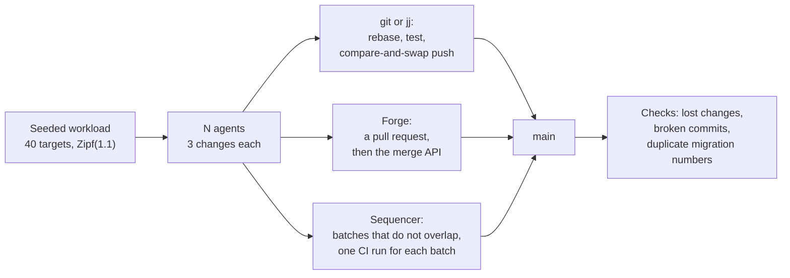

- Each change edits one line of one target and adds a marker file. 50% of the changes also
  append to `CHANGELOG.md`, 30% add a dependency (this changes `deps.lock`), and 20% add a
  migration.
- CI is a simulated run of 2 s. A broken commit is a commit on `main` that fails CI: a
  duplicate migration number or a stale lockfile.
- "NERUDO, live" is the deployed Worker, with `main` and all forks on Artifacts. "NERUDO,
  local" is the same code in local workerd, with Forgejo in place of Artifacts. The two
  Forgejo baselines ran on the same Forgejo host.

### Throughput

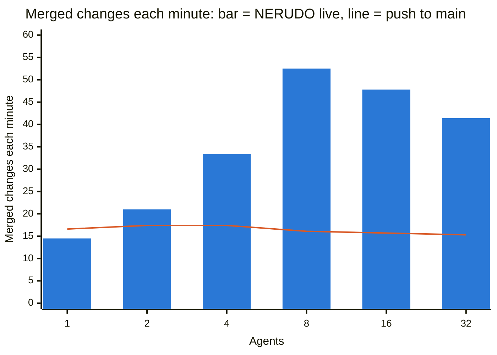

| Agents | NERUDO, live (Durable Object + Artifacts) | NERUDO, local (workerd + Forgejo) | Push to main (Forgejo) | Pull requests + merge API (Forgejo) |
|---|---|---|---|---|
| 1 | 14.5/min | 12.9/min | 16.6/min | 12.4/min |
| 2 | 21.0/min | 18.5/min | 17.4/min | 15.8/min |
| 4 | 33.4/min | 28.1/min | 17.4/min | 25.6/min |
| 8 | **52.5/min** | 38.2/min | 16.1/min | 23.0/min |
| 16 | 47.8/min | **48.4/min** | 15.7/min | 10.9/min |
| 32 | 41.4/min | 40.2/min | 15.3/min | 8.3/min |

- Throughput is highest at 8 agents live and at 16 agents locally. From 8 agents, a batch
  has approximately 3 changes, because popular targets overlap. More agents then add time
  in the queue, not parallel work.
- `seqd`, the first sequencer with `main` on a local disk, merged 67.8 changes each minute
  at 16 agents.
- Estimated Git HTTP requests per merge, for the sequencer and agents together: 6.4 to
  8.0. This is a traffic proxy. Git requests and billed Artifacts operations are different
  units; Workers, Durable Object execution/storage, and repository storage also contribute.
- In a control at 16 agents, the agents also ran CI before they asked to merge: 48.6/min and
  1.44 CI runs for each merge.

The closest same-host control includes agent pretests: at 16 agents, local workerd with
Forgejo lands 39.51/min with 1.458 CI runs per landing, versus 15.74/min and 10.729 for
Forgejo rebase/retest/CAS. Both preserve the fixture invariants. These single samples
show about 2.5 times the throughput and 7.4 times fewer check invocations, not a measured
production cost ratio.

Source: [`cf/README.md`](cf/README.md#measured), [`results/runs.jsonl`](results/runs.jsonl),
[`results/report.html`](results/report.html), and the sweep logs
[`results/cf-artifacts-sweep.log`](results/cf-artifacts-sweep.log) and
[`results/cf-sweep.log`](results/cf-sweep.log).

### Broken commits on main

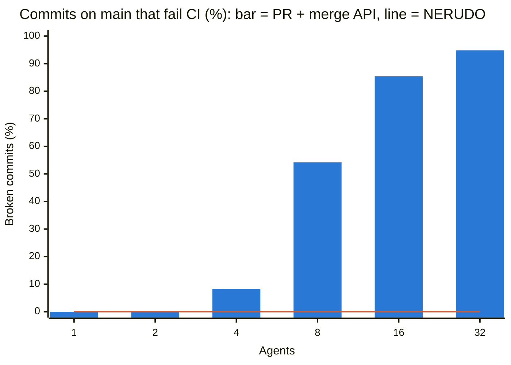

Each pull request passed CI on its own base. Together, they broke `main`. The table counts
the commits on `main` that fail CI, and the changes that an agent pushed but that are not
on the final `main` (lost).

| Agents | Pull requests + merge API (Forgejo) | Merge without a new test (local git) | jj, workspaces of one repo | NERUDO (live and local), `seqd`, push to main, jj clones |
|---|---|---|---|---|
| 1 | 0 of 3 broken | 0 of 6 broken | 0 lost | 0 broken, 0 lost |
| 2 | 0 of 6 | 0 of 12 | 4 lost | 0 broken, 0 lost |
| 4 | 1 of 12 | 6 of 24 | 4 lost | 0 broken, 0 lost |
| 8 | 13 of 24 | 22 of 48 | 8 lost | 0 broken, 0 lost |
| 16 | 41 of 48 | 81 of 96 | 18 lost | 0 broken, 0 lost |
| 32 | 91 of 96 | 158 of 192 | 8 lost; 39 of 192 landed before the timeout | 0 broken, 0 lost |

On GitHub (a private repo, 2 changes for each agent), pull requests + the merge API broke 26
of 32 commits on `main` at 16 agents. The sequencer with GitHub as a downstream mirror broke
none.

### CI runs for each merged change

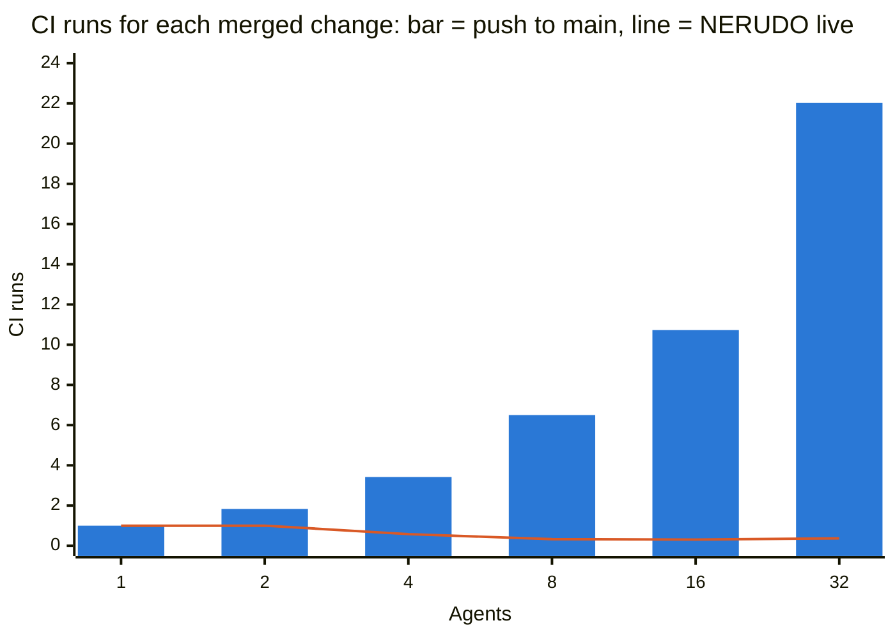

A push to `main` must test again after each lost race, so its CI cost increases with the
agents. The agents of NERUDO do not run CI before they ask to merge. The CI run of the batch
is the evidence, so check invocations per landing decrease as batches get larger.
This does not price general CI, which can grow with the affected code and batch size.

| Agents | 1 | 2 | 4 | 8 | 16 | 32 |
|---|---|---|---|---|---|---|
| Push to main (Forgejo) | 1.00 | 1.83 | 3.42 | 6.50 | 10.73 | 22.03 |
| Rebase, test and push (local git) | 1.00 | 1.83 | 3.50 | 6.15 | 11.99 | 20.88 |
| NERUDO, live | 1.00 | 1.00 | 0.58 | 0.33 | 0.31 | 0.37 |
| NERUDO, local | 1.00 | 0.83 | 0.58 | 0.38 | 0.27 | 0.34 |

### The local baselines

| Agents | Rebase, test, push (local git) | Merge without a new test (local git) | jj clones | jj workspaces | `seqd` |
|---|---|---|---|---|---|
| 1 | 24.8/min | 23.8/min | 21.8/min | 22.0/min | 12.7/min |
| 2 | 26.1/min | 47.0/min | 22.2/min | 26.4/min | 21.8/min |
| 4 | 26.8/min | 89.5/min | 21.3/min | 22.3/min | 32.6/min |
| 8 | 26.6/min | 127.9/min | 21.1/min | 20.4/min | 52.4/min |
| 16 | 25.3/min | 121.8/min | 19.9/min | 19.4/min | 67.8/min |
| 32 | 25.5/min | 78.3/min | 12.7/min | 1.2/min | 60.6/min |

The local values are means of 2 runs. The Forgejo, GitHub and Cloudflare values are from 1
run. "Merge without a new test" is fast because it does not test, and it broke up to 158 of
192 commits. `seqd` runs CI two times for each change at low load (the agent tests, then the
batch), so 1 agent merges at half the rate of rebase, test and push.

What broke, from the output of the tools ([`results/report.html`](results/report.html)):

- jj workspaces that share one repo lose landings with no error. A push moves `main`
  sideways and drops the commit of another agent.
- Two concurrent `jj bookmark set` calls leave `main` conflicted. Without
  `--allow-backwards`, each later call is refused: one 8-agent run logged 5,817 op-log
  reconciles and 4 pushes in 12 minutes.
- git worktrees share the remote-tracking refs: 12 worktrees fetched at the same time, and
  11 failed.
- Forgejo's server-side merge ignores `merge=union` in `.gitattributes`. It refused the
  second of two changelog appends that local git merges cleanly.
- On 2026-10-07, each git push to the GitHub bench repo failed for a period while the
  GitHub status page showed all systems operational. The sequencer kept landing, and its
  GitHub mirror caught up when the pushes recovered.
- Two agents that each pick "the next migration number" both write `0042`. git sees no
  conflict. The sequencer gives the number when the change lands.

## 2. Can models do the review?

A hand-built corpus of 10 Intents for a small `ledger` package: 10 clean changes and 25
changes with one seeded defect. Every change passes the test suite. Each change goes
through the deterministic gates, then through four reviewer models. The routing policies
are scored from the same recorded verdicts (2026-10-07).

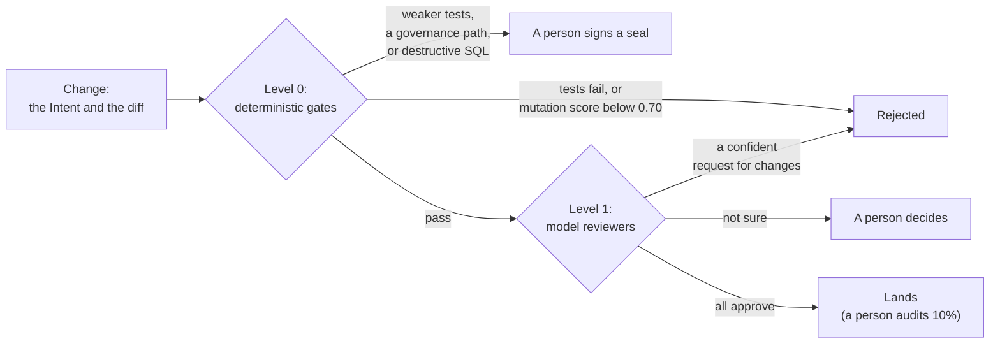

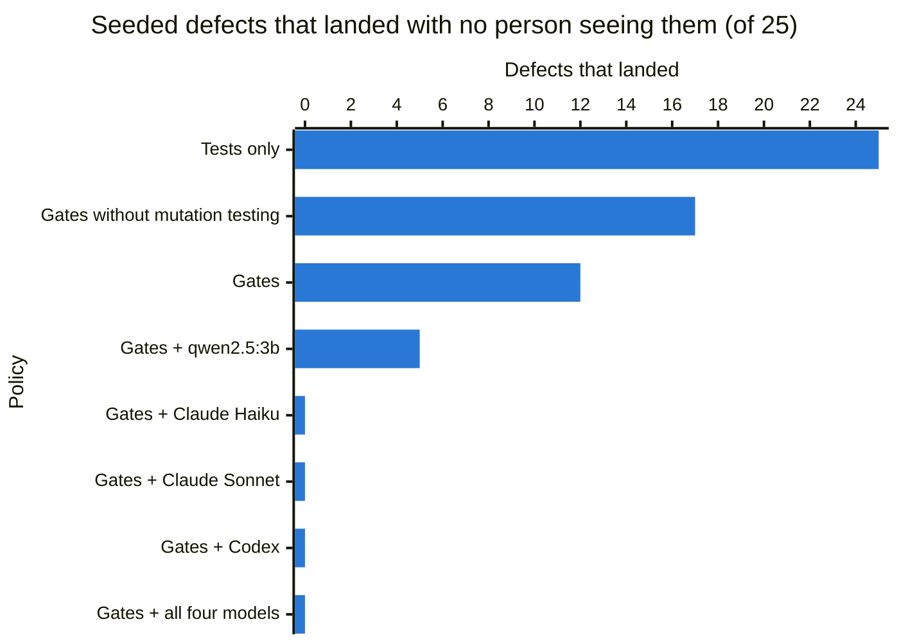

| Policy | Defects that landed (of 25) | Clean changes that landed (of 10) | Decisions of a person for each 100 changes |
|---|---|---|---|
| Tests only | 25 | 10 | 10.0 |
| Gates without mutation testing | 17 | 10 | 30.6 |
| Gates | 12 | 9 | 26.0 |
| Gates + `qwen2.5:3b` (Ollama) | 5 | 4 | 22.6 |
| Gates + Claude Haiku | 0 | 9 | 22.6 |
| Gates + Claude Sonnet | 0 | 9 | 22.6 |
| Gates + Codex (`gpt-6-astra`) | 0 | 8 | 22.3 |
| Gates + all four models | 0 | 3 | 20.9 |
| Claude Sonnet + Codex, no gates | 0 | 9 | 25.4 |

The decisions of a person are the seals, the changes that a model was not sure about, and a
10% audit of the changes that landed. A change that reaches a person counts as caught. That
is optimistic.

| Reviewer | Defects stopped (of 25) | With the right reason | Clean changes stopped (of 10) | Mean time | Cost of the run |
|---|---|---|---|---|---|
| Claude Haiku (`claude-haiku-4-5-20251001`) | 25 | 23 | 0 | 28.4 s | $0.62 |
| Claude Sonnet (`claude-sonnet-5-5`) | 25 | 25 | 0 | 4.2 s | $0.28 |
| Codex (`gpt-6-astra`) | 25 | 25 | 1 | 18.8 s | Not recorded |
| `qwen2.5:3b` on Ollama | 14 | 6 | 5 | 20.4 s | $0 |

The mutation threshold is a trade. A higher threshold rejects more defects and more clean
changes:

| Mutation threshold | 0.5 | 0.6 | 0.7 | 0.8 | 0.9 |
|---|---|---|---|---|---|
| Defects rejected (of 25) | 0 | 4 | 6 | 12 | 15 |
| Clean changes rejected (of 10) | 0 | 0 | 1 | 2 | 5 |

Source: [`results/review/summary.json`](results/review/summary.json),
[`results/review/review.jsonl`](results/review/review.jsonl), and the corpus in
[`bench/review_corpus.py`](bench/review_corpus.py). One repetition. The corpus is small and
its defects are hand-built, so real review can be harder.

## 3. The sequencer on Cloudflare

### The demo

`nerudo demo` on the deployed Worker on 2026-10-11:

| Measurement | Result |
|---|---|
| Pull requests | 21 from 6 agents, merged in 12 batches, in 28 s |
| CI runs | 17, that is 0.81 for each merged PR |
| Caught by CI | 1 PR passed on its own base and failed on `main` (`TS2554`). Its agent built it again on the new `main`, and it merged. |
| With a crash after a push (`--crash-once`, 20 PRs) | 20 merged in 11 batches, 16 CI runs. The sequencer reconciled from `main`. No PR merged two times. |
| `nerudo verify` | Each commit on `main` passed the trunk checks. The hash chain of the landing log ended at the tip of `main`. |

Source: [`cf/README.md`](cf/README.md#what-we-verified).

### A real type check in a Worker

The CI Worker runs the TypeScript 7 compiler from ts-rust, compiled to WebAssembly, in a V8
isolate.

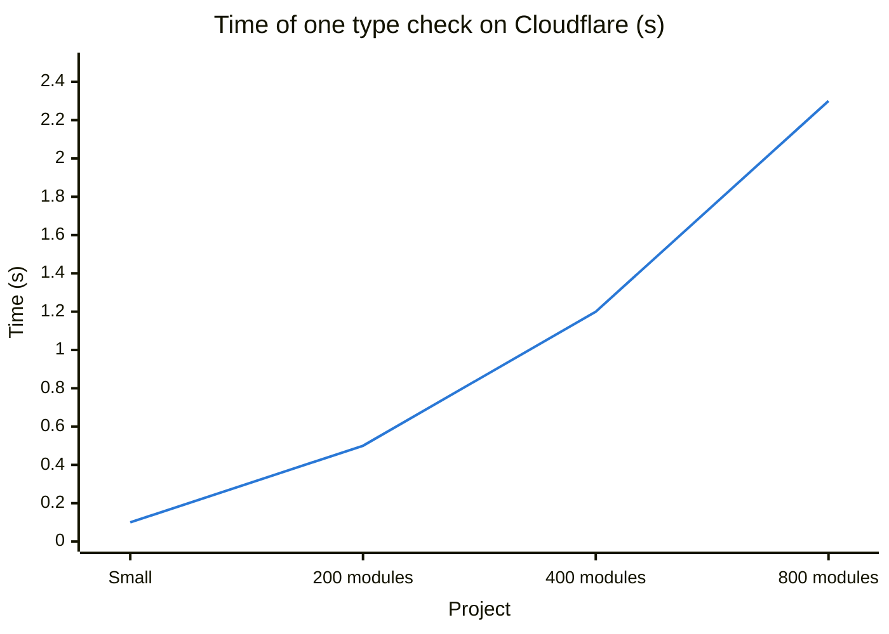

| Measurement | Result |
|---|---|
| Size of the module | 4.9 MB, and 2.1 MB with gzip |
| One check in local workerd | 40 to 50 ms for a small project, 210 to 280 ms for 400 files |
| WebAssembly memory | 50 MiB for a small project, 74 MiB for 400 files. The documented limit of a Worker is 128 MB. |
| A project of 2,000 files on the deployed Worker | Passed 8 times with 163 MiB. We do not depend on that. |
| One check through the `CI` service binding | Approximately 0.1 s small, 0.5 s for 200 modules, 1.2 s for 400, 2.3 s for 800. The CPU of one check changed by up to 2 times between runs. |

Source: [`cf/README.md`](cf/README.md#real-ci-a-type-check-in-a-worker),
[`cf/scale/ci.md`](cf/scale/ci.md#the-time-of-one-check).

### Replay of real history

`nerudo replay` rebuilds the recent history of a real repo with 16 agents, under
`wrangler dev` with Artifacts.

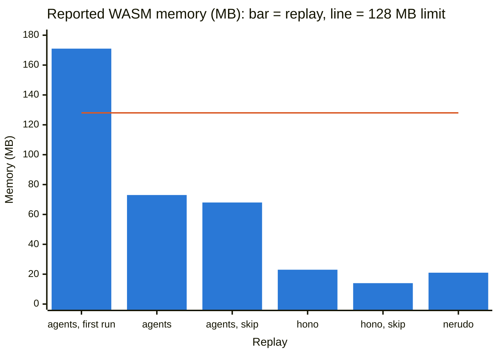

| Repo | Commits merged | Batches | Time | Approvals | Reported WASM linear-memory peak |
|---|---|---|---|---|---|
| cloudflare/agents (3,020 files), first run | | | | | 171 MB: above the limit |
| cloudflare/agents, `--no-skip` | 70 of 70 | 60 | 98 s | 0 | 73 MB |
| cloudflare/agents, releases skipped | 57 of 63 | 48 | 98 s | 0 | 68 MB |
| honojs/hono (583 files), `--no-skip` | 70 of 70 | 41 | 35 s | 7 | 23 MB |
| honojs/hono, releases skipped | 37 of 48 | 16 | 20 s | 2 | 14 MB |
| nerudo, 8 agents, from a pack | 24 of 24 | 24 | 25 s | 1 | 21 MB |

Three changes made cloudflare/agents fit: the start reads only the start commit, the web
views share the objects of the sequencer, and a PR fetch sends the base of the PR as a
"have". Every run passed `nerudo verify`. Source:
[`cf/README.md`](cf/README.md#replay-real-history).

### A decision model: Clef

Under `wrangler dev` with Artifacts, the `AI` binding called Cloudflare's Clef (scenario
`clef`, 2026-10-13). The threshold was 0.80.

| Pull request | Model | Answer | Outcome |
|---|---|---|---|
| Skips an auth check and has a token in the code | `@cf/cloudflare/clef` | `sign` 0.98 (confidence 0.94) | Waited for the approval of a maintainer |
| A routine edit of one line | `@cf/cloudflare/clef` | `merge` 0.84 (confidence 0.60) | Merged with no extra step |
| The same two PRs | `clef-flash` | top `sign` 0.76 and `merge` 0.74 | Both below 0.80: both waited for a review |
| A model name that does not exist | | An error | Went to a review; the receipt kept the error |

Each PR got its decision 1.0 to 1.4 s after the request to merge. Source:
[`cf/README.md`](cf/README.md#what-we-verified).

## 4. Scale on Cloudflare

On 2026-10-12, a group of agents measured how far one Cloudflare account scales.
[`cf/scale/README.md`](cf/scale/README.md) is the full report. This section gives its main
charts.

### How a landing works

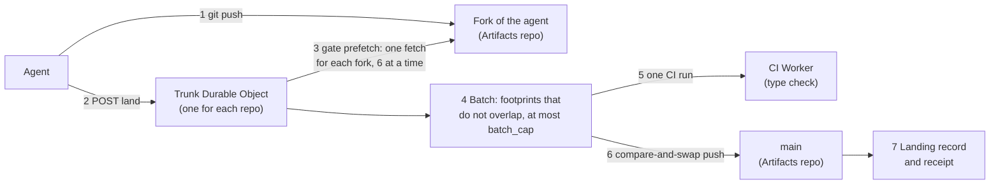

| Step | Time on Cloudflare | Source |
|---|---|---|
| 1. Push to the fork | 233 to 336 ms (p50) | [`repos.md`](cf/scale/repos.md#results) |
| 2. Ask to land | 73 to 124 ms (p50) | [`repos.md`](cf/scale/repos.md#results) |
| 3. Gate prefetch | 270 to 350 ms for each fetch | [`stages.md`](cf/scale/stages.md#summary) |
| 5. Type check | 0.1 to 2.3 s | [`ci.md`](cf/scale/ci.md#the-time-of-one-check) |
| 6. Push to `main` | 0.4 to 0.9 s for a batch of 16 | [`stages.md`](cf/scale/stages.md#summary) |

At 1 change each second or less, a change lands alone in approximately 650 ms.

### Many repos at once

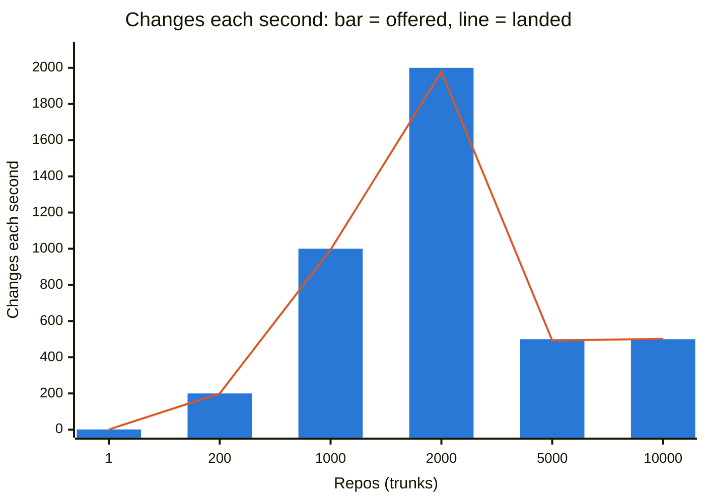

| Repos | Offered to each repo | Offered | Landed each second | Landed ÷ offered | p50 latency |
|---|---|---|---|---|---|
| 1 | 1 each second | 1 | 1.00 | 1.00 | 675 ms |
| 200 | 1 each second | 200 | 200.0 | 1.00 | 640 ms |
| 1,000 | 1 each second | 1,000 | 994.3 | 0.99 | 660 ms |
| 2,000 | 1 each second | 2,000 | 1,977.9 | 0.99 | 700 ms |
| 5,000 | 0.1 each second | 500 | 492.5 | 0.98 | 745 ms |
| 10,000 | 0.05 each second | 500 | 501.9 | 1.00 | 970 ms |

- The 2,000-repo run stopped after 131 s, when Artifacts pushes failed in bursts. Its window
  is 30 s to 120 s, before the failures.
- At 5,000 and 10,000 repos, each repo got fewer changes, so that the account stayed below
  the limit of Artifacts.
- The changes did not overlap, and there was no CI. The driver ran inside Cloudflare,
  because the edge blocks one IP address at approximately 2,000 requests each second.

Source: [`cf/scale/10k.md`](cf/scale/10k.md#result),
[`cf/evidence/scale-10k-20261012.json`](cf/evidence/scale-10k-20261012.json),
[`cf/scale/repos.md`](cf/scale/repos.md#result).

A quiet repo landed slower when its history was longer (1 change each 20 s, 10,000 repos):

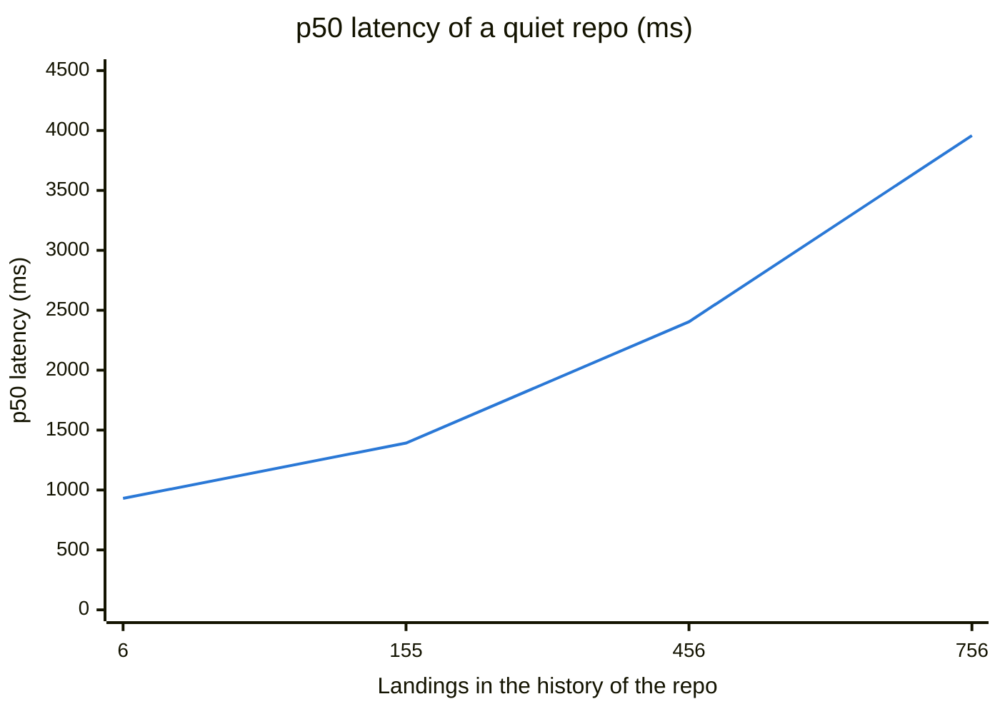

| Landings in the history | 6 | 155 | 456 | 756 |
|---|---|---|---|---|
| p50 latency (ms) | 930 | 1,392 | 2,404 | 3,958 |

The probable cause, a Trunk object that fetched all of the history after a cold start, is a
hypothesis. The live build reads the trunk at depth 1, but nobody measured this latency on
it ([`cf/scale/README.md`](cf/scale/README.md#many-repos-at-once)).

### One repo: the gate prefetch

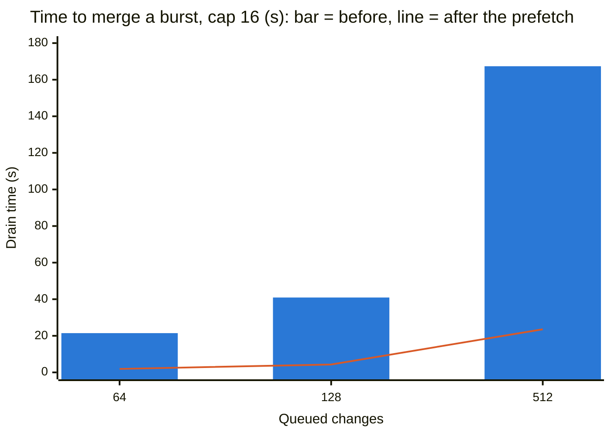

| Queued changes | Batch cap | Before (s) | After (s) | Fetch requests before | Fetch requests after |
|---|---|---|---|---|---|
| 64 | 16 | 21.46 | 1.91 | 64 | 4 |
| 128 | 16 | 40.93 | 4.33 | 128 | 4 |
| 512 | 16 | 167.35 | 23.56 | 512 | 4 |
| 128 | 64 | 37.66 | 2.08 | 128 | 4 |
| 512 | 64 | 163.86 | 12.01 | 512 | 4 |

Before, the gate fetched each queued change with its own request, one after the other. Now
it asks each fork once, 6 forks at a time. At 512 changes the rate is 21.7 changes each
second at cap 16 and 42.6 at cap 64; before, it was 3.1. Runs of the same burst vary from
20 to 30 s. Source: [`cf/scale/stages.md`](cf/scale/stages.md#before-and-after),
[`cf/evidence/scale-stages-20261012.json`](cf/evidence/scale-stages-20261012.json).

### Big repos

Memory below is `wasm_memory_bytes`: the peak linear memory of WebAssembly, not total
JavaScript/V8/isolate resource usage. Successful read-back and `git fsck` checks support
object integrity for the tested changes; they do not establish arbitrary monorepo CI.

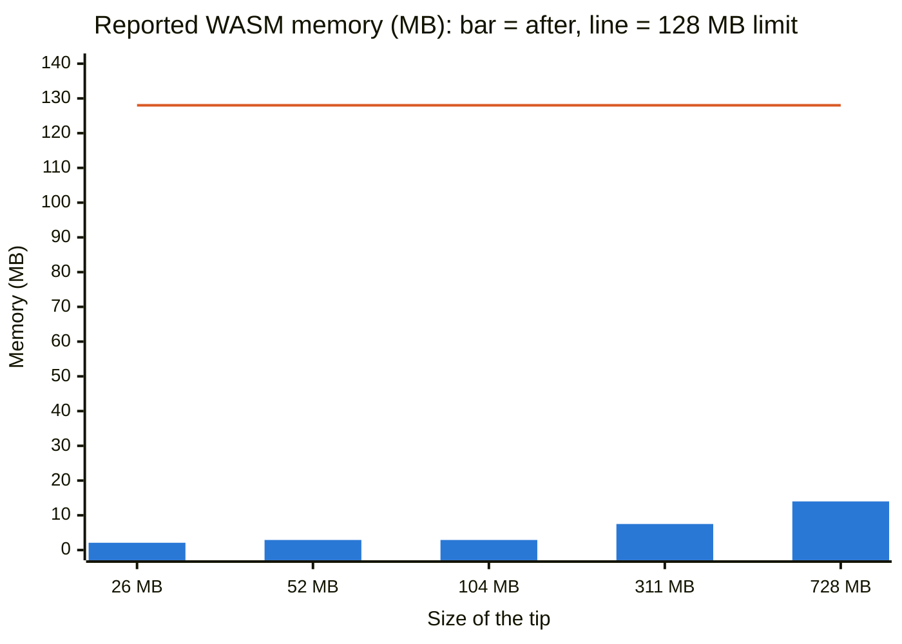

| Repo | Files | Tip | Memory before | Memory after | One landing after |
|---|---|---|---|---|---|
| m25 | 5,026 | 25.9 MB | 76 MB | 2.1 MB | 2.3 s |
| m50 | 10,026 | 51.9 MB | Fails | 2.9 MB | 3.5 s |
| m100 | 10,026 | 104 MB | Fails | 2.9 MB | 2.7 s |
| m300 | 50,026 | 311 MB | Not tried | 7.5 MB | 5.1 s |
| m700 | 70,026 | 728 MB | Not tried | 14 MB | 6.6 s |
| d120k (lazy mode) | 120,026 | 57 MB | Not tried | 1.8 MB | 10.7 to 11.4 s |

Before, the sequencer read all of the history and all files of `main` into memory. Now it
reads one commit and its trees, and a file only when a landing needs it. Source:
[`cf/scale/mono.md`](cf/scale/mono.md#before-and-after),
[`cf/evidence/scale-mono-20261012.json`](cf/evidence/scale-mono-20261012.json).

### The Hub: one object for all names

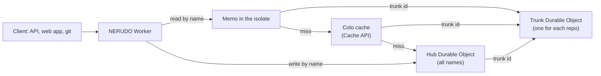

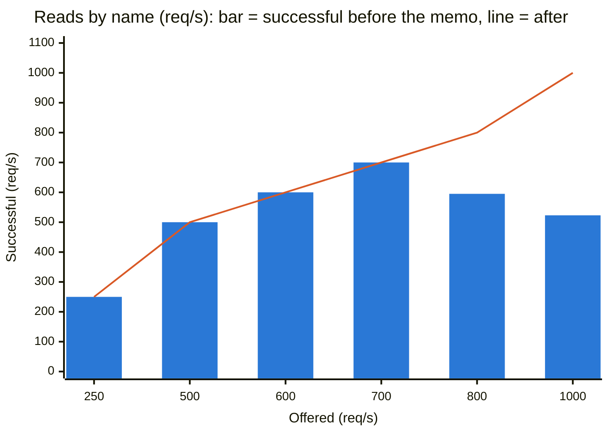

| Offered (req/s) | 250 | 500 | 600 | 700 | 800 | 1,000 |
|---|---|---|---|---|---|---|
| Successful before the memo | 250 | 500 | 600 | 700 | 595 | 523 |
| Successful after the memo | 250 | 500 | 600 | 700 | 800 | 1,000 |

The Hub served approximately 600 requests each second. With the memo and the colo cache, it
gets 0.02 requests for each read by name, and 0.0002 to 0.0005 for each view of a repo
page. Each Trunk object is now the limit of its own repo: approximately 250 to 350 simple
reads each second. Source: [`cf/scale/hub.md`](cf/scale/hub.md#results),
[`cf/scale/hub-next.md`](cf/scale/hub-next.md#results).

### CI: find the bad change by halving

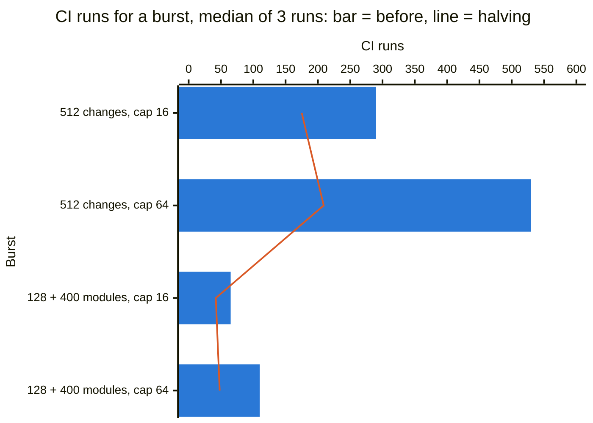

| Burst (5% of the changes have a type error) | Batch cap | CI runs before | CI runs after | Drain before (s) | Drain after (s) |
|---|---|---|---|---|---|
| 512 changes, 26 bad | 16 | 290 | 175 | 93.8 | 58.0 |
| 512 changes, 26 bad | 64 | 530 | 209 | 120.0 | 61.4 |
| 128 changes, 6 bad, 400 more modules | 16 | 65 | 42 | 76.5 | 35.9 |
| 128 changes, 6 bad, 400 more modules | 64 | 110 | 48 | 98.8 | 38.8 |

Before, the sequencer checked each prefix of a failed batch in order. Now it halves the
range: at most 4 checks at cap 16 and 6 at cap 64. Source:
[`cf/scale/ci.md`](cf/scale/ci.md#three-runs-of-the-main-cases),
[`cf/evidence/scale-ci-20261012.json`](cf/evidence/scale-ci-20261012.json).

### Limits and cost

| Limit | Value |
|---|---|
| Git requests of one Artifacts account | Pushes failed in bursts at approximately 5,000 to 10,000 git requests each second, that is 1,000 to 2,000 landings each second. No request got HTTP 429. |
| One Artifacts repo | 2,000 git requests for each 10 s, 1 GB, 32 MB for each file (documented). A git fetch fails at approximately 120,000 files in 19,200 directories. |
| One Trunk object | Approximately 250 to 350 simple reads each second |
| Historical campaign estimate at list price | Approximately $19–20 for the 1,000–10,000-repo runs before Artifacts billing; excludes then-free Artifacts, included allowances, inference, and a production CI workload |

Source: [`cf/scale/README.md`](cf/scale/README.md#limits),
[`cf/scale/README.md`](cf/scale/README.md#cost). Not measured: 23,000 landings each second
(approximately 12 times the peak rate of the campaign), long-duration load with conflicts
and real integrated CI, and more than one client location.

Artifacts billing starts **on October 14, 2026**. Its published rates are $0.15 per
1,000 operations (after the monthly included operations) and $0.50 per GB-month of
storage. The historical driver performs two pushes and one fetch per change, expressed
as five HTTP requests; the experiment did not resolve which requests the bill counts
as operations. Its $135–225 projection per 300,000 changes is an accounting range, not
an observed invoice. Repository/fork storage, Workers requests/CPU, Durable Object
requests/duration/storage, failed retries, model inference and general runtime CI must
be added for a production cost per useful landing. See [official Artifacts pricing](https://developers.cloudflare.com/artifacts/platform/pricing/)
and [the historical accounting](cf/scale/10k.md#cost).

## 5. Faults and recovery

### A CI outage

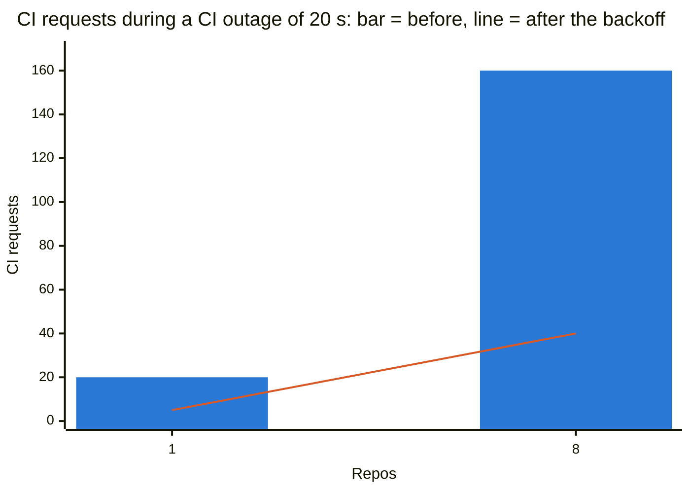

| Check | Before | After |
|---|---|---|
| CI requests in an outage of 20 s, 1 repo | 20 | 5 (budget 8) |
| CI requests in an outage of 20 s, 8 repos | 160 | 40 |
| Time to land after CI is available again | 0.7 to 1.3 s | 13 to 19 s |
| Second CI request when each request hangs 45 s | After 46 s | After 26 s (deadline 25 s) |
| A git host that holds the connection for 40 s | The loop waits for the full fault. The queue shows nothing. | The request stops at 30 s. The queue shows `git_unavailable`. |

After a failed run, the landing loop now waits 1 s, 2 s, 4 s and more, to at most 30 s. The
cost is a slower recovery. On Cloudflare, an overloaded Hub now answers HTTP 503 with
`Retry-After: 1`, not HTTP 500. Source:
[`cf/scale/resilience.md`](cf/scale/resilience.md#results-of-the-fault-tests),
[`cf/evidence/resilience-cloudflare-20261012.json`](cf/evidence/resilience-cloudflare-20261012.json).

### The fault harness

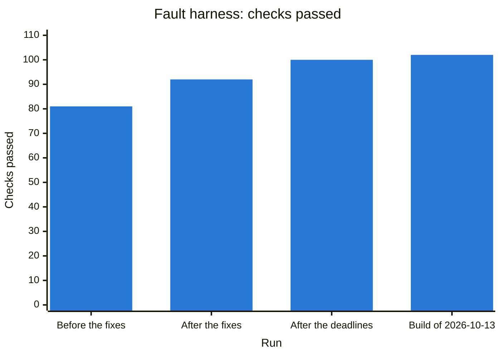

| Run | Passes | Known gaps | Failures |
|---|---|---|---|
| Before the fixes (`9924c36`) | 81 | 6 | 0 |
| After the fixes (`1a885ad`) | 92 | 5 | 0 |
| After the deadlines (`a22b93d`) | 100 | 0 | 0 |
| The build of 2026-10-13 (`6cba20a`) | 102 | 0 | 0 |

The harness runs the Worker in `wrangler dev` with a Gitea git host behind toxiproxy, and injects faults: CI down, CI that hangs, a
flaky git host, a git host that hangs, `kill -9`, and queue growth to 512 changes. The drain
time of the growth case is linear: from 1.85 s at 32 changes to 32.8 s at 512. The
flake of the approvals scenario gave 18 failures in 2,000 pairs of requests before its fix,
and 0 in 4,000 after it. Source: [`cf/faults/README.md`](cf/faults/README.md#results-on-2026-10-12),
[`cf/scale/ops.md`](cf/scale/ops.md#the-flake-of-the-approvals-scenario),
[`cf/scale/branches-fix.md`](cf/scale/branches-fix.md#results).

### Submission candidate checks (2026-10-13)

The candidate's strict local fault run passed **102/102 checks** with no known gaps.
That run preceded the final allowance replay-key correction: its tested Worker WASM
SHA-256 starts `3222fbc5`. After that correction, **4/4 targeted recovery scenarios**
passed on WASM `6411b797`, covering approvals, recovery, authority after push and after
record, allowance waiter liveness, and exactly-once allowance charges after replay.
These are local `wrangler dev`/Gitea fault checks. They do not establish deployment
verification or a full fault-suite rerun on the final WASM. Sources:
[full candidate run](cf/evidence/submission-faults-20261013.json),
[final recovery regressions](cf/evidence/submission-recovery-final-20261013.json).

After the concurrent upstream rules fix was merged, [another 4/4 targeted scenarios](cf/evidence/submission-recovery-merged-20261013.json)
passed at `5a74c01` with working-tree changes on tested WASM
`f62080b3935398b6b7eb0503ae55d58db2f03b7dcec66be154f13cda0986ec1f`.
This adds the upstream approver-rename recovery case and retains both authority crash
windows and allowance wakeup/accounting checks. The final production deployment now
uses that exact `f62080b3` WASM, as [the manifest](cf/evidence/submission-deployment-20261013.json)
records. The tests ran locally; this match does not establish deployed fault testing or
a full merged-build fault-suite run. The earlier `6411b797` deployment remains in the manifest history.

### Fresh deployed contention soak (2026-10-13)

Eight scripted clients ran for **600.009 seconds** on one small TypeScript fixture in
an isolated Worker/Artifacts deployment. They attempted 80 logical changes through
133 revisions: **61 landed and 19 stopped at the three-revision retry bound**. The
sequencer rejected 71 conflicting revisions and one actual TypeScript error, then
landed its repair. It used 43 CI runs across 40 batches and drained to zero queued
changes. Thirty-seven idempotent POST retries did not duplicate a landing.

All 61 landings matched the independently fetched Git history, receipts and log exactly
once, with 61 proof files, an intact hash chain and passing external Node runtime
acceptance. Successful receipt latency was p50 **5.428 s**, p95 **8.129 s**, maximum
**8.712 s**, including the client's request pacing, network and wait. The driver paced
1,043 HTTP requests to at most three starts per second; it reported no HTTP/network
errors. This was a correctness/availability soak, not a saturation test or 100% task
completion. The initial same-base conflict barrier was deliberate, and runtime acceptance
was external; deployed CI checked TypeScript.

The tested isolated backend was `79c259ad-080f-4f14-9fa1-18ec64830ab3`, before the final
allowance replay-key correction, with allowances disabled. It does not test the later
production deployment's allowance recovery. Source:
[soak evidence](cf/evidence/submission-soak-20261013.json),
[public fixture](https://nerudo-submission-web.patrickdeutsch.workers.dev/nerudo/submission-soak-20261013-150449).

## 6. The web app on a big repo

On 2026-10-12, the page of the live cloudflare/agents repo hung. The cause:
the web UI keeps a copy of the trunk, approximately 62 MB for that repo. A request that came
during another request read all of the trunk again, and two copies passed the 128 MB limit
of the isolate. The fix of 2026-10-13 (`6cba20a`) lets one request at a time have the copy.

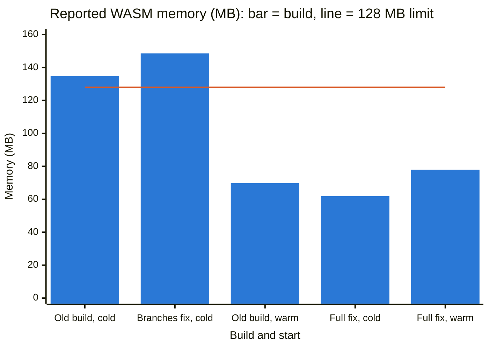

| Build | Start | Requests | Errors | Isolate restarts | Reported WASM linear-memory peak |
|---|---|---|---|---|---|
| Old build | Cold | 195 | 53 | 4 | 134.8 MB |
| Branches fix only | Cold | 118 | 47 | 4 | 148.5 MB |
| Old build | Warm | 404 | 8 | 0 | 69.8 MB |
| Branches fix only | Warm | 405 | 8 | 1 | 77.1 MB |
| Full fix: branches fix + one holder of the copy | Cold | 527 | 0 | 0 | 61.9 MB |
| Full fix: branches fix + one holder of the copy | Warm | 527 | 0 | 0 | 77.9 MB |

The test: a non-lazy replay of cloudflare/agents (17 forks, 55 landings), 3 simulated tabs
for 4 minutes. The branches view of 17 forks took 11 s before its fix (27 s when each fork
token had to be renewed); it now reads 6 forks at a time. Source:
[`cf/scale/branches-fix.md`](cf/scale/branches-fix.md),
[`cf/evidence/ui-memory-20261012.json`](cf/evidence/ui-memory-20261012.json),
[`cf/evidence/branches-fix-gates-20261013.json`](cf/evidence/branches-fix-gates-20261013.json).

For the submission deployment, [six fresh anonymous browser contexts](cf/evidence/submission-public-smoke-20261013.json)
returned HTTP 200 and no page errors on October 13. This is a bounded route smoke check,
separate from the historical multi-tab memory experiment. Exact deployed inputs, versions
and public demo scope are recorded in [the deployment manifest](cf/evidence/submission-deployment-20261013.json).

## Sources

| Document | Topic | Evidence |
|---|---|---|
| [`cf/README.md`](cf/README.md#measured) | The bench on Cloudflare, the demo, real CI, replay, Clef | [`results/runs.jsonl`](results/runs.jsonl) |
| [`results/report.html`](results/report.html) | The bench report of 2026-10-07, with the review experiment | [`results/runs.jsonl`](results/runs.jsonl), [`results/review/summary.json`](results/review/summary.json) |
| [`cf/scale/README.md`](cf/scale/README.md) | The scale campaign of 2026-10-12 | [`cf/evidence/`](cf/evidence/) |
| [`cf/scale/10k.md`](cf/scale/10k.md), [`cf/scale/repos.md`](cf/scale/repos.md) | Many repos | [`scale-10k-20261012.json`](cf/evidence/scale-10k-20261012.json), [`scale-repos-20261012.json`](cf/evidence/scale-repos-20261012.json) |
| [`cf/scale/stages.md`](cf/scale/stages.md) | One repo and the gate prefetch | [`scale-stages-20261012.json`](cf/evidence/scale-stages-20261012.json) |
| [`cf/scale/mono.md`](cf/scale/mono.md) | Big repos | [`scale-mono-20261012.json`](cf/evidence/scale-mono-20261012.json) |
| [`cf/scale/hub.md`](cf/scale/hub.md), [`cf/scale/hub-next.md`](cf/scale/hub-next.md) | The Hub | [`scale-hub-20261012.json`](cf/evidence/scale-hub-20261012.json), [`hub-next-20261012.json`](cf/evidence/hub-next-20261012.json) |
| [`cf/scale/ci.md`](cf/scale/ci.md) | CI on one repo | [`scale-ci-20261012.json`](cf/evidence/scale-ci-20261012.json) |
| [`cf/scale/resilience.md`](cf/scale/resilience.md), [`cf/faults/README.md`](cf/faults/README.md) | Faults | [`faults-20261012-resilience.json`](cf/evidence/faults-20261012-resilience.json), [`resilience-cloudflare-20261012.json`](cf/evidence/resilience-cloudflare-20261012.json) |
| [`cf/scale/ops.md`](cf/scale/ops.md), [`cf/scale/slo.md`](cf/scale/slo.md) | Metrics, SLOs and the approvals flake | [`ops-20261012.json`](cf/evidence/ops-20261012.json) |
| [`cf/scale/branches-fix.md`](cf/scale/branches-fix.md) | The web app on a big repo | [`ui-memory-20261012.json`](cf/evidence/ui-memory-20261012.json), [`branches-fix-gates-20261013.json`](cf/evidence/branches-fix-gates-20261013.json) |

For the competition packet and narrated demo storyboard, see [SUBMISSION.md](SUBMISSION.md).
For recorded real coding-model workflows, see [cf/LLM_WORKFLOWS.md](cf/LLM_WORKFLOWS.md).

To run the bench again, see [`README.md`](README.md#run). To run the scale tests again, see
each document in [`cf/scale/`](cf/scale/README.md).
