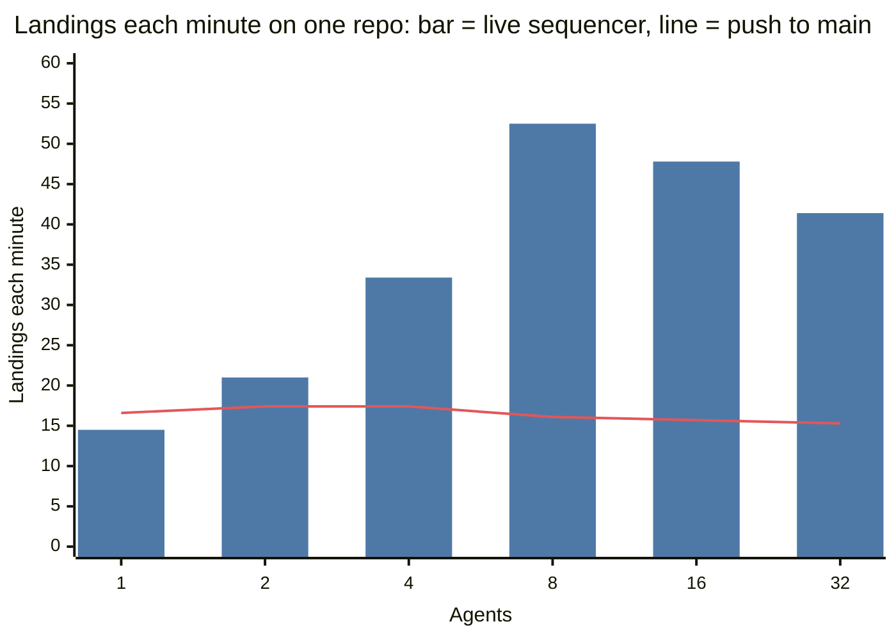

# NERUDO on Cloudflare

## Migrating the hosted forge to NERUDO

The product and developer interface use one name: **NERUDO**, `nerudo`, `nerudo.toml`,
`NERUDO_*`, and `X-Nerudo-*`. Source packages are `nerudo-app`, `nerudo-worker`,
`nerudo-cli`, `nerudo-core`, `nerudo-git`, `nerudo-ci`, and `nerudo-slo`. Retro remains the
default experience; Modern uses the same data, routes and access controls.

The existing hosted forge needs a staged cutover. Its root `landseq.toml` stays in place
in the compatibility change, because the currently deployed sequencer reads that name.
Both rules filenames are protected by governance. After the compatibility backend is
live, a second signed change replaces the root file with `nerudo.toml`. Two rules files
in the same tree are rejected rather than choosing one silently.

1. Merge the compatibility change with the maintainer seal required by the current rules.
2. Deploy `nerudo-ci`, then the existing backend using `nerudo-worker/wrangler.compat.toml`.
   This upgrades the same Durable Objects and still points at the existing Artifacts
   namespace. Keep the existing admin/agent secret values; keys derive from the admin
   secret, so rotating it during a rename would invalidate invitations and agent keys.
3. Replace the root rules file in a second governance PR. Merge it with a maintainer seal,
   and run the new `nerudo verify` against the existing forge before proceeding.
4. Set `NERUDO_ADMIN_TOKEN` and `NERUDO_AGENT_TOKEN` on the destination Worker to the
   existing values, then deploy **`wrangler.production.toml`**. It transfers `Trunk` and
   `Hub` from `landseq` to `nerudo`. Never deploy the destination with the fresh-install
   `wrangler.toml` first: that would provision empty namespaces instead of transferring
   the existing ones. [Cloudflare's transfer migration documentation](https://developers.cloudflare.com/durable-objects/reference/durable-object-class-migrations-legacy/#transfer-migration)
   describes how existing bindings continue to reach the transferred data.
5. Rename the Hub organization and repository mappings to `nerudo/nerudo` and
   `nerudo/demo`, preserving each trunk ID, visibility, description, upstream, and
   creation time. `scripts/remap-brand.py` previews this mapping; `--apply` performs it.
   Check the destination heads and refs against the originals.
6. Deploy `nerudo-web` from the generated `nerudo-app/dist/server/wrangler.json`.
   Verify repo reading, branches/tags, Git fetch and sign-in in both experiences.
7. Deploy the two Workers in `compat/` to keep former API/Git URLs and bookmarks working.
   The old web origin proxies the new frontend, preserving its existing cookies. A
   sign-in on the new origin uses the same invitation key and writes `nerudo_signin`.

Existing `LANDSEQ_*` CLI environments and `X-Landseq-*` request headers remain accepted;
the new names take precedence. The CLI reads existing `~/.landseq/key` and agent keys
when no new file exists, without regenerating or rotating identity. New key files live
under `~/.nerudo/`. New MCP synchronization uses `nerudo/main`; new working context uses
`nerudo/context`, carrying forward its previous branch history. Existing immutable
context repositories remain readable through their stored identities.

Version-one signing/HMAC domains and log hashes retain their original bytes. Historical
evidence and pinned legacy fixtures retain their original names. The hosted Artifacts
namespace is also retained as a storage address: Cloudflare documents it as a stable
repository address and offers no namespace rename operation in its
[Artifacts REST API](https://developers.cloudflare.com/artifacts/api/rest-api/).
Fresh installations use the `nerudo` namespace. The same storage rule applies to an
existing Analytics dataset; the SLO source and Worker name use NERUDO.

The original checkout may contain unrelated work. Complete this migration from the native
forge checkout; do not replace its independent history with the GitHub checkout.

NERUDO is a merge queue for coding agents. Agents open pull requests
from Claude Code, Codex, Antigravity or Cursor. nerudo merges them in batches and runs
real CI. It asks a person only when the rules need a person.

For each repo, one Trunk Durable Object (the sequencer) is the only writer of `main`. Each
agent writes its pull request (PR) in its own fork. Then the agent asks the sequencer to
merge the PR. The sequencer merges PRs in batches. The PRs in one batch have footprints
that do not overlap.

For each batch, the sequencer does these steps:

1. It merges the files that have merge rules.
2. It runs CI one time. If `nerudo.toml` asks for it, CI includes a type check with tsc.
3. It updates the `main` ref with a compare-and-swap push.

The sequencer then returns a receipt (`state: landed`, `seq`). The receipt is the only
proof that a PR merged.

Almost all of the code is Rust: the git engine, the merge logic, the Worker, and the CLI
for people. There are two exceptions:

- `nerudo-ci` is a small JavaScript Worker. It runs ts-rust, a TypeScript type checker in
  Rust that is compiled to WebAssembly.
- `nerudo-app` is the web app (nerudo-web). It is TypeScript on vinext, the Next.js API
  of Cloudflare on Vite.

The sequencer keeps its state in Durable Object key-value storage. The code uses only the
key-value API, and it does not send SQL. The platform products are Workers, Durable
Objects, Artifacts, and Workers AI (optional, for one decision-model provider).

Only the sequencer can write to `main`. The sequencer creates the repo through the
Artifacts binding, and it pushes the first commit. Then it revokes the creation token and
creates its own write token. No other component ever has a write token for `main`. Each
agent gets a fork that it can write, and a token for `main` that can only read.

All agents share one bearer token for the API, the agent token. The agent token does one
thing for an agent: it makes the first fork of that agent. The response contains the key
of the agent. After that, only that key, or the admin token, acts for the agent, in the
API and in plain git.

A request with an agent key acts only for that agent. The agent token alone can still read
through the API. It never acts for a person of the repo. See [Agent keys](#agent-keys).

```
agent ──push──► its own fork (Artifacts fork; Forgejo locally)
  │              + nerudo/context branch: the agent's plan and decisions
  └─POST /land──► Trunk Durable Object (single writer of main)
                    gate: seal boundaries + quorum, allowance budget, decision model
                    competing attempts: trial (CI as a dry run), then wait for a pick
                    batch: footprint-disjoint, arrival order
                    apply over trees: 3-way + line merge, append, allocate, regenerate
                    trunk checks → one CI run → intent record → CAS push → atomic landing record
                    CI run: tsc in nerudo-ci (service binding), then simulated time
                    context: immutable copy in <repo>--nerudo-context
                  ◄─receipt (long-poll)─
person ──nerudo CLI──► signed allowance / signed seal / signed release
         approvers and quorums: nerudo.toml on main
person ──browser──► nerudo-web (vinext) ──service binding──► nerudo
```

## Terms

The web app and this file use the words of a git host. The code and the API use the
words of the sequencer. This table gives both.

| In the app | In the code and the API | Meaning |
|---|---|---|
| repo | trunk | The repository that the sequencer writes. |
| main | trunk branch | The branch that only the sequencer writes. |
| pull request (PR) | change | One commit that an agent sends to merge. |
| merge | land | To add a PR to `main`. A landing is one PR on `main`. |
| closed | ejected | The sequencer refused the PR and returned it to its agent. |
| approve | seal | A signed approval from a person for one exact commit. |

Other terms:

- **Sequencer**: the Trunk Durable Object. There is one sequencer for each repo.
- **Agent**: a program that writes PRs, for example a coding agent.
- **Fork**: an Artifacts repo that one agent can write. The sequencer creates it from
  `main`.
- **Footprint**: the units that a PR edits. `nerudo.toml` defines the units, for example
  one unit for each `targets/<name>` directory.
- **Batch**: a group of PRs whose footprints do not overlap. One batch gets one CI run.
- **CI run**: the CI of one batch. It is the type check from `[ci] typecheck`, if
  `nerudo.toml` has it, and then a simulated duration for the rest of a test suite.
- **Receipt**: the record that the sequencer returns for a PR. Only a receipt with
  `state: landed` proves that the PR is on `main`.
- **Trunk checks**: the conditions that every commit on `main` must satisfy, for example
  unique migration numbers.
- **Seal boundary**: a rule in `nerudo.toml` that names the PRs that need an approval,
  for example edits to `ci/**` or SQL that drops a column.
- **Allowance**: a signed budget from a person. It lets the sequencer merge a specified
  number of ordinary PRs.
- **Approver**: a person whose key is in `nerudo.toml`. Each approver has one or more
  roles.
- **Quorum**: the number of different approvers that must sign for one kind of PR.
- **Team**: a role in `nerudo.toml`, for example `dba`. `@dba` mentions every approver
  with that role.
- **Task**: a work item that a person writes, for example `T-12`. An agent claims it, and
  a merge closes it.
- **Parked**: a parked PR waits for an approval, an allowance, or a pick. It does not merge
  until it gets one.
- **Personal link**: a web link for one approver. With it, that person can comment, react,
  request reviews, write tasks and pick between attempts.

## Try it

The hosted app is at https://nerudo-web.patrickdeutsch.workers.dev. Its first page lists
the public repos and the users. A private repo opens only with its link.

To run nerudo yourself, you need a Cloudflare account with Workers Paid, because
Artifacts needs Workers Paid. Deploy the three Workers in this order, because each one has
a service binding to the one before it:

1. `nerudo-ci`: the type checker.
2. `nerudo` (in `nerudo-worker`): the sequencer.
3. `nerudo-web` (in `nerudo-app`): the web app.

Before you deploy `nerudo`, change `NERUDO_WEB` in `nerudo-worker/wrangler.toml` to the
address of your web app, `https://nerudo-web.<your-subdomain>.workers.dev`. The links that
nerudo prints go to that address.

Run these commands in this directory:

```sh
rustup target add wasm32-unknown-unknown
cargo install worker-build --version 0.8.7
cd nerudo-ci
npx wrangler@4.149.0 deploy                            # the type checker; deploy it first
cd ../nerudo-worker
npx wrangler@4.149.0 deploy                            # builds the Rust Worker and deploys it
npx wrangler@4.149.0 secret put NERUDO_ADMIN_TOKEN    # a long random string
npx wrangler@4.149.0 secret put NERUDO_AGENT_TOKEN    # a different long random string
cd ../nerudo-app
npm ci && npm run build
npx wrangler deploy --config dist/server/wrangler.json # the web app
cd ..
export NERUDO_WORKER=https://nerudo.<your-subdomain>.workers.dev
export NERUDO_ADMIN_TOKEN=... NERUDO_AGENT_TOKEN=...
cargo run --release -p nerudo-cli -- demo
```

`nerudo demo` runs the full demonstration on your deployment. It takes approximately one
minute. It does these steps:

1. The sequencer creates a repo in your Artifacts namespace, `nerudo`. The first use
   creates the namespace. The first commit contains a small repo and its `nerudo.toml`
   ([`fixtures/demo-nerudo.toml`](fixtures/demo-nerudo.toml)). The demo writes five
   tasks as you. Task T-5 asks for three competing attempts.
2. Six agents get one Artifacts fork each. Each agent builds three PRs on the latest
   `main` with `nerudo-git`. Some agents claim a task first. Each agent pushes each PR to
   its fork and asks the sequencer to merge it.
   - Every PR adds a line to the changelog.
   - Some PRs add a dependency. The sequencer then generates the lockfile again.
   - Some PRs add a migration. The sequencer gives the migration its number when it
     merges.
   - Some PRs record their context: the plan, the decisions, and the rejected
     alternatives.

   Two agents also edit the TypeScript in `src/`. Both start from the first commit, an old
   `main`:
   - `a01` changes `price()` so that it needs a currency. It updates the callers that it
     can see.
   - `a03` adds `src/cart.ts`, which calls `price()` as `a03` sees it.

   Each PR passes the type check on its own base. The PR that merges second fails the type
   check on `main`. The sequencer closes it, and its receipt names the PR that moved
   `main` (`main moved: #N`). Its agent builds it again on the new `main`. The context of
   the new revision quotes the plan of the other agent, for example "callers pass 'EUR'".
   A PR that is closed for a conflict shows `beaten by #N`.

   Agents `a04`, `a05` and `a06` each attempt T-5. Each attempt has its own plan in its
   context. Each attempt gets a trial: the type check on `main` as a dry run. Nothing
   merges until a person picks one.
3. The migration of one agent removes a column from a table (`drop column`). This PR must
   wait for a person. The demo shows the reason, and asks you to approve that exact
   commit. The demo uses your key in `~/.nerudo/key`. If the key does not exist, the demo
   creates it. The `nerudo.toml` in the first commit lists that key as an approver.
4. You compare the three attempts for T-5 and pick one. The picked PR merges. The other
   two close as not picked.
5. You cut the first release, v0.1.0. The sequencer drafts the notes from the merged PRs.
   You sign the release, and the sequencer pushes the tag.
6. The demo gets `main` from Artifacts with a token that can only read. Then it examines
   `main`:
   - Every commit passes the trunk checks.
   - The `Sealed-By` trailer of the approved PR verifies against the approvers in its
     parent commit.
   - Each merged PR is on `main` exactly one time.
   - The migration numbers are unique.
   - Each `Context:` trailer points to an immutable copy in the context repo.
   - The release tag has a valid signature.
   - The hash chain of the landing log ends at the tip of `main`.

The demo prints a read-only link and your personal link. Each link opens the repo in the
app at `NERUDO_WEB`, under `/app/<repo>?k=…`. Without `NERUDO_WEB`, each link opens the
old web pages, under `/t/<repo>?k=…`. The same `k` (and `u`) also open the repo in the app.

The demo names you in `nerudo.toml` with `NERUDO_USER`, or with your login name. Set
`NERUDO_USER` to your user name if you have one (see
[Users and signing in](#users-and-signing-in)).

Options:

- `--agents N`: the number of agents, 16 or fewer.
- `--changes N`: the number of PRs for each agent.
- `--ci-ms MS`: the simulated CI time for each batch, in milliseconds. The default is 2000.
  The type check runs before this time.
- `--crash-once`: the sequencer stops immediately after its first push. Then it must
  reconcile its state from `main`.
- `--yes`: sign the approval and the release without a question.

The demo never shows a token.

## The web app

The web app is `nerudo-web`, in `nerudo-app/`. It is a TypeScript app on vinext. A
server component gets the first snapshot of the repo over the `NERUDO` service binding,
so the page arrives with data. Then the page reads the repo again every 2 seconds. Route
handlers pass `/t/*` and `/v1/*` to the nerudo Worker.

The public web identity is **NERUDO**: "Good work takes form." The default Retro
experience keeps the classic desktop window, bevels, compact rows, group boxes, property
tables, and trees, rethemed with warm porcelain and deep green. The optional Modern
experience uses an open workbench, horizontal navigation, organic contours, and soft
Fraunces display type. The Strand identity gathers fine handmade noodles into a measured N.
Its material treatment carries warmth and tension; controls stay precise. Both styles
use the same routes, data, permissions, actions, and keyboard shortcuts.

The Retro/Modern switch is available in the header. Its `nerudo_experience` preference
cookie lasts one year; the server reads it so reloads render the selected style from the
start. A first visit, or an invalid preference, uses Retro. The app is light only. IBM
Plex Sans, IBM Plex Mono, and Fraunces are hosted locally; their Open Font Licenses are included in
`nerudo-app/public/fonts/`.

The living brand kit is at `/settings/brand`, with identity, palette, typography,
interaction guidance, an interactive three-stage formation study, and a local-only review specimen. Download the SVG marks,
outlined lockups, tokens, fonts, licenses, and theme styles from its Assets section.
Source tokens and assets live in `nerudo-app/public/brand/`; product presentation is in
`nerudo-app/src/nerudo.css`, `nerudo-app/src/formation.css`, and `nerudo-app/src/reading.css`. From `nerudo-app`, run
`npm run brand:build` to regenerate the noodle geometry, vector assets, share artwork,
and downloadable archive. If the share artwork changes, render `nerudo-social.svg` at
1200 × 630 into `nerudo-social.png` and run `brand:build` again to package it. The saved
PNG supplies Open Graph and Twitter previews; their URLs use the current deployment's
origin. The developer interface uses `nerudo`, `nerudo.toml`, `NERUDO_*`,
`X-Nerudo-*`, and `nerudo_signin`. Existing keys and legacy aliases remain valid
during the migration described above.

A URL has this form: `/<owner>/<repo>/<view>/<id>` for a public repo with a name, or
`/app/<trunk>/<view>/<id>?k=…&u=…`. The key `k` gives read access. The key `u` names the
person of a personal link. Thus a link is complete: send it, and the other person sees the
same view. A signed-in user needs no key in the URL (see
[Users and signing in](#users-and-signing-in)).

The directory searches accessible repositories by name, owner, and description. Owner,
visibility, activity/name sorting, and pagination are reflected in the URL, so searches
survive reloads and can be shared. `/` focuses directory search; in Code, `/` focuses the
file search and arrow keys move through matching files.

A bare repository URL opens **Code**. It displays the root README beside a directory
browser, with Preview/Source controls, GitHub-flavored Markdown tables and tasks, heading
anchors, and relative links resolved inside the same repository. Markdown HTML is
sanitized. Remote images render without a referrer; relative images link to their source
file because the current tree API does not serve binary previews. File source, README
code fences, and diffs use syntax highlighting with IBM Plex Mono. Large or unsupported
formats remain plain text. `/graph` opens the contribution graph explicitly.

| Tab | What it shows |
|---|---|
| Code | Root README, files one directory at a time, file Preview/Source/History, agent branches, and release tags. |
| Graph | `main` as a line. Each batch is a node, with its merged PRs. Each PR has its own lane, in the color of its agent. The lane goes from the commit of `main` that the PR started from to the batch that merged it, so PRs that were open at the same time are side by side. An open PR has a dashed lane with no merge. A closed PR ends in a cross. A ◆ marks a release. Hover a row to see where its branch started. |
| Pull requests | Open, Merged and Closed. Each row shows its merge status, for example `Queued (position 2 of 5)` or `Blocked: needs 1 of 1 maintainer signature`. |
| Tasks | The tasks by status. With a personal link, `c` writes a new task. |
| Releases | The releases, the draft of the next release, and the command that signs it. |
| Inbox | Review requests for you and your teams, PRs that need an approval, mentions, and release proposals. |
| Agents | Each agent, its PRs, its branches, and its context. |

The keyboard:

- `⌘K` finds a PR, a task, an agent, or a command.
- `g` and then a letter opens a tab: `g` Graph, `p` Pull requests, `t` Tasks, `l`
  Releases, `i` Inbox, `a` Agents, `r` Code.
- `j` and `k` select the next row and the previous row. `/` puts the cursor in the find
  box.
- `c` writes a comment, or a new task in Tasks. `s` copies the approve command. `r` asks
  for a review. `?` shows the keys.
- When a detail tab is focused, Left/Right selects the adjacent tab; Home/End selects
  the first/last tab.

The app never signs. An approval and a release need a key, and keys stay in the terminal.
The app shows the command, and `s` copies it.

The sequencer also serves the old web pages under `/t/<repo>`. They work without
JavaScript. They do not show tasks, competing attempts, context, decisions or releases.

## Orgs and repo names

A repo has a name `<owner>/<repo>`, as on a git host, for example `honojs/hono`. The owner
is an org or a user (see [Users and signing in](#users-and-signing-in)). Orgs and users
share one set of names. The trunk id does not change. It is the name of the Durable Object
and of the Artifacts repo.

The `Hub` Durable Object keeps the names: the orgs, the users,
the repos, and the trunk of each repo. The Hub does not keep teams. A team is a role in
`nerudo.toml`, so the teams of an org are the roles in all its repos.

```sh
nerudo repo --trunk demo-1791740371 --as nerudo/demo              # public
nerudo repo --trunk nerudo/demo --as nerudo/demo --private
nerudo org --org nerudo --title nerudo --description "Agents merge here"
nerudo replay --repo https://github.com/honojs/hono --yes --no-skip  # the name is honojs/hono
nerudo status --trunk honojs/hono
```

- **Names**: an org or user name has 1 to 39 characters: `a-z`, `0-9` and `-`. Some names
  are reserved, for example `t`, `v1`, `app`, `api` and `login`. A repo name has 1 to 100 characters:
  `A-Z`, `a-z`, `0-9`, `.`, `_` and `-`. It cannot end in `.git`.
- **Public repos**: a new repo is public. Anybody can read a public repo without a key:
  the app, the old web pages, and the app API. To comment, review, react or pick, a person
  still needs a personal link. Without the admin token, a private repo does not exist.
- **Links**: `share` and `invite` give a public repo a link by name, for example
  `<web app>/honojs/hono?k=...`. A private repo keeps the link with the trunk id,
  `/app/<trunk>?k=...`, because the web app cannot find a private name.
- **CLI**: each `--trunk` accepts `<org>/<repo>`. The CLI gets the trunk id from the Hub
  one time, so an approval always signs the trunk id. The name of a private repo resolves
  only with `NERUDO_ADMIN_TOKEN`.
- **Replay**: `nerudo replay` names the repo with `--as <org>/<repo>`, public unless
  `--private`. For an https upstream, the default is the owner and the name of the
  upstream, in lower case. For a local clone, `--as` is necessary. The trunk id is
  `<org>-<repo>-<unix seconds>`. The repo keeps the upstream URL and the GitHub
  description.
- **Move**: when a name moves to a new trunk, the old trunk loses the name and becomes
  private. `DELETE` removes a name. The trunk stays, private.

## Users and signing in

A user is one name on every repo, as on a git host. The approvers with that name in the
`nerudo.toml` of each repo are the user. When the user has a key, only the approvers
with that name and that key are the user. The keys stay in `nerudo.toml`, because the
approvals verify against that file. The Hub only binds the name to the key.

```sh
nerudo user --name kcirtapfromspace --key mine     # admin: the key of this machine
nerudo repo --trunk demo-1791728477 --as kcirtapfromspace/demo
```

- **Sign-in link**: `nerudo user` prints the sign-in link of the user:
  `<web app>/login?u=<user>&k=<key>`. Give it only to that user. Open it one time. The web
  app then keeps an HttpOnly cookie, and every repo that lists you opens as you: the
  inbox, comments, reviews and tasks. `/login?out=1` signs out.
- **The key in the link**: it is one HMAC for the user, made with the admin token. It does
  the work of a personal link on every repo that lists you. It is also your git password
  for those repos. A personal link for one repo (`nerudo invite`) still works.
- **Another key, another person**: two repos can list the same name with different keys.
  Your sign-in key works only where the repo lists your name with your key. On a public
  repo that does not list you, you read as anybody does.
- **Profile**: `/<user>` shows the repos that the user owns (`<user>/<repo>`), each repo
  that lists the user, and the orgs and teams of the user. A repo that lists the key of
  the user under another name shows that name. A repo that lists the name with another
  key shows "another key".
- **Become a person on a repo**: a governance PR adds your name and key to the
  `[[approvers]]` of its `nerudo.toml`. Or, the governance PR renames an approver to your
  name.
- **Old names**: records keep the name that a person had when the record was written. A
  governance PR can rename an approver and keep the key. Then the app shows the old name as
  the new name, for example on old approvals and tasks. Signed trailers on `main` do not
  change. For a rename from before this version, the admin sends
  `POST .../aliases {from, to}`.

## Push a branch

You can use plain git, as with a git host. Push a branch, and the sequencer opens a PR
for it. Your user name is your agent name or your name in `nerudo.toml`. Your password is
your agent key, your sign-in key (the `k` of your sign-in link), or your personal key (the
`k` of your invite link). The agent token is the password of an agent only for its first
push, if the agent has no fork yet. The agent token never works for the name of a person,
or for the fork name of a person (`lee_ann` for `lee-ann`).

`nerudo git-credential` gives git the user name `NERUDO_GIT_USER` and a password. It
answers only for the hosts of `NERUDO_WORKER` and `NERUDO_WEB`.

- For an agent, the password is the agent key. The helper reads the key from
  `NERUDO_AGENT_KEY`, or from the key file `~/.nerudo/agents/<repo>/<agent>`.
- If the agent has no key file, the helper sends `POST /forks` with the agent token in
  `NERUDO_GIT_TOKEN`. This makes the fork of the agent and returns its key. The helper
  keeps the key in the key file (only the owner can read it). Thus git never gets the
  agent token.
- For a person, the password is `NERUDO_GIT_TOKEN`, without a change.
- The helper finds the repo in the URL (`credential.useHttpPath`), or in `NERUDO_TRUNK`.
  For a private repo, set `NERUDO_TRUNK` to the trunk id.

The empty `credential.helper` comes first. It stops the other helpers, so that they do not
save the password.

```sh
export NERUDO_WORKER=https://nerudo.<your-subdomain>.workers.dev NERUDO_WEB=https://<web>
export NERUDO_GIT_USER=<agent> NERUDO_GIT_TOKEN=<the agent token>
git clone -c credential.helper= -c credential.helper='!nerudo git-credential' \
  -c credential.useHttpPath=true https://<web>/<org>/<repo>.git
git switch -c fix-login && git commit -am "Fix the login redirect"
git push origin fix-login
```

The push shows the PR:

```
remote: Opened pull request #12 for fix-login
remote:   https://<web>/<org>/<repo>/pulls/12
remote: The queue merges it when checks pass and it has the approvals it needs.
To https://<web>/<org>/<repo>.git
 * [new branch]      fix-login -> fix-login
```

- The repo URL is the clone URL: `https://<web>/<org>/<repo>.git`. The Worker's own
  address works too, and so does `<worker>/v1/trunks/<trunk>/git` for a repo without a
  name. A private repo links to `/app/<trunk>/pulls/<id>`.
- `git clone` and `git fetch` read `main`. A public repo needs no credentials.
- The first push makes your fork. The branch goes to your fork, never to `main`.
- If the password of a first push is the agent token, the push tells you that the next
  push needs the agent key. The next push with the agent token gets 403. A `git fetch`
  with the agent token as that agent also gets 403. The admin then gives you the key:
  `nerudo agent-key --trunk <repo> --agent <agent>`.
  `nerudo git-credential` gets the key before the first push, so it does not need the
  admin.
- The PR id is the branch name, with each `/` as `-`: `feature/x` is PR `feature-x`.
- Push the branch again, and the PR gets a new revision: `Updated pull request #12
  (revision 2)`. The new revision replaces a revision that waits, and that revision does
  not merge. A change is one commit on `main`, so push the commit made again (`git commit
  --amend`), not a second commit on top.
- A merged PR takes no new revision. A push to its branch opens a new PR, with the PR id
  `<branch id>..2` (then `..3`). Its base is the merged commit, so only the new work
  merges. If the PR is in the batch that the queue pushes now, the push waits for the
  batch (at most 30 s). The rules are in [scale/backlog.md](scale/backlog.md).
- A branch `T-3`, `T-3-...` or `t-3/...`, or a `Task: T-3` line at the end of the commit
  message, links the PR to task T-3.
- The base of the PR is the newest commit of `main` in the branch. If the branch has no
  commit of `main`, the push tells you to rebase on `origin/main`.
- You cannot push to `main`, push a tag, or push a ref outside `refs/heads/`. Only the
  merge queue changes `main`, and a release is a tag that the sequencer signs.
- If your branch tracks `origin/main` and git's `push.default` is `upstream` or
  `tracking`, `git push origin <branch>` sends the branch to `main`, and nerudo refuses
  it. Run `git branch --unset-upstream` first, or push `HEAD:<branch>`.
- `git push origin --delete fix-login` deletes the branch in your fork. The PR does not
  change.

## Pull requests

A PR has the information that a git host shows:

- **Number**: each PR gets a number, for example `#12`, when its agent first sends it. Its
  later revisions keep the number. The API also accepts `#12` or `12` in place of the
  change id.
- **Header**: the number, the title, the state, and one line. For example: `a02 wants to
  merge 1 commit into main from <fork>:land/a02c3-1`, or `a02 merged 1 commit into main as
  03481e0 in batch #11`. The header also shows the size, for example `+5 −1 in 4 files`.
- **Tabs**:
  - Conversation: the description (the "why" from the commit body of the agent), a
    timeline, the comments, a merge box, and the comment box.
  - Commits: the commit of each revision, and the commit on `main`.
  - Checks: paths and conflicts, trunk checks, the type check with its errors, the
    approval, the decision model, and the trial of a competing attempt.
  - Files changed: the diff.
  - Context: the context that the agent recorded.
- **Sidebar**: the reviewers and their states (requested, approved, commented), and the
  assignee (the agent). It also shows the labels, the linked task, the merge, and the path
  of the PR through the sequencer.

The labels come from the task and from the PR:

| Label | When |
|---|---|
| `migration` | The PR edits `migrations/`. |
| `dependencies` | The PR edits a lockfile, a package manifest, or `deps/`. |
| `ci` | The PR edits `ci/` or `.github/`. |
| `governance` | The PR edits `nerudo.toml`, or crosses a governance boundary. |
| `irreversible` | The PR crosses an irreversible boundary, for example `drop column`. |
| `risk` | The decision model asked for a review or a signature. |

The sequencer records the size of a PR when it gates the PR. Records from before this
version have no number. The app shows their change id.

To close a PR that waits for a person (an approval, an allowance or a pick), the admin
sends `POST /v1/trunks/<trunk>/changes/<id>/close {as, reason}`. `as` names whom the
admin closes it for, for example its agent. An agent can close its own PR with its agent
key. The agent token alone cannot close a PR, because it names no agent. A queued PR
merges or closes by itself in seconds.

## Tasks

A task tells what must change and why. A person writes it in the app with a personal
link, and an agent can write one with the MCP tool `new_task`.

- A task has an id (`T-1`, `T-2`, …), a title, a description, a status, a priority, an
  assignee, and labels.
- An agent finds open tasks with `tasks` and claims one with `claim`. The claim moves the
  task to In progress.
- The agent sends its PR with `task: T-n`. The task moves to Merging.
- When the PR merges, the task moves to Done. If the PR closes, the task moves back to In
  progress.
- The statuses are Backlog, Todo, In progress, Merging, Done, and Canceled.

## Compare and pick

A task can ask for 2 to 5 competing attempts (`attempts: 3`). Up to that number of agents
can claim it.

1. Each agent sends its own PR with `task: T-n`.
2. When a PR passes the gate, the sequencer runs a trial. It applies the PR to `main` as
   `main` is now. It runs the trunk checks and the type check on the result. It pushes
   nothing.
3. The PR then waits for a pick. The app shows `Waiting for pick`.
4. The Compare tab of the task shows the attempts side by side. For each attempt, it
   shows the agent, the why, the result of the trial, the files with `+` and `−`, and the
   diffs. It also shows the plan, the decisions and the rejected alternatives that the
   agent sent as context with the attempt. `GET task/{id}/compare` gives the context commit
   and the version of each attempt (`context_commit`, `context_version`). The app reads
   the text with `GET context/{change}?rev=&v=`.
5. A person picks one with "Ship this one". The picked PR returns to the queue. It
   merges with its own CI run on `main` as `main` is then.
6. The other attempts close with the reason `not_picked`. Their branches become stale.

Each task has a pick policy:

| Policy | Who picks |
|---|---|
| `person` (default) | A person with a personal link, in the app. |
| `smallest` | The sequencer, after all attempts arrive: the passing attempt that changes the fewest lines. |
| `first` | The sequencer, after all attempts arrive: the passing attempt that arrived first. |

The sequencer refuses a pick from a read-only link. It also refuses to pick an attempt
whose trial failed.

## Agent context

An agent can record why it made a PR: its plan, the decisions, and the alternatives that
it rejected. Other people and other agents can read it later.

- The MCP tool `land` takes `context` (Markdown). The CLI removes token shapes,
  `Authorization` and `Bearer` values, `key=value` secrets, passwords in URLs, and PEM
  keys. Then it commits the text to the orphan branch `nerudo/context` in the fork of the
  agent, as `changes/<change>/rev-<n>.md`. It pushes that commit together with the PR.
  This branch is the working copy of the agent.
- When the agent asks to merge the PR, the sequencer verifies the context commit. Then it
  copies the file to its own repo, `<repo>--nerudo-context`, as
  `changes/<change>/rev-<n>/v<k>.md`. Only the sequencer can write that repo. Each version
  also gets a tag, `context/<change>/rev-<n>/v<k>`.
- The sequencer never changes a file in the context repo. Context that comes again for the
  same revision is the next version (v2, v3, …).
- The commit on `main` gets the trailer `Context: <repo>--nerudo-context@<commit>`. It
  points to the version that came with the revision. The receipt keeps the fork and the
  commit of the agent as the source.
- `nerudo verify` examines each `Context:` trailer. The commit must be on the main branch
  of the context repo, and it must add exactly one version file. Its source must agree
  with the receipt.
- The agent can force-push its own branch. The copy of the sequencer does not change.
- The MCP tool `context` reads the context of a PR, for example to learn what another
  agent planned.
- In the app, the Context tab of a PR shows the versions and the pinned version. The
  Context tab of an agent shows the working copy in its fork.

The sequencer also uses the context. It gives the context of a PR to the next agent whose
PR collides with it:

- The sequencer finds a conflict when it applies a PR to `main`. Then it examines the
  commits on `main` since the base of the PR, at most 200. It reads the `Change-Id` of
  each commit and loads the record of that PR. In `beaten_by`, the receipt names each PR
  whose footprint holds a unit of a path in conflict. For each PR, it gives the number,
  the agent, the subject, the commit on `main`, and its `Context:` trailer.
- The receipt also keeps the lines in conflict with their markers, in `hunks`. The markers
  say `main` and `this change`. The sequencer keeps 2 lines around each conflict, at most
  4 KB for each file, and at most 4 files.
- When the type check fails on `main`, the receipt names at most 3 PRs that merged since
  the base of the PR, in `moved`. A PR that shares a unit with the PR, or with a file in
  the errors, comes first. A PR in the directory of such a file comes next.
- The MCP receipt reads the context of each of these PRs (`GET context/{change}`). It
  shows the first lines of the plan and of the decisions, never the rejected
  alternatives. For example: `CLOSED: conflict with PR #1 (w1, "t03 names its owner") in
  targets/t03/src.txt.`, then the plan of PR #1, then the lines in conflict. It tells the
  agent to keep their decision unless its task says otherwise.
- `in_flight` shows the first line of the plan of each PR that waits, and the tasks that
  agents claimed. It shows at most 10 of each.
- In the app, a PR that was closed for a conflict shows `Needs rebase`. The PR page links
  to the PRs that beat it, and shows their plans and the lines in conflict. A PR that
  failed the type check shows the PRs that moved `main`.
- Receipts from before this version have no `hunks`, `beaten_by` or `moved`. They read
  as before.

## Decision models

A decision model returns probabilities for a fixed set of options. It does not write
text. nerudo can ask one model before a PR merges: "merge now, ask for a review, or
require a signature?" The `[decide]` section in `nerudo.toml` turns this on:

```toml
[decide]
provider = "clef"         # "clef", "workers-ai", or "fixed"
[decide.risk]
threshold = 0.8           # act on review or sign only at this probability or more
uncertain = "review"      # no option reaches the threshold: "review" or "merge"
on_error = "review"       # the model does not answer: "review" or "merge"
```

- **Providers**:
  - `clef`: Clef, the decision model of Cloudflare, on the `AI` binding. The default
    model is `@cf/cloudflare/clef`. Set `model = "clef-flash"` for the faster, smaller
    model. Cloudflare trains Clef to give calibrated probabilities. It needs no key.
  - `workers-ai`: an LLM on the `AI` binding. The default model is
    `@cf/meta/llama-3.3-70b-instruct-fp8-fast`. The model reports its own probabilities.
    These probabilities are not calibrated, and the receipt says so.
  - `fixed`: probabilities from `nerudo.toml`, for tests and demos.
- **The model can only add friction.** `review` adds a reason that one approver can sign.
  `sign` adds a reason that needs the `risk` quorum in `[seals.require]`. The model can
  never remove a reason that comes from the path rules. Thus a prompt injection can, at
  worst, stop an escalation.
- **The thresholds are on `main`, not in the model.** A change to `[decide]` changes the
  rules digest. Thus it needs an approval, as every edit to `nerudo.toml` does.
- **The sequencer asks one time for each revision.** The receipt keeps the decision. It
  records the provider, the model, the probabilities, and the choice. It also records the
  confidence, the threshold, the outcome, and an error if there is one. Thus an approval
  stays valid if the gate runs again.
- `nerudo verify` examines the quorum of each `review` or `risk` reason on a merged
  commit.
- The PR page shows the decision, for example `Risk: needs review 0.87 (threshold 0.80)`.
- Without `[decide]`, nothing changes. `nerudo demo` has no `[decide]`, so the demo runs
  without a key.

## Releases

The sequencer is the only writer of `main`, so it also writes the tags.

1. **Draft**: the sequencer finds the next version from the subjects of the merged PRs
   since the last release:
   - `!` or `BREAKING CHANGE` gives a major version. Before 1.0, it gives a minor version.
   - `feat` gives a minor version.
   - Other subjects give a patch version.
   - The first release is v0.1.0.
2. **Notes**: the draft groups the merged PRs by type: Features, Fixes, Docs, Refactors,
   and Other. Each line has the subject, the PR number, the agent, and the task. Then the
   notes list the approved PRs, the contributors, and "Full changelog" with the file
   statistics.
3. **Signature**: an approver signs the release with `nerudo release --trunk <repo>`. The
   key stays in the terminal. By default, one maintainer must sign. `[releases] require =
   { roles = [...], count = N }` in `nerudo.toml` changes the quorum.
4. **Tag**: when the quorum is complete, the sequencer pushes an annotated tag
   `refs/tags/vX.Y.Z` to Artifacts. The push can only create the tag. The tag object is
   the same, byte for byte, as the object from `git mktag`. Its trailers contain the
   digest of the notes and each signature. Thus anybody can examine the tag without the
   sequencer.
5. **Verify**: `nerudo verify` examines the signatures of each release tag against the
   approvers in `nerudo.toml` at the released commit.

An agent can propose a release with the MCP tool `release_propose`. The proposal goes to
the inbox of the approvers.

`nerudo release` options: `--version vX.Y.Z`, `--at SEQ|COMMIT`, `--notes FILE`,
`--title T`, `--prerelease`, `--yes`.

## Replay: real history

`nerudo replay` takes the recent history of a real repo. Many agents rebuild that history
at the same time through nerudo.

```sh
nerudo replay --repo https://github.com/cloudflare/agents --commits 70 --no-skip --ci-ms 1500 --open 8 \
  --maintainers ben-reitz,threepointone,cjol,mattzcarey,aron-cf --yes
nerudo replay --repo https://github.com/honojs/hono --commits 70 --no-skip --ci-ms 1500 --open 8 --maintainers yusukebe --yes
nerudo replay --repo /path/to/a/local/clone --as nerudo/nerudo --commits 30 --agents 8 --yes --no-skip
```

Each replay is a new repo with a name: `cloudflare/agents`, `honojs/hono`, or `--as`
(see [Orgs and repo names](#orgs-and-repo-names)).

1. **Start**: `main` starts at an older upstream commit X. It is one root commit with the
   tree of X and a `nerudo.toml` for that repo
   ([`fixtures/replay/`](fixtures/replay/)). The sequencer gets a public repo with the
   `import()` method of the Artifacts binding, into a read-only `<repo>-upstream` repo.
   For a repo that Artifacts cannot get, for example a private repo, the CLI sends a git
   pack.
2. **Replay**: the agents take the upstream commits after X, oldest first. For each
   commit, an agent syncs `main`. It applies the diff of the commit to `main` with the
   three-way merge of the sequencer. It keeps the subject and the body (the why). It
   pushes to its own fork and asks to merge. If another merge conflicts, the agent
   rebuilds the PR on the new `main`.
3. **Open PRs** (`--open N`, with `--yes`): a rules PR, approved by you, adds
   `approval = ["**"]`. From then on, each PR waits for one maintainer, as upstream review
   does.
   - Then the agents send the N open PRs of the GitHub upstream that changed last. These
     PRs are from people, and they are not drafts. Each PR is one squashed commit on the
     commit where its branch started. They wait for an approval. A PR that started before
     the replayed commits stays out.
   - With `--maintainers A,B`, the same rules PR gives the repo to its real maintainers.
     They replace the approvers, with no key until they join nerudo. You approve the
     history and the rules PR, and then you are not a maintainer of the repo.
   - The live mirrors list the people who merged their PRs on GitHub since 2026-09-01. The
     upstreams have no CODEOWNERS file.
4. **Check**: `nerudo verify` examines `main` from outside.

- **Branch points**: a commit can come from a GitHub PR, `subject (#N)`. Then the agent
  starts the PR where the branch of the PR started upstream. That is the newest commit of
  `main` in `refs/pull/N/head`, after the replay of that commit merged. The sequencer then moves the
  PR onto `main`. Thus PRs that were open at the same time upstream are open at the same
  time here, and the Graph shows them side by side. If the diff does not apply there, the
  PR starts from `main`. `--no-branch-points` starts all PRs from `main`.
- **CI time**: `--ci-ms` sets the time of each CI run. The PRs that arrive in that time
  merge in the next batch together.

The CLI reads the upstream commits from a local clone with the git CLI. Nothing upstream
goes anywhere except through the sequencer. The rules files for replay have no `[ci]`,
because the type check of these repos needs their npm dependencies.

Results, under `wrangler dev` with Artifacts, 16 agents unless the table tells otherwise.
These runs used the code from before the large-repo work of [scale/mono.md](scale/mono.md),
which decreases the memory of the sequencer. Every run passed `nerudo verify`:

| Repo | Commits merged | Batches | Time | Approvals | Peak memory of the Durable Object |
|---|---|---|---|---|---|
| cloudflare/agents (3,020 files), `--no-skip` | 70 of 70 | 60 | 98 s | 0 | 73 MB |
| cloudflare/agents, releases skipped | 57 of 63 | 48 | 98 s | 0 | 68 MB |
| honojs/hono (583 files), `--no-skip` | 70 of 70 | 41 | 35 s | 7 | 23 MB |
| honojs/hono, releases skipped | 37 of 48 | 16 | 20 s | 2 | 14 MB |
| nerudo, 8 agents, from a pack | 24 of 24 | 24 | 25 s | 1 | 21 MB |

The memory limit of a Durable Object is 128 MB. The first run of cloudflare/agents used
127 MB after the start and 171 MB at the end. Three changes made it fit:

- The start reads only the start commit from the import.
- The web views use the objects of the sequencer. They do not keep a second copy.
- The sequencer fetches each PR from its fork with the base of the PR as a "have". Thus
  the fork does not send the full tree of 27 MB again.

Limits:

- Use `--no-skip`. By default, replay skips release commits and version changes. The
  commits that build on them then wait for a person.
- No replay run closed a PR for a conflict. The agents rebuild on the newest `main`, and
  they wait for earlier commits on the same files. Only `nerudo demo` shows a conflict
  closure.

## Coding agents: nerudo as MCP tools

Coding agents use MCP (Model Context Protocol) to get tools. `nerudo mcp` is an MCP
server. It runs on the machine that has the checkout of the agent. The agent never pushes
to `main`. It commits, and it calls `land`.

| Tool | What it does |
|---|---|
| `land` | Pushes the commit at HEAD to the fork of the agent and asks the sequencer to merge it. It takes an optional `task` and optional `context`. It returns the receipt: merged, waiting for a person or a pick, or closed with the reason and the next step. |
| `in_flight` | Shows the PRs that wait to merge, and the footprint units that each one touches |
| `sync` | Fetches `main` into `nerudo/main` in the checkout |
| `rules` | Tells the rules of `nerudo.toml` in plain words: merged files, generated files, numbered files, paths that need an approval, and the CI check |
| `status`, `receipt` | Show the tip of `main`, the latest merges, and the receipt of one PR |
| `tasks`, `claim`, `new_task` | List the open tasks, claim one (also one of the attempts of a task), and write a task |
| `context` | Reads the context that an agent recorded with a PR |
| `comment`, `mentions` | Add to the conversation of a PR, and show who mentioned the agent or asked it for a review |
| `request_review`, `react` | Ask a person, a team or an agent for a review, and add an emoji reaction |
| `cleanup` | Deletes the branches in the fork whose PR merged, or whose closed revision a later revision replaced |
| `release_propose` | Proposes a release. The proposal goes to the inbox of the approvers. |
| `request_approval` | Asks the user to approve a PR that waits for a person. The client shows a form, and only the user answers. Only clients that show forms get this tool. See [Approve from your coding agent](#approve-from-your-coding-agent). |

When the server starts, it gives the agent its instructions. The agent syncs, reads the
rules, examines what is in flight, makes one commit, writes why in the commit body, and
calls `land`. If the sequencer closes the PR, the agent builds it again on the new `main`.
If the PR needs an approval, the agent stops and tells the user. In a client that shows forms,
the agent can also ask the user with `request_approval`.

To install the CLI, run `cargo install --path nerudo-cli` in this directory. The server
reads these variables:

- `NERUDO_WORKER`: the URL of your nerudo Worker.
- `NERUDO_TOKEN`: the agent token. It can read, and it makes the first fork of the agent.
  The other requests of the agent also send the agent key. Neither one can write to `main`.
- `NERUDO_TRUNK`: the name of the repo.
- `NERUDO_AGENT` (optional): the name of the fork of the agent. The default is the name
  of the client, for example `claude-code`.
- `NERUDO_AGENT_KEY` (optional): the agent key. Without it, the server uses the key file
  `~/.nerudo/agents/<repo>/<agent>`. The server writes that file when it makes the first
  fork of the agent.

Claude Code:

```sh
claude mcp add nerudo -e NERUDO_WORKER=https://nerudo.<your-subdomain>.workers.dev \
  -e NERUDO_TOKEN=... -e NERUDO_TRUNK=<repo> -- nerudo mcp
```

Codex (`~/.codex/config.toml`):

```toml
[mcp_servers.nerudo]
command = "nerudo"
args = ["mcp"]
env = { NERUDO_WORKER = "https://nerudo.<your-subdomain>.workers.dev", NERUDO_TOKEN = "...", NERUDO_TRUNK = "<repo>" }
```

Antigravity (`~/.gemini/config/mcp_config.json`, or `.agents/mcp_config.json` in the
workspace) and Cursor (`.cursor/mcp.json`):

```json
{
  "mcpServers": {
    "nerudo": {
      "command": "nerudo",
      "args": ["mcp"],
      "env": { "NERUDO_WORKER": "https://nerudo.<your-subdomain>.workers.dev", "NERUDO_TOKEN": "...", "NERUDO_TRUNK": "<repo>" }
    }
  }
}
```

The server gives each git command its token through environment variables, not on the
command line. It clears the credential helpers, so git does not save the token.

### Agent keys

- The first `POST /forks` of an agent returns its key, `lsa1.<agent>.<gen>.<mac>`. The key
  is an HMAC of the repo, the agent and `gen`, and the admin token is the HMAC key.
  `nerudo mcp`, `demo`, `replay` and `git-credential` keep the key in
  `~/.nerudo/agents/<repo>/<agent>` (only the owner can read it). They send it in the
  header `X-Nerudo-Agent-Key`, or give it to git as the password.
- The agent token alone does one thing for an agent: its first fork. After that, a
  request that acts for the agent needs its key or the admin token. This applies to the
  fork, `land`, comments, reviews, reactions, claims, tasks, cleanup, notes, release
  proposals, and a plain git push. The agent token alone gets 403, and the message tells
  what to do. The agent token alone can still read through the API.
- With a key, `as`, `who`, `by`, the fork, and the PR must be those of that agent. With
  its key, an agent can close its own PR.
- A new revision of a PR comes only from the fork that sent revision 1.
- The agent token does not act for a person of the repo. It cannot do these things:
  - Make a fork with the name of a person, or with the fork name of a person.
  - Act `as` a person.
  - Read the notes of a person.
- The admin prints the key of an agent and saves it in the key file:
  `nerudo agent-key --trunk <repo> --agent <agent>`. `--rotate` makes a new key. The old
  key then stops at once, also for reads.
- Migration: an agent that has a fork and no key file cannot act with the agent token
  alone. This includes each fork from before agent keys. The first `nerudo mcp` call or
  git push of that agent gets 403 with the command above. Ask the admin to run
  `nerudo agent-key` one time on the machine of the agent. Then `nerudo mcp` and
  `nerudo git-credential` use the key file.

## Approve from your coding agent

Some PRs wait for a person: edits to CI, edits to `nerudo.toml`, and irreversible SQL. You
can approve such a PR in your coding agent. The agent asks. Only you answer. The signature
is the same signature that `nerudo seal` makes, and `nerudo verify` checks it.

**Setup.** The tool `request_approval` comes with `nerudo mcp`. You do not install more
software. Do these steps on the machine where the agent runs:

1. Run `nerudo keygen`. Put the public key in `nerudo.toml` as an `[[approvers]]` entry.
2. Add `nerudo mcp` to your client. See [Coding agents](#coding-agents-nerudo-as-mcp-tools).

The server gives the tool only to a client that declares MCP elicitation, the forms that a
server can show (MCP 2025-06-18 and later). Other clients do not see the tool.

**What you see.** The agent calls `request_approval` with the change id of a PR that waits
for a person. nerudo examines the PR first. In these cases, it refuses and does not ask
you:

- The PR does not wait for an approval. The tool gives the state of the PR.
- Your key is not an approver, or your roles do not count for this PR.
- You approved this revision already.

Then your client shows a form. The form contains:

- the PR number, the change id, and the subject. The agent wrote the subject.
- why the PR needs a person, and the approvals that it has and needs;
- the commit, the revision, and the digest of the rules;
- the number of files and lines that changed, from the sequencer. It also contains the
  list of files when the checkout of the agent has the commit.
- one box: **Approve and sign**.

Only **Accept** with the box set signs. These answers sign nothing: decline, cancel,
accept with the box clear, no answer in 5 minutes, and a cancelled tool call. Then the
agent gets `NOT APPROVED`, and the PR continues to wait. One request for each PR can be
open at a time.

**The key and the signature.**

- The MCP server runs on your machine. It signs with the key in `~/.nerudo/key`. The key
  does not go to the agent, to the client, or to the Worker.
- The tool and `nerudo seal` use the same code. This code gets the receipt, signs a seal
  for that exact commit, its reasons and the rules digest, and sends the seal to the
  sequencer. The merge commit gets the same `Sealed-By:` trailer.
- The form does not protect the key from the agent. An agent that can run shell commands
  on your machine can read `~/.nerudo/key`. If you do not trust the agent, keep the key on
  a different machine and use `nerudo seal` there.
- Do not configure an `Elicitation` hook that accepts these forms. Then nobody reads them.

**Interactive use only.** Headless `claude -p` cannot show a form. With
`--permission-prompts none`, Claude Code cancels each form that no `Elicitation` hook
answers. `codex exec` also cancels forms. A cancelled form signs nothing. Thus use the
agent interactively, or use `nerudo seal`.

**Client support.** We examined the documentation and the source code of each client. We
did not run a live session in a client. The `ide_approval` scenario acts as the client.

| Client | Forms from a server | Source |
|---|---|---|
| Claude Code | Yes, from 2.1.76. We use 2.1.296. | `CHANGELOG.md` of anthropics/claude-code, 2.1.76: "Added MCP elicitation support" |
| Codex CLI | Yes, in the terminal UI, with boolean fields. `codex exec` cancels forms. We did not find the first version with fields. | openai/codex PR #6947; `codex-rs/tui/src/bottom_pane/mcp_server_elicitation.rs`; `codex-rs/exec/src/lib.rs` |
| Cursor | Yes, from 1.5. | cursor.com/changelog/1-5: "Support for MCP elicitation" |
| Antigravity | Not verified. | |

**In the terminal.** Before `nerudo seal` asks, it shows the size of the PR: the files
and lines from the sequencer. It also shows the list of files when the current directory
is a checkout that has the commit. `nerudo inbox --trunk <repo>` shows each PR that waits for
an approval that your key can give. It asks y/N for each PR and signs with the same code.

## People, teams and conversations

The people of a repo are the approvers in `nerudo.toml`, and the teams are their roles.
Thus only an approved governance PR can add a person or change a team. The agents are the
forks of the repo.

- **Links**: an admin runs `nerudo share --trunk <repo>` for a read-only link, and
  `nerudo invite --trunk <repo> --user <name>` for a personal link. A user's sign-in link
  works on all repos that list the user (see [Users and signing in](#users-and-signing-in)). The key in a link is
  an HMAC of the repo name (and the person), and the admin token is the HMAC key. If you
  change the admin token, no old link works after that.
- **Link target**: set the `NERUDO_WEB` var of the nerudo Worker to the origin of the web
  app. Then `share` and `invite` print a link to the app (`/app/<repo>?k=...`, or
  `/<org>/<repo>?k=...` for a public repo with a name). The API also returns the link to
  the old web pages as `url`. Without `NERUDO_WEB`, the CLI prints that link.
- **Conversation**: each PR and each task has one conversation.
- **Mentions**: `@name` notifies a person or an agent. `@team` notifies each member of the
  team. A name that the repo does not know stays text.
- **Review requests**: when a PR first needs an approval, the sequencer asks the teams of
  its quorums for a review. A person or an agent can also ask a person, a team or an
  agent. The status comes from the PR: requested, approved, or closed.
- **Inbox**: with a personal link, the inbox shows the review requests for you and your
  teams. It also shows the mentions of you, the parked PRs, and the release proposals.
- **Emoji**: a person or an agent can add a reaction to a PR, a task, or a comment. You
  can also type a shortcode like `:rocket:`. A second click removes the reaction.
- **Agents**: an agent uses the MCP tools `comment`, `mentions`, `request_review` and
  `react`. The agent gives its own name, and the name must be a fork of the repo. The name
  cannot be a person. `nerudo mcp` sends the agent key, so the sequencer refuses a name
  that is not the name of the agent. A request with only the agent token cannot give the
  name of an agent that has a fork.

## Branches and cleanup

An agent works in its own fork. It pushes each PR to a branch `land/<change>-<rev>`, or it
pushes a branch with plain git (`git push origin feature/x` opens PR `feature-x`). Nothing
merges from a branch: the sequencer merges each PR from it.

- The Repo tab shows `main`, then the branches of each fork with the state of each PR. If
  the token of a fork has expired, the sequencer gets a new token from Artifacts and keeps
  it.
- A branch is stale if its PR merged or was closed. A branch is also stale if its revision
  was ejected and a later revision replaced it. An attempt that was not picked also leaves
  a stale branch. The branch of a parked PR is not stale.
- A branch pushed with plain git has the revision of its PR whose commit it points to. A
  branch that points to a commit that no revision has is not stale, so cleanup does not
  delete work that is not in a PR.
- Cleanup deletes the stale branches of a fork in one push. A person can use the button on
  the agent page. An agent can call the MCP tool `cleanup` for its own fork.

## Approvers and quorums

The `nerudo.toml` file on `main` tells which people can approve which PRs:

```toml
[[approvers]]
name = "alice"
key = "…"                 # `nerudo pubkey`
roles = ["maintainer"]

[[approvers]]
name = "dana"
key = "…"
roles = ["maintainer", "dba"]

[seals.require]           # different approvers for each kind of approval
governance   = { roles = ["maintainer"], count = 2 }   # CI, nerudo.toml, this list
irreversible = { roles = ["dba"], count = 1 }          # drop/delete SQL

[releases]
require = { roles = ["maintainer"], count = 1 }        # who signs a release

[allowances]
required = true           # ordinary PRs need an allowance
roles = ["maintainer"]    # roles that can sign an allowance
```

- An approver with no `key` has not joined nerudo yet. They are a person of the repo and
  on its teams, and the quorum counts them, but they cannot approve. When they join, an
  admin adds their key with `nerudo break-glass`, which lands an edit of `nerudo.toml`
  only. Until then, a PR that needs their approval waits.
- To make each PR wait for a person, as branch protection does, add
  `approval = ["**"]` to `[seals]` and `approval = { roles = ["maintainer"], count = 1 }`
  to `[seals.require]`. Any glob works, for example `approval = ["src/billing/**"]`. A PR
  gets one approval reason, `approval: <first path> and N more`.
- Some PRs cross a seal boundary, for example an edit to CI. Such a PR merges only when
  enough different approvers approve that exact commit. Each approver must have a role
  that this kind of approval accepts. A kind with no entry needs one approval from any
  approver.
- A key counts one time, if it signs one approval or many. The sequencer refuses an
  approval from a key that is not in the list. Until the quorum is complete, the receipt
  shows the tally, for example `governance: 1 of 2 maintainer (alice)`.
- The sequencer reads the rules from `main`. It never reads the rules from the PR. Thus,
  a PR that adds or removes an approver is a governance PR. The approvers that are already
  in the list must approve it.
- Each approval and each allowance contains the digest of the rules. Thus an edit to the
  list cancels all approvals and allowances that the sequencer did not use yet. A PR that
  edits `nerudo.toml` merges last in its batch.
- The digest is the SHA-256 of the rules in canonical JSON. In this JSON, the keys are in
  alphabetical order. A setting at its default value is not in the JSON. Thus a setting
  that a later version of nerudo adds does not change the digest of a `nerudo.toml`
  that does not use it.
- Earlier versions of nerudo calculated the digest from a different form of the same
  rules. The sequencer and `nerudo verify` also accept the digest of an earlier form.
  They accept it only if that form contains all the rules that are in force. Thus a new
  version of the sequencer does not cancel the approvals and allowances that wait.
  Approvals on `main` from earlier versions also verify.
- Approvals and releases that the CLI signed before the canonical digest still pass the
  sequencer and `nerudo verify`. `scripts/upgrade_seals.py` tests this against a deployed
  Worker, with the CLI of that earlier version.
- The admin token creates a repo. After that, `init` cannot change the repo, its host,
  its branch, or its approvers. `init` can change `ci_ms` and `batch_cap`, and it can
  create a new write token.
- The admin can `pause` and `resume` merging. The admin also has one override,
  `break-glass`, for when the approvers cannot get a quorum. It merges a parked PR that
  edits only `nerudo.toml`. That commit has the trailer `Break-Glass: <reason>`.
- Each approved merge has its proof in trailers: `Change-Commit`, `Seal-Reason`, and one
  `Sealed-By: <name> <key> <expires> <signature>` for each approver that counted.
- `nerudo verify --trunk <repo>` gets `main` with a token that can only read. It
  verifies each commit against the approvers and quorums in the `nerudo.toml` of the
  parent commit. It calculates from the diff of each commit which approvals that commit
  needed. Each entry of the landing log contains the `commit_out` of its landing, so the
  log also covers the trailers. `verify` also examines `Context:` trailers and release
  tags.
- Approvers sign with Ed25519 keys from `nerudo keygen`. A link from these keys to the
  GPG identities of people is not available yet.

## Real CI: a type check in a Worker

A repo can ask for a real type check in its `nerudo.toml`:

```toml
[ci]
typecheck = { tsconfig = "tsconfig.json" }
```

The `nerudo-ci` Worker runs tsc from [ts-rust](https://github.com/pingdotgg/ts-rust).
ts-rust is a Rust port of the TypeScript 7 compiler. It is compiled to WebAssembly, so the
check runs in a V8 isolate, with no container and no file system.

- The sequencer sends the TypeScript and JSON files of the tree of the batch to
  `nerudo-ci` through the `CI` service binding. `nerudo-ci` has no public route.
- If the tree passes, the sequencer waits the simulated CI time (`ci_ms`) and merges the
  batch.
- If the tree fails, the sequencer first type-checks `main`. If `main` itself fails, the
  sequencer closes no PR. It tries again after 30 seconds.
- Otherwise, the sequencer finds the PR that broke the check. Each PR is one commit on the
  PR before it, so each prefix of the batch is a tree. The sequencer halves the range of
  prefixes until it finds the first prefix that fails (`trunk/culprit.rs`). It checks at
  most 4 prefixes at batch cap 16, and at most 6 at cap 64.
- The sequencer merges the PRs before that PR. It closes that PR with the reason
  `ci_failed` and the errors, for example `TS2554 src/cart.ts:2`. The PRs after it stay
  in the queue.
- If the checker itself fails on a tree, for example with a stack overflow, the reason is
  `ci_crashed`.
- If `nerudo-ci` gives no answer in 25 s, or the sequencer cannot reach it, the sequencer
  merges nothing. All PRs stay in the queue. The sequencer tries again after 1 s, then 2 s,
  4 s and more, at most 30 s. The queue and the PR page show the cause in a `stall` field
  ([scale/resilience.md](scale/resilience.md)).
- Each merged receipt contains `ci_runs`, the number of CI runs in its batch. A failed
  batch costs more runs: one for the batch, one for `main`, and one for each prefix that
  the search checks.
- The trial of a competing attempt uses the same check as a dry run.
- In the demo, `tsconfig.json` is a governance path. Thus an agent cannot make the check
  weaker without an approval.

What we measured:

- The optimized module is 4.9 MB, and 2.1 MB with gzip.
- With that module in local workerd, a check of a small project took 40 to 50 ms. A check
  of 400 files took 210 to 280 ms.
- The WebAssembly memory was 50 MiB for a small project, and 74 MiB for 400 files.
- The documented memory limit of a Worker is 128 MB. On the deployed Worker, a project
  with 2,000 files (163 MiB) also passed 8 times. We do not depend on that.
- On Cloudflare, through the `CI` service binding, a check of a small project took
  approximately 0.1 s. A check of 200 modules took 0.5 s, 400 modules 1.2 s, and 800
  modules 2.3 s.
  The CPU of one check changed by up to 2 times between runs
  ([scale/ci.md](scale/ci.md#the-time-of-one-check)).

ts-rust is new, and its README says that its author did not read its code. We use the
pinned commit `887da59`. `nerudo-ci/vendor/ts-rust/SOURCE.md` tells how to build the
module again.

## Components

| Component | What it contains | Runs on |
|---|---|---|
| `nerudo-git` | Git objects, trees, annotated tags, packs (delta read, plain write), pkt-lines, smart HTTP: v2 `ls-refs`/`fetch` (also shallow), v1 `receive-pack` | native + wasm |
| `nerudo-core` | `nerudo.toml` rules, footprints, tree merge, commutative/allocated/derived files, seal boundaries, trunk checks, hash-chained log, Ed25519 allowances, approvals and releases, approver quorums, the `[decide]` policy, and the verifier for trailers and tags | native + wasm |
| `nerudo-worker` | Worker router, the `Hub` Durable Object (repo names), the `Trunk` Durable Object (gate, batches, CI, tasks, competing attempts, context, decisions, releases, import, PR information), the JSON API for the app, and the old web pages | wasm (workerd) |
| `nerudo-cli` | `nerudo keygen / pubkey / allowance / seal / release / status / verify / demo / replay`, `nerudo mcp` (the MCP server for coding agents), and for the admin `share / invite / pause / resume / break-glass / repo / org` | native |
| `nerudo-ci` | JavaScript Worker: tsc from ts-rust (WebAssembly) on files in memory, with the ts-rust loader and module in `vendor/` | workerd |
| `nerudo-app` | The web app `nerudo-web`: TypeScript on vinext, with a service binding to `nerudo` | workerd |

## What we verified

- `nerudo-git`:
  - It reads the packs that git makes (OFS and REF deltas).
  - It builds trees again with the exact ids that git uses.
  - It writes packs that `git index-pack --strict` accepts.
  - It writes annotated tags that are the same, byte for byte, as the tags from
    `git mktag` (test).
  - It uses smart HTTP with a real server. The server refuses a push from a stale writer
    (`incorrect old value provided`).
- `nerudo-core`:
  - Concurrent PRs merge over trees. Two edits to the same line cause a conflict.
  - Two PRs give a migration the same number themselves, and do not use `NEXT_<name>`.
    Together, they fail the trunk checks (duplicate number).
  - Each seal boundary applies.
  - An edited signature does not verify. A change to the rules cancels the signatures.
  - The lockfile generator gives the same bytes as the Python generator of the bench.
  - The sequencer validates approver lists and quorums. It refuses a quorum that the
    approvers cannot meet.
  - A quorum counts only different approvers with a role that the approval kind accepts.
  - Approved merges verify from `main` only. Verification fails for these:
    - a merge without approvals, or with too few approvals;
    - an approval for a different repo;
    - a break-glass commit that edits more than `nerudo.toml`.
  - A `nerudo.toml` that does not parse fails the trunk checks.
  - The `[decide]` policy: a decision can add a reason, but it cannot remove one. nerudo
    applies the threshold, not the model (tests).
  - Release versions, release notes, and the verification of a signed tag (tests).
- Why the agent made a PR: the sequencer keeps the body of its commit message above the
  trailers of the sequencer. A body that contains `Change-Id:`, `Sealed-By:` or
  `Break-Glass:` lines does not create trailers, because trailers come only from the last
  paragraph (test).
- `nerudo mcp` in Claude Code 2.1.296, headless, with only the nerudo tools, git, and
  file edits. The task was to add `src/discount.ts` and merge it. Claude Code called
  `sync`, `rules` and `in_flight`. It made a branch from `nerudo/main`, committed with a
  why body, and called `land`. The PR merged in one batch with one CI run, and `main`
  shows its body. Codex, Antigravity and Cursor use the same server; we did not run them.
- Compare-and-swap on live Artifacts (`nerudo-git/tests/artifacts.rs`):
  - Artifacts refuses a push from a stale head (`stale ref`).
  - Artifacts refuses a push with a stale old value, also when the new commit is a
    fast-forward of the real head. Thus Artifacts examines the old value, not only the
    fast-forward.
  - Eight writers pushed at the same time with the same old value. Exactly one push
    merged. The others got `stale ref` or `artifacts_git_receive_pack_busy`. The sequencer
    treats both errors as "not merged" and reconciles from `main`.
- `nerudo demo` on the deployed Worker, on 2026-10-11:
  - 21 PRs from 6 agents merged in 12 batches, with 17 CI runs (0.81 for each PR), in
    28 s.
  - CI caught one PR. `a03ts` passed on its own base, but on `main` it failed with
    `TS2554 src/cart.ts:2 Expected 2 arguments, but got 1.` Its agent built it again on
    the new `main`, and it merged.
  - The migration that removes a column merged only after an approval. Its `Sealed-By`
    trailer verified against `nerudo.toml`.
  - Three agents attempted T-5. You picked one, it merged, and the other two closed as
    not picked.
  - 3 `Context:` trailers resolved to immutable copies in the context repo.
  - Release v0.1.0 (21 PRs, 50 files, +97 −22) was signed, and its tag verified.
  - Every commit on `main` passed the trunk checks. The hash chain of the landing log
    ended at the tip of `main`.
- An earlier version of the demo, with 20 PRs and `--crash-once`: 20 PRs merged in 11
  batches, with 16 CI runs (0.80 for each PR). The sequencer stopped after one push and
  reconciled from `main`. No PR merged two times.
- The decision model with Clef, under `wrangler dev` with Artifacts. The `AI` binding
  calls the real model (scenario `clef`, 2026-10-13):
  - A PR that skipped an auth check and contained a token in the code got `sign` 0.98
    (confidence 0.94). It waited for the approval of a maintainer. No path rule covered
    that file.
  - A routine edit of one line got `merge` 0.84 (confidence 0.60). It merged with no
    extra step.
  - Each PR got its decision and its outcome in 1.0 to 1.4 s after the request to merge.
  - `clef-flash` was not sure about the two PRs (top `sign` 0.76 and `merge` 0.74). Both
    are less than 0.80, so both PRs waited for a review.
  - With a model name that does not exist, the PR went to a review, and the receipt
    recorded the error.
  - With `workers-ai` (an earlier run on the deployed Worker), a PR got `merge` 0.70.
    That is less than 0.80, so the PR waited for a review.
- Worker scenarios (`scripts/scenarios.py`). On 2026-10-11, all 12 scenarios passed in one
  run under `wrangler dev` with Artifacts (`NERUDO_HOST=artifacts`,
  `NERUDO_VARS=nerudo-worker/.dev.vars`):

| Scenario | What it shows |
|---|---|
| approvals | PRs wait for an allowance. A budget of 2 merges exactly two PRs. An edit to the CI configuration waits for an approval from the CLI, then merges. |
| quorum | A CI edit needs approvals from two maintainers. A key outside `nerudo.toml` is refused. A PR that adds an approver needs the old approvers. A second `init` gets 400 or 409. A paused repo holds a PR until it resumes. `break-glass` works only for `nerudo.toml`. `nerudo verify` checks each approval from outside. |
| recovery | The sequencer stops between the push and the landing record. It reconciles from `main`. The PR merges exactly one time. |
| fencing | The token of an agent cannot push to `main` or to another fork. The sequencer does not use a fork name that another party took. An agent gets its fork token again only with its own key. |
| ci | A PR that passed on its own base fails on `main` (TS2554). Its rev 2 merges. A plain type error closes as `ci_failed`. A checker crash closes as `ci_crashed`. |
| ci_red | `main` itself fails the type check. A clean PR stays queued, and no PR closes. The fix merges in one batch with the clean PR. |
| social | Automatic review requests, `@person` and `@team` mentions, comments, reactions and review requests from a personal link. A read-only link and a forged link are refused. |
| branches | Stale branches are marked. Cleanup deletes them through the API and the web. History, the history of one file, and the tree at a landing are correct. |
| decide | The `fixed` provider asks for a review. The receipt keeps the decision. One approval merges the PR, and `nerudo verify` checks it. A confident `merge` adds nothing. |
| context | A PR merges with context through `nerudo mcp`. A token in the text is removed. The copy in the context repo stays the same after the agent force-pushes its branch. Context sent again is v2. |
| compare | Three attempts: two trials pass and one fails (TS2345). A fourth claim is refused. Nothing merges before the pick. A read-only link and the failed attempt cannot be picked. The picked PR merges, and the others close. The `smallest` policy picks without a person. The attempt sent with context shows its context commit and version. |
| revisions | On a paused repo, a new revision replaces the queued one, which does not merge. An older revision and the same revision with another commit get 409. A parked revision is replaced too. A merged PR takes no new revision. While a revision is in the batch being pushed, a new one gets 409 (`merging`), and a git push waits for the batch and opens a new PR. `nerudo verify` finds each PR id on `main` one time. |
| beaten | Two agents change the same line from the same base. The second PR closes for a conflict. Its receipt names the first PR (number, agent, commit and `Context:` trailer) and keeps the conflicting lines. The MCP receipt shows the plan of the first PR. Rev 2 on the new `main` merges. |
| release | The draft, a proposal from an agent, a forged signature (403), edited notes (400), and a key outside `nerudo.toml` (403). The tag is on Artifacts. A tag cannot be released two times. `nerudo verify` checks the tag. |
| identity | The agent token alone, or the key of another agent, cannot get the fork token of an agent (403). A rotated key stops at once. The agent token cannot act as a person: forks, cleanup, tasks, notes, and git. The agent token alone cannot act as an agent that has a fork: `land`, claims, tasks, comments, reviews, reactions, cleanup, release proposals, notes, and a git push (403). The key of the agent can. A new agent gets its fork and its key with the agent token alone. The first git push of a new agent with the agent token makes its fork, and tells how to get the key. A PR gets its next revision only from its fork. An agent closes its own PR with its key. `nerudo mcp` without its key tells what to do, and works after `nerudo agent-key`. |

## Measured

Two sets of measurements follow. The bench measures agents on one repo. The scale campaign
of 2026-10-12 measures many repos, big repos, the `Hub`, CI and faults on Cloudflare.

### Agents on one repo (the bench)

We used the same seeded workload as the rest of the bench:

- 3 PRs for each agent.
- 2 s of simulated CI for each run.
- One repetition for each point.

"Live" is the deployed Worker, with `main` and all forks on Artifacts. "Local" is the same
code in local workerd, with a Forgejo host in place of Artifacts. The two baselines ran on
the same Forgejo host:

- "Push to main": each agent rebases, tests, and pushes each change to `main`.
- "Pull requests": each agent opens a pull request for each change. The merge API merges
  it.



The live sequencer lands more changes each minute as agents increase, to 52.5 at 8 agents.
Push to main stays near 16 each minute. The table has all four columns.

| Agents | Live: Durable Object + Artifacts | Local: workerd + Forgejo | Baseline: push to main | Baseline: pull requests + merge API |
|---|---|---|---|---|
| 1 | 14.5/min | 12.9/min | 16.6/min | 12.4/min |
| 2 | 21.0/min | 18.5/min | 17.4/min | 15.8/min |
| 4 | 33.4/min | 28.1/min | 17.4/min | 25.6/min (1 of 12 commits on main broken) |
| 8 | **52.5/min** | 38.2/min | 16.1/min | 23.0/min (13/24 broken) |
| 16 | 47.8/min | **48.4/min** | 15.7/min | 10.9/min (41/48 broken) |
| 32 | 41.4/min | 40.2/min | 15.3/min | 8.3/min (91/96 broken) |

Both sequencer columns merged every change. They had 0 broken commits on `main` and lost no
changes. Each pull request passed CI on its own base. Together, they broke `main`.

- CI runs for each merged change, live: 0.31 at 16 agents and 0.37 at 32 agents. Push to
  main needed 10.7 and 22.0. The synthetic agents do not run CI before they ask to merge. These are
  invocation counts with a fixed simulated CI duration, not measured dollar savings.
- In the control at 16 agents, the agents also ran CI before they asked to merge. The
  result was 48.6/min and 1.44 CI runs for each merge.
- Git HTTP requests for each merge, live, for the sequencer and the agents together: 6.4
  to 8.0. This estimates traffic, not billed operations or complete cost.
  Artifacts operations/storage, Workers, Durable Object execution/storage, retries and
  actual runtime CI need separate accounting; see [the cost scope](../BENCHMARKS.md#limits-and-cost).
- Throughput is highest at 8 agents live, and at 16 agents locally. With more agents,
  throughput decreases.
  - From 8 agents, a batch contains approximately 3 changes (3.0, 3.2, and 2.7 at 8, 16,
    and 32 agents, live).
  - The workload selects targets from a Zipf distribution. Thus popular targets overlap,
    and the overlap limits the size of a batch.
  - Also, each batch takes more time: 3.4 s at 8 agents, and 4.0 s at 16 and 32 agents.
  - After the peak, more agents add time in the queue, not parallel work.
- This contention benchmark measured up to 32 synthetic agents. The later
  [scale campaign](scale/README.md) uses different disjoint fixtures on up to 10,000 repos;
  [real coding-model workflow evidence](LLM_WORKFLOWS.md) records three overlapping
  providers. These workloads do not measure the same capacity.
- CI is 2 s of each batch. Thus the next improvement is speculative CI: start the CI of the
  next batch early. Task T-30 tracks it.
- The agents of the bench share one clone through git worktrees. When they get `main` at
  the same time, they compete for the same remote-tracking ref
  (`cannot lock ref 'refs/remotes/origin/main'`), and they try again. These are the 49
  fetch errors at 32 agents. The cause is the bench harness, not the sequencer or
  Artifacts.
- The native sequencer, with `main` on a local disk, merged 68/min at 16 agents.

### Scale on Cloudflare (2026-10-12)

The scale campaign ran on throwaway Workers with Artifacts. It sent no load to the live
Workers. [scale/README.md](scale/README.md) gives the overview, the charts, what is live,
and the limits.

| Measurement | Result | Source |
|---|---|---|
| Many repos | 2,000 trunks landed 1,978 changes each second, 0.99 of the offered rate. The changes did not overlap, there was no CI, and the Artifacts error rule stopped the run after 131 s. The trunks stayed independent up to 10,000 trunks. | [scale/10k.md](scale/10k.md#result) |
| The limit of one account | Pushes to Artifacts failed in bursts at approximately 5,000 to 10,000 git requests each second. That is 1,000 to 2,000 landings each second. | [scale/10k.md](scale/10k.md#result) |
| One repo: a burst of 512 changes, no CI | 23.6 s at batch cap 16, and 12.0 s at cap 64. Before the gate prefetch: 167.4 s and 163.9 s. | [scale/stages.md](scale/stages.md#before-and-after) |
| Big repos | A tip of 728 MB lands with 14 MB of memory. Before, a tip of 26 MB used 76 MB, and a tip of 52 MB failed. | [scale/mono.md](scale/mono.md#before-and-after) |
| The `Hub` | One `Hub` object served approximately 600 requests each second for all repos. Now reads by name and the repo page do not use it. | [scale/hub.md](scale/hub.md#results), [scale/hub-next.md](scale/hub-next.md#results) |
| CI: 512 changes, 5% with a type error, cap 16 | 175 CI runs and a drain of 58.0 s with the search that halves the batch. Before: 290 runs and 93.8 s (medians of 3 runs). | [scale/ci.md](scale/ci.md#three-runs-of-the-main-cases) |
| A CI outage of 20 s on 8 trunks | 40 CI requests. Before the backoff: 160. | [scale/resilience.md](scale/resilience.md#results-of-the-fault-tests) |
| The fault harness | 100 passes, 0 known gaps, 0 failures | [faults/README.md](faults/README.md#results-on-2026-10-12) |

## API

The agent API is under `/v1/trunks/{t}/`. All requests use a bearer token. `init` needs
the admin token. The other requests accept the admin token or the agent token.

A request can also send an agent key in `X-Nerudo-Agent-Key`. Then it acts only for that
agent (see [Agent keys](#agent-keys)). A key that is not valid, for example a rotated key,
gets 403 on every request. A request that acts for an agent that has a fork needs the key
of that agent, or the admin token. Such a request names the agent in `as`, `who` or `by`, or
names its fork in `land`. With the agent token alone, it gets 403.

- `POST .../init {trunk, host, ci_ms?, batch_cap?, seed?, import?}`:
  - With `seed: {files: {path: text}, message}` and an Artifacts host, the sequencer
    creates the repo and pushes the seed. The `nerudo.toml` in the seed must parse.
  - With `import`, the sequencer starts `main` from an existing repo: a public URL for
    the `import()` method of Artifacts, or a git pack. `nerudo replay` uses it.
  - Without a seed, give `remote`. For Forgejo, also give `authorization`.
  - A repo name cannot contain `--`, because each fork name is `<repo>--<agent>`.
  - The approvers and the allowance requirement are in `nerudo.toml`. If you send
    `approvers` or `require_allowance` to `init`, you get 400.
  - If the repo already exists, `init` can change only `ci_ms` and `batch_cap`. It can
    also create a new write token.
- Admin only:
  - `POST .../pause {reason}` and `POST .../resume`.
  - `POST .../break-glass {change_id, rev, reason}`.
  - `POST .../share` returns the read-only link.
  - `POST .../invite {user}` returns the personal link of an approver.
  - `POST .../aliases {from, to}` shows the former name `from` of a person as `to` in the
    app. An empty `to` removes it.
- `POST .../forks {agent, agent_key?}`: returns a fork that the agent can write, a token
  for `main` that can only read, and the agent key (`agent_key`). The agent token makes
  the first fork of a new agent. For an agent that has a fork, the request needs the key
  of that agent (in the header or in `agent_key`) or the admin token. Without them, it gets
  403. A name that is a person, or the fork name of a person, gets 403 with the agent
  token.
- Admin only: `GET .../agents/{agent}/key` returns the key of the agent.
  `POST .../agents/{agent}/key` makes a new key; the old key stops working.
- `POST .../land {change_id, rev, fork, commit, base, task?, context_commit?}`: asks the
  sequencer to merge a PR. Revision 2 and later come only from the fork of revision 1.
  A new revision replaces a revision that waits. 409 with `kind`: `merged` (a merged PR
  takes no new revision), `merging` (a revision is in the batch being pushed: wait for its
  receipt), `older` (lower than the latest revision), or `taken` (that revision has
  another commit).
  `fork` must be the fork of the agent of the key. The agent token alone cannot send a PR.
  `GET .../changes/{id}?wait=30`
  returns the receipt (long-poll). `POST .../changes/{id}/close {as, reason}` (admin, or
  an agent key for its own PR) closes a PR that waits for a person.
- `POST .../allowances`, `POST .../seals`: the CLI signs these. The response to an
  approval contains the quorum tally.
- `GET .../releases`, `GET .../releases/draft`, `GET .../releases/{tag}`,
  `POST .../releases` (a signed release), `POST .../releases/propose {by}`. `by` is the
  agent of the key. The admin can give any name.
- `GET .../tasks`, `POST .../tasks`, `POST .../tasks/{id}/claim`.
- `GET .../context/{id}?rev=&v=`, `GET .../context-repo` (its remote and a token that can
  only read).
- `GET .../stats`, `GET .../log?since=N`, `GET .../queue`.
- `stall`: the landing loop can wait after a failed run. Then `queue`, `summary` and the
  receipt of a queued PR contain `stall`. It gives the kind, the time it started, the
  failed tries, and the time of the next try.
- `GET .../timings`: the stage times of the last 64 rounds of the landing loop
  ([scale/stages.md](scale/stages.md#measurements-in-the-worker)).
- When a Durable Object refuses a request because it is overloaded, the Worker answers HTTP
  503 with `Retry-After: 1`. The CLI sends the request again, at most 3 times.
- `POST .../comments {change_id, body, as}`, `GET .../comments?change=<id>`,
  `POST .../reviews {change_id, reviewer, as}`, `POST .../reactions {change_id, emoji,
  comment?, as}`, `GET .../notes?who=<name>`. `as` and `who` name an agent with a fork,
  never a person. The request needs the key of that agent. The admin reads the notes of
  anyone.
- `POST .../cleanup {as}`: deletes the stale branches of the fork of that agent. `as` is an
  agent, never a person.
- `GET .../trunk`: returns the remote and a token that can only read, for `nerudo verify`.
- Admin only: `POST .../visibility {public}`. The Hub sends it when a repo gets or loses
  a name.
- `GET .../summary`: the head, the visibility, the numbers (merged, open, closed,
  batches, submitted), the latest release, the people with their roles, and the agents.

The Hub API is under `/v1/hub/`. Without the admin token, it shows only public repos.

- `GET orgs`: each org, with its number of repos.
- `GET orgs/{org}`: the org, its repos with the summary of each, and its teams, people
  and agents (the union over its repos).
- `PUT orgs/{org} {title?, description?}` (admin).
- `PUT repos/{org}/{repo} {trunk, description?, upstream?, public?}` (admin): gives an
  initialized trunk a name. It creates the org if necessary. A field that you do not send
  keeps its value.
- `GET repos/{org}/{repo}`, `GET trunks/{trunk}`: the repo, with the summary of its trunk.
- `DELETE repos/{org}/{repo}` (admin).

By name: `/v1/repos/{org}/{repo}/...` is `/v1/trunks/{trunk}/...`. The Worker sends git
smart HTTP at `/{org}/{repo}.git/info/refs`, `.../git-upload-pack` and
`.../git-receive-pack` to `/v1/trunks/{trunk}/git/...` without a change to the body, and
adds `X-Nerudo-Repo: {org}/{repo}`. For an unknown repo, the answer is 404.
- Plain git, with HTTP Basic in place of the bearer token: `.../git/info/refs`,
  `.../git/git-upload-pack` (`main`), and `.../git/git-receive-pack` (your fork, then a
  PR for each branch). See "Push a branch".

The app API is under `/t/{repo}/api/`. It takes the key of a link in the header
`X-Nerudo-Key` (and `X-Nerudo-User` for a personal link), or in `k` and `u`. A public
repo needs no key to read:

- `GET state`: the snapshot. It contains the people, the teams, the agents, and the
  stats. It also contains the open PRs, the latest merges, the closed PRs, the tasks, the
  inbox, the events, and the release tags.
- `GET change/{id}?rev=`: one PR, with its diff, its thread, its checks, its commits, and
  its timeline. `{id}` can also be `#12` or `12`.
- `GET task/{id}`, `GET task/{id}/compare`, `GET agent/{name}`,
  `GET agent/{name}/context?commit=&path=`, `GET context/{id}?rev=&v=`.
- `GET branches`, `GET tree?path=&at=`, `GET history?path=&before=`.
- `GET releases`, `GET release/draft`, `GET release/{tag}`, `GET compare/{a}...{b}`.
- With a personal link: `POST comment`, `POST review`, `POST react`, `POST cleanup`,
  `POST fork`, `POST tasks`, `POST task/{id}`, `POST task/{id}/pick`.

## Develop locally

Artifacts has no local simulator. Under `wrangler dev`, an Artifacts repo still uses the
real namespace. For work that is fully local, you can use a different git host for `main`
and forks. The host must have smart HTTP and a Forgejo-compatible API. The bench used such
a host on a private cluster.

```sh
cd nerudo-worker
printf 'NERUDO_ADMIN_TOKEN=...\nNERUDO_AGENT_TOKEN=...\n' > .dev.vars
../nerudo-app/node_modules/.bin/wrangler dev -c wrangler.toml -c ../nerudo-ci/wrangler.toml --port 8787  # both Workers
# in a second terminal, in cf/nerudo-app:
npm run dev                                             # the web app on http://localhost:5173
# in a third terminal, in cf/:
cargo build -p nerudo-cli                              # the scenarios run target/debug/nerudo
python3 scripts/scenarios.py                            # Forgejo
NERUDO_HOST=artifacts NERUDO_VARS=nerudo-worker/.dev.vars python3 scripts/scenarios.py   # Artifacts
```

For fault tests on this computer, use `nix run .#faults` in `cf/`. It starts a local git
host, a CI stub and the Workers. Then it stops CI, makes the git host fail and kills the
Worker, and it checks that each change lands once. Refer to
[faults/README.md](faults/README.md).

Problems that we found during deployment:

- Cloudflare does not create new Durable Object classes with key-value storage (API code
  10099). Thus `Trunk` and `Hub` use `new_sqlite_classes`. The sequencer's key-value API
  operates on it without change; search also uses SQLite tables and FTS5.
- The Artifacts binding is an RPC stub. Each property is a remote method, also `apply`.
  Thus `host.rs` calls the methods through `Reflect.apply`.
- `fork()` returns a remote but no token. The sequencer waits until the fork is ready.
  Then it creates the token of the agent with `createToken`.
- If 6 or 8 callers create forks of one repo at the same time, some `fork()` calls fail
  with `INTERNAL_ERROR`. Four calls at the same time were satisfactory. After such a
  failure, the incomplete repo keeps the name but never becomes ready. Thus the sequencer
  creates 3 forks or fewer at the same time. If a fork fails, the sequencer uses a new
  name.
- workers.dev refuses the default User-Agent of Python (error 1010). The scripts send
  their own User-Agent.
- A Durable Object that is already in operation keeps its old secrets until it restarts.
- wrangler runs the build command of `nerudo-worker` in the current directory. Start
  `wrangler dev` in `nerudo-worker`, not in `cf/`.
- Old versions of wrangler refuse the compatibility date of the web app (2026-10-01). Use
  the wrangler in `nerudo-app/node_modules`.
- In Workers AI, `llama-3.1-8b-instruct` is deprecated since 2026-05-30. The binding also
  reads a `Map` from `serde_json` as empty input. The `workers-ai` provider sends typed
  structures.
- The code must dispose each result of an Artifacts binding call. A result that is not
  disposed keeps the Durable Object in memory, and billed, for 11 minutes or more.
  `host.rs` disposes each result
  ([scale/10k.md](scale/10k.md#idle-trunks-stayed-billed-after-a-binding-call)).
- The Cache API documentation says that the Cache API has no effect on `*.workers.dev`. On
  2026-10-12 it kept entries there, also through a service binding
  ([scale/hub-next.md](scale/hub-next.md#the-colo-layer)).
- The Cloudflare edge blocked one IP address at approximately 2,000 requests each second,
  for the full `workers.dev` subdomain. Send higher load from a Worker inside Cloudflare
  ([scale/hub.md](scale/hub.md#the-edge-limit)).

## Repository search and code digest

The Code page includes a repository digest above the README: tracked-file totals,
source bytes, languages, a concise detected stack with manifest links, and key
project files. Clicking a language opens a repository-wide search. Detailed
category and extension tallies remain available through the digest API. Language
composition is an extension-based source-byte estimate, including tests, with common generated and
vendor paths excluded. It does not use GitHub Linguist. Binary files are omitted
from source-language bytes; categories and extensions still include assets.

One search field (`Cmd/Ctrl+P` or `Cmd/Ctrl+Shift+F`) searches filenames and
contents together. Exact filenames, prefixes, contiguous matches, subsequence
abbreviations and bounded typo matches rank before content-only hits. Results
group highlighted matching lines by file, and each line opens its source anchor.
Arrow keys or j/k move between results; Enter opens a result; Escape returns focus
to the query. The command palette also exposes repository search.

The backend supports extension (comma lists; `none` means no extension), language,
category, include/exclude path globs, literal/regex text, case and whole-word filters.
They are hidden from the everyday interface; optional query qualifiers include
`type:ts`, `type:tests`, `lang:Rust`, `path:src/**`, `exclude:**/*.test.*`,
`case:yes`, `word:yes`, and `regex:"function\s+search"`. Explicit filename/content
API modes remain available to clients. Globs are anchored to the repo root:
`*` stays within a directory, `**` crosses directories, and `**/` can match zero
directories. Generated/vendor exclusions use a documented common-path heuristic,
including lockfiles, rather than `.gitignore`; the API accepts `ignored=1` to include them. Search
state is URL-backed so reload, browser history, and shared result links preserve it.

The protected app API provides `GET search` and `GET digest`, behind the same
public/share/personal read gate as `tree`. Both identify the immutable commit
searched; `at=N` can select a recorded landing. Content scans skip non-text files,
submodules and files over 256 KiB, and stop at 16 MiB or 20,000 candidate files.
Responses report filtered/skipped coverage and partial results. Results show at
most 100 files and 20 matching lines per file; snippets use UTF-16 highlight offsets.
The digest is cached by commit and caps long lists while retaining complete totals.
The web interface searches the current trunk; it does not expose arbitrary branches,
symbols, saved searches or semantic search.

The interaction follows the separate filename/content modes in
[VS Code](https://code.visualstudio.com/docs/editing/codebasics#_search-across-files),
with filters comparable to
[GitHub Code Search](https://docs.github.com/en/search-github/github-code-search/understanding-github-code-search-syntax)
and [Sourcegraph](https://sourcegraph.com/docs/code-search/queries).
[GitHub Linguist](https://github.com/github-linguist/linguist/blob/main/docs/how-linguist-works.md)
uses a richer classification pipeline for its language-byte statistics.

The main page uses the same single-field interaction for global search. It returns
people, organizations, repositories, filenames and code from multiple repositories
in one ranked list. Each file result names its repository and links to matching
source lines. Inside a repository, search remains scoped to that repository.
Optional main-page qualifiers include `owner:studio`, `org:studio`,
`repo:studio/web`, `user:river`, and `type:people|org|repo|file`, alongside the
language, extension and path qualifiers above. The default page still browses
accessible repositories; owner/visibility/sort bookmarks continue to work without
adding filter controls to the interface.

`GET /v1/hub/search` validates search parameters, selects candidate repositories
from persistent Hub postings, checks the viewer's repository access, and queries
the selected trunk indexes. Content requests carry
the same account identity and each trunk checks access again; an administrator
credential is never injected into browser content reads. Organization and repository
counts reflect only accessible repositories. `stats.accessible_repos` counts the
authorized query candidates, rather than the entire installation. Public user profiles return no signing
keys. Failed or denied private reads expose no private names, snippets or error
details. Responses use private, no-store caching, and invalid/unauthorized cursors
return a generic error.

Global indexed queries use eight candidate repositories per batch, four simultaneous reads,
a four-second timeout, and twelve file records per repository. Continuation cursors
bind to the viewer, query and filters, and also handle overflow within a batch.
The UI automatically continues empty pages and offers more results for long
searches. Accumulated results are deduplicated and reordered by relevance; an
incomplete search does not report a complete empty result. Code caps or transient
failures produce a generic partial-results message. Directory-check failures set
`stats.directory_incomplete` without reporting inaccessible names or counts.

Each trunk stores immutable filename and text snapshots in SQLite. FTS5 trigrams
narrow literal content candidates; the same Rust matcher verifies literals, regex,
case, whole-word, fuzzy filenames and path/type filters. Search requests read this
index without downloading Git objects. The Hub stores paths and content grams,
with no source text or snippets, to select possible matching repositories. Short
queries, regex, Unicode and incomplete hints retain conservative coverage.

Imports and completed landings schedule index work after the landing is durable.
Resumable alarm jobs reuse unchanged trees and blobs, and only publish a completed
generation. A failed index build does not fail a landing. Existing repos are
backfilled with admin-only `POST /v1/trunks/{trunk}/search-index`; admin-only
`GET` on the same path reports progress. A query can also schedule a missing
generation. The active snapshot and two recent historical snapshots are retained.
An unindexed historical landing is prepared in the background.

Responses identify the indexed commit and current head, and report pending or
stale coverage. The homepage immediately shows already-authorized directory
matches in the same list, then replaces them with authoritative indexed results
after a 75 ms typing delay. Pending code results refresh quietly. The single
search field and existing result URLs remain the interface.

Every selected private repository is checked with current account credentials,
and each trunk applies its live read gate again. Stored index contents are never
an access grant, and authorized result responses are not shared across users.
Hits report the commit searched; links open the repository's current source,
which may have moved since the search. For coordinated backend and frontend
deployments, use Wrangler's `--durable-objects-code-update-mode immediate` so
existing objects expose the new endpoints before the frontend calls them.

## Not implemented

The work that is not done is in the tasks of the live repo, with the label `not-implemented`:
<https://nerudo-web.patrickdeutsch.workers.dev/nerudo/nerudo/tasks>.
These are T-50 to T-68, and T-29, T-30 and T-31 for the reads, CI and Hub changes on other
branches. Each task tells what the code does today, where it is in the code, and when the
work is done.

## Licence

You can use this code under the MIT licence or under the Apache-2.0 licence. You select
one. See `../LICENSE`, `../LICENSE-MIT` and `../LICENSE-APACHE`.

`nerudo-ci/vendor/ts-rust/` contains files from ts-rust. ts-rust uses the MIT licence,
and its TypeScript parts keep the Apache-2.0 licence. See the `LICENSE`, `NOTICE.md` and
`licenses/` files in that directory.
