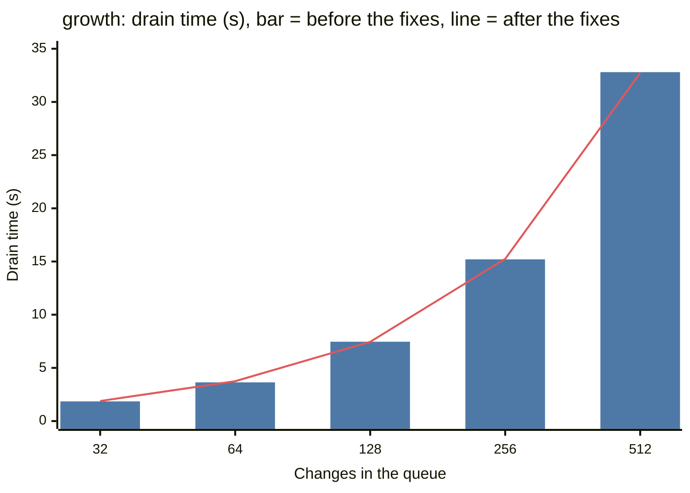

# Fault tests

These tests put faults into the services that NERUDO (formerly landseq) uses: CI, the git
host, and the Worker process. Then they check that no change is lost, landed twice or
blamed for the fault. They also measure how nerudo behaves while the fault continues.

All the tests operate on this computer. They do not use Cloudflare, Artifacts or the
deployed Worker.

## Run the tests

You must have Nix with flakes, and a Rust toolchain with `worker-build`. In `cf/`:

```sh
nix run .#faults                          # all cases, approximately 10 minutes
nix run .#faults -- --cases ci_down       # one case
nix run .#faults -- --help                # the cases and their options
nix develop                               # a shell with the same tools
```

The flake supplies `wrangler`, Gitea, toxiproxy, git and Python from nixpkgs-unstable.
`flake.lock` locks the versions.

The harness writes a JSON report to the temporary directory, and it shows the path. To
keep a report with the code, use `--evidence cf/evidence/faults-<date>.json`. The logs, the
state of each service and the clones are in one run directory. If no check fails, the
harness deletes it. Use `--keep` to keep it.

The exit code is 1 if a hard check fails. A known gap does not fail the run. Use `--strict`
to fail the run on a known gap too.

## What the harness starts

| Process | Function |
|---|---|
| toxiproxy | It is between all clients and the git host. It adds delay and resets connections. |
| Gitea | The git host. It has the Forgejo API. nixpkgs marks Forgejo as broken on macOS. |
| `wrangler dev` | Three Workers: `nerudo`, a CI stub (`ci-stub.js`) and the real `nerudo-ci`. |
| control server | It is in the harness. It tells the CI stub what to do, and it counts each CI request. |

The `nerudo` configuration is the deployed configuration without the remote bindings
(Artifacts and Workers AI). Its `CI` binding goes to the stub. The stub sends each check to
the real `nerudo-ci`, or it gives a fault.

The harness uses the scenarios that are already in `scripts/scenarios.py` to make trunks,
agents and changes.

## Cases

| Case | Fault | Hard checks | Measurements |
|---|---|---|---|
| `parity` | None. It runs six scenarios: approvals, ci, recovery, authority_recovery, allowance_recovery, ci_red. | Each scenario passes. | None |
| `ci_down` | CI gives HTTP 503 for 20 s, on 1 trunk and then on 8 trunks. | No change ejected. Each change lands once. All changes land within 30 s after CI is available again. Each trunk sends at most `backoff_budget` CI requests. The queue or the change shows that CI is down. No stall after CI is available again. | CI requests for each trunk |
| `ci_hang` | Each CI request hangs for 45 s. | The same. The Worker stops a hung request at its deadline (25 s), and asks again within 30 s. During the hang, the queue shows `ci_unavailable`. | The time until the Worker stops a hung request |
| `git_flaky` | The git host resets each connection for 3 s. Then its replies wait 200 ms, and it resets 40% of connections after 100 ms. One change in each batch. | The same, and the Worker does not take a lost reply for an external move of `main`. The faults must have an effect. | Errors, fetches tried again, ejections and recovered attempts. |
| `git_hang` | The git host drops all data for 40 s and keeps the connection open (toxiproxy `timeout`, 0): first its replies, then its requests. One change in each batch. | The same, and the Worker does not take a lost reply for an external move of `main`. During each fault, the queue shows `git_unavailable`. The next landing comes within 90 s after the host answers again. The Worker logs its deadline. | Time to the next landing, pushes sent again, recovered attempts |
| `kill9` | SIGKILL on the Worker processes while a queue drains, 3 times. Then the harness starts them again with the same state. | The queue drains with no help. Each change lands once. | Recovered attempts |
| `growth` | None. 32, 64 and 128 disjoint changes wait in a paused queue, then the queue resumes. | Each change lands once. When the size doubles, the drain time increases by ×3.0 or less. | Drain time for each size |

Each hard check also clones `main`, counts the `Change-Id` trailers, compares them with the
landing log, and runs `nerudo verify`.

## Known gaps

A known gap is a check that the code does not satisfy today. The list is `KNOWN_GAPS` in
`run.py`. When a known gap passes, the report tells you to remove it from the list.

The list is empty now. These gaps are closed. Their checks are now hard checks:

| Gap | Cause | Fix |
|---|---|---|
| `git_flaky.fetch_failed` | If the gate could not fetch a change from the fork of the agent, it closed the change as `fetch_failed`, also for a reset connection. | For a lost connection, 408, 429 or 5xx, the change stays queued with the reason `fetch_retry`. The gate tries again after 1 s, 2 s, 4 s and so on, at most 30 s. After 20 tries (approximately 7 minutes), or at once for a 4xx, it closes the change as `fetch_failed` (`trunk.rs`, gate; `nerudo-git`, `Error::transient`). |
| `verify.log_page` | `nerudo verify` and `nerudo release --at` read only the first 500 entries of the landing log. | Both read all pages (`nerudo-cli`, `Api::landing_log`). |
| `ci_down.requests` | The landing loop tried again each second, with no increase of the interval (`trunk.rs`, `alarm`). When CI was down, each trunk sent 60 requests each minute. | After a failed run, the next run starts after 1 s, 2 s, 4 s ... at most 30 s. Each interval is longer by a random 0 % to 25 % (`retry.rs`, `trunk/stall.rs`). The budget: in an outage of T seconds, 2 + ⌈log2 T⌉ + T/30 requests for each trunk (`backoff_budget` in `run.py`). |
| `ci_down.visible` | No field in the queue or the change told that CI was down. | The queue, the summary and a queued change have a `stall` field with the kind `ci_unavailable`. The PR page shows a pending type check row. |
| `ci_hang.timeout` | The CI call had no timeout (`ci.rs`, `typecheck`). | A check with no answer in 25 s fails as `ci_unavailable`. |

The new case `git_hang` tests the deadline of each git request (30 s, `transport.rs`). It
was not a known gap. On the code before the deadlines, 3 of its checks fail. See
`../scale/resilience.md`.

## Results on 2026-10-12

| Run | Commit | Result | Report in `cf/evidence/` |
|---|---|---|---|
| Before the fixes | `9924c36` and the harness | 81 passes, 6 known gaps, 0 failures | `faults-20261012-103449.json`; growth to 512: `faults-20261012-growth512.json` |
| After the fixes | `1a885ad`, growth to 512 | 92 passes, 5 known gaps, 0 failures | `faults-20261012-fixes.json` |
| After the deadlines | `a22b93d`, with `git_hang` | 100 passes, 0 known gaps, 0 failures. Two earlier full runs: the same at `c7feca8`; at `d5e7c29`, 99 passes and 1 failure. The failure was the approvals scenario (the known local fault below), and it passed when it ran again. | `faults-20261012-resilience.json` |

| Case | Before the fixes | After the fixes | After the deadlines |
|---|---|---|---|
| `parity` | approvals, ci, recovery and ci_red passed. | The same | The same |
| `ci_down` | 1 trunk: 20 CI requests in 20 s. 8 trunks: 160 requests in 20 s. That is 1 request each second for each trunk, as the log of the Worker also shows. No change was ejected. All changes landed 0.6 s (1 trunk) and 1.3 s (8 trunks) after CI was available again. | The same requests. The changes landed 0.7 s and 1.2 s after CI was available again. | 1 trunk: 5 CI requests in 20 s (budget 8). 8 trunks: 40 requests, 5 for each trunk. The queue and the change showed `ci_unavailable`. The changes landed 13.3 s and 16.6 s after CI was available again (13 to 19 s in 3 runs). They wait for the next try. |
| `ci_hang` | The second CI request came 46 s after the first: the Worker waited for the full hang of 45 s. The change landed 43 s after CI was available again. | The same | The second CI request came 26 s after the first (deadline 25 s). During the hang, the queue showed `ci_unavailable: no answer in 25 s`. The change landed 4.3 s after CI was available again (3.7 to 4.3 s in 3 runs). |
| `git_flaky` | With no outage at the start, the gate closed 2 of 12 changes as `fetch_failed` (3 of 12 in the second run). The other changes landed once. | With the outage of 3 s, the gate tried 14 fetches again. 12 of 12 changes landed once, and the gate closed none. | 12 of 12 changes landed once during the faults. The gate tried 11 fetches again. 1 run failed, and the Worker recovered its attempt from `main`. |
| `kill9` | In 3 runs, the queue drained after the restart with no help, and each change landed once. In 2 runs, the kill came between a push and its landing record, and the Worker recovered the attempt from `main`. | The same | The same. In 2 of 3 runs the Worker recovered the attempt from `main`. |
| `git_hang` | Not run. On the code before the deadlines (`128b641`), 3 checks fail: no stall in the queue during both faults, and no deadline in the log. The loop waited in the hung request until toxiproxy closed the connection at the end of the fault, then landed 3 s later. | Not run | Replies dropped for 40 s: the queue showed `git_unavailable`, and the next landing came 2.9 s after the host answered again. Requests dropped for 40 s: 9.9 s. The Worker sent 2 pushes again. 6 of 6 changes landed once. No external move. |
| `growth` | 32: 1.85 s. 64: 3.64 s. 128: 7.46 s. 256: 15.2 s. 512: 32.8 s. At 512, `nerudo verify` failed (`verify.log_page`). | 32: 1.89 s. 64: 3.75 s. 128: 7.45 s. 256: 15.25 s. 512: 32.73 s. `nerudo verify` passed at 512. | 32: 1.55 s. 64: 3.34 s. 128: 6.07 s (only to 128). |

Each step of `growth` is ×2.0 to ×2.2 before and after the fixes, and ×1.7 to ×2.3 after the
deadlines. Thus the drain time is linear here.

The chart shows the `growth` times before and after the fixes, from the table. The bar is
the time before the fixes, and the line is the time after them.



In one other run after the fixes, the approvals scenario failed once. The local
`wrangler dev` lost the connection of an admin request immediately after a 403 ("Network
connection lost" in its proxy). The scenario passed when it ran again.

The cause: the Trunk object answered some requests before it read the request body, and
that broke the connection. Commits `75dd7b5` and `da946c6` fix it, and they are in this
build. [`../scale/ops.md`](../scale/ops.md#the-flake-of-the-approvals-scenario) gives the
test: 18 failures in 2,000 pairs of requests before the fix, and 0 in 4,000 after it.

The live stress run on Artifacts of 2026-10-12 gave ×3.4 from 64 to 128 (`STRESS_TESTING.md`
of that work, not on this branch). These local runs do not show that increase up to 512. Thus the cause is probably not in the gate.
It can be in Artifacts, in the network, or in the polling of the clients. A test on a
deployed Worker must find it.

`../scale/stages.md` gives that test. The gate fetched each change with its own request, and
one fetch takes approximately 300 ms on Artifacts and 25 ms here. The gate now asks each fork
once, for several forks at the same time.

## Limits

These tests do not measure the limits of Cloudflare:

- The local runtime does not enforce 128 MB for each isolate.
- All Durable Objects operate in one local process. The tests do not show the request
  rate of one object on Cloudflare, or the rate of the `Hub` object.
- Gitea is not Artifacts. Artifacts has different limits, for example on forks that start
  at the same time.
- The tests do not measure global distribution or consistency.

To measure these limits, use a Worker that you deploy only for the test. Do not use the
live Worker.

Version 1 is not hermetic. It uses the build of the Worker and the CLI from the working
tree. If these builds do not exist or are older than the sources, the harness builds them with
your `cargo` and `worker-build`.

## Files

| File | Contents |
|---|---|
| `../flake.nix` | The tools and the `faults` app |
| `run.py` | The harness and the cases |
| `ci-stub.js` | The CI stub Worker |
