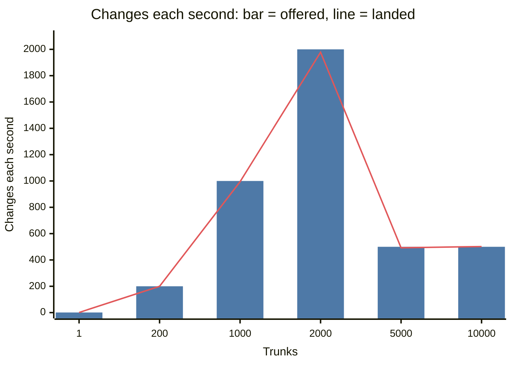
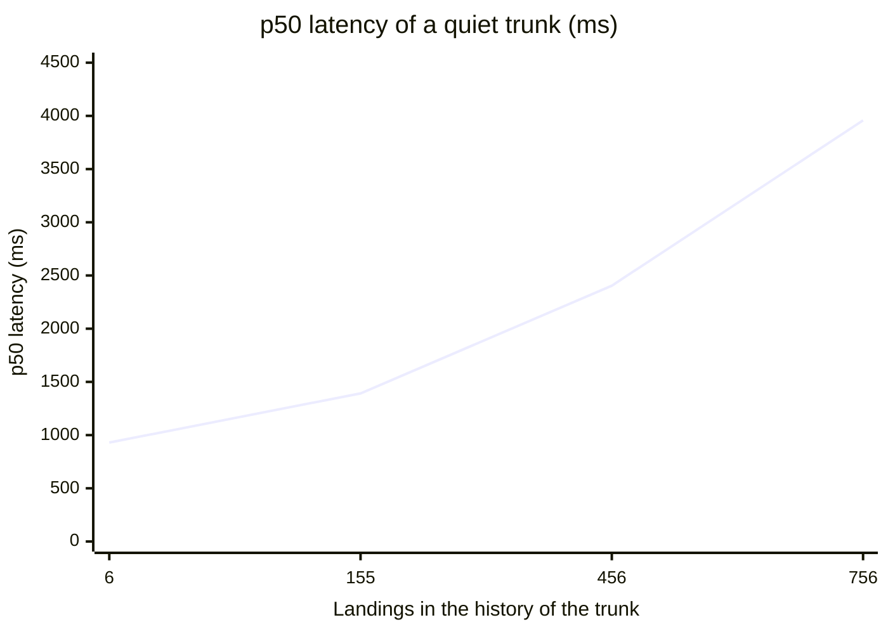

# 1,000 to 10,000 trunks

This test continues `repos.md`. That test showed that 200 trunks land 200 changes each
second, 200 times the rate of one trunk. This test asks the same question at 1,000 trunks
and more: are the trunks still independent? It also asks what more trunks cost, and what
Artifacts does when one account has thousands of repos.

The test ran on 2026-10-12 against Workers for the test only. It did not send load to the
live Workers. The load came from a Worker inside Cloudflare, not from this computer.

## Result

1. **The trunks were independent up to 10,000 trunks.** At 1 change each second for each
   trunk, 200 trunks landed 200 changes each second and 1,000 trunks landed 994. At the same
   rate, 2,000 trunks landed 1,978 until the run stopped. 5,000 trunks at 0.1 change each second landed
   492 of 500 offered. 10,000 trunks at 0.05 landed 501.9 of 500 (1.00; the window uses
   whole seconds).

   In Nerudo (formerly nerudo), no trunk waited for another. The slowdowns that many trunks had at the same time came from
   Artifacts (see 2). Each change that nerudo accepted landed once, except 2 changes that
   the gate ejected at 2,000 trunks (see 3). `nerudo verify` passed on each of 120 sampled
   trunks.
2. **Failures in Artifacts constrained these runs.** At approximately 5,000 git
   requests each second from this account (1,000 trunks), the pushes to many repos failed
   for approximately 2 s. The 12 failures were HTTP 503 and 500. At approximately 10,000 git
   requests each second (2,000 trunks), the same occurred with 145 failures in 10 s, and
   the run stopped.

   The pushes also became slower as the load increased. No request got
   HTTP 429. The live Workers answered 200 at each check. After this, the test kept the
   load of the account at or below 1,000 changes each second.
3. **The gate ejects a change when Artifacts answers a fetch with no pack.** At 2,000
   trunks, the gate ejected 2 changes as `fetch_failed`: `protocol: fetch returned no packfile`.
   `nerudo-git` (`client.rs`, `fetch_pack`) returns `Error::Protocol` for a 200 answer with
   no pack, and `Error::transient` (`error.rs`) does not try a protocol error again. Thus a
   short failure of Artifacts can eject a change. The fault tests forbid this ("no change
   blamed for the fault"). This test did not change the code.
4. **A call to the Artifacts binding kept the Trunk object billed for 11 minutes and more.**
   `host.rs` did not dispose the results of binding calls. Commit `34d2439` disposes them.
   After the fix, the trunks left memory in the same minute as their request. To make 800
   trunks cost 48,360 GB-s before the fix. To make 1,000 trunks cost 1,665 GB-s after it.
5. **At 10,000 quiet trunks, the latency of a trunk grew with its history.** At 1 change
   each 20 s for each trunk, the p50 latency of a trunk was 930 ms at approximately 6
   landings. It was 1,392 ms at 155 landings, 2,404 ms at 456 and 3,958 ms at 756. Each landing needed 3.6
   git requests, not 3, in each of these groups.

   The probable cause, a hypothesis: a Trunk object that is not in memory has no objects
   of `main`. Then the landing loop fetches the head of `main` with no `have` and no depth
   (`trunk.rs`, `schedule_with`), so it gets the full history. Thus the latency of many
   quiet trunks depends on the size of each repo, not on the number of trunks. The trunk
   read at depth 1 of the `mono-repos` work is the probable fix. This test did not change
   the code. The read at depth 1 is in the live build now, but nobody measured this latency
   on that build.

| Run | Trunks | Offered/s (each trunk) | Landed / sent | Failed | Landings/s in the window | ÷ (K × 1 trunk) | Latency p50 / p95 / p99 (ms) |
|---|---|---|---|---|---|---|---|
| `k1r1` | 1 | 1 (1) | 300 / 300 | 0 | 1.00 | 1.00 | 675 / 1,145 / 1,485 |
| `k200r1` | 200 | 200 (1) | 60,000 / 60,000 | 0 | 200.0 | 1.00 | 640 / 880 / 1,205 |
| `k1000r1` | 1,000 | 1,000 (1) | 299,988 / 300,000 | 12 | 994.3 | 0.99 | 660 / 980 / 1,585 |
| `k2000r1` | 2,000 | 2,000 (1) | 259,235 / 259,384 | 147 | 1,977.9 | 0.99 | 700 / 1,640 / 3,715 |
| `k5000r01` | 5,000 | 500 (0.1) | 88,702 / 88,730 | 28 | 492.5 | 0.98 | 745 / 1,455 / 4,015 |
| `k10000r005` | 10,000 | 500 (0.05) | 59,999 / 60,000 | 1 | 501.9 | 1.00 | 970 / 2,840 / 4,795 |

The chart shows the same runs. The bar is the offered rate, and the line is the landed rate.
At 5,000 and 10,000 trunks, each trunk got fewer changes, so the offered rate was 500 each
second.



Result 5 as a chart and a table: the p50 latency of a quiet trunk in `k10000r005`, by the
landings in its history.



| Landings in the history | 6 | 155 | 456 | 756 |
|---|---|---|---|---|
| p50 latency (ms) | 930 | 1,392 | 2,404 | 3,958 |

`repos.md` measured 641 / 877 / 1,647 ms at 200 trunks with `repos-load` on this computer.
The driver inside Cloudflare gives the same latency.

At 1,000 trunks, the landings in the window were 0.6% fewer than offered. The cause is on
the side of the agents, not nerudo. The pushes of some agents were slow, so their changes
started late (see "Late agents"). The 2,864 late changes landed after the end of the
window. All queues were empty 2.6 s after the last change.

The plan for `k2000r1` was 180 s. It stopped at 131 s, at 144 failures in 10 s. Its window is
30 s to 120 s, before the failures. Of the 360,000 planned changes, the driver sent 259,384.

`k5000r01` kept the load of the account at 500 changes each second, half the load of
`k1000r1`. For 1 trunk at 0.1 change each second, K × 1 trunk is K × 0.1. 17 agents could
not fetch their seed (HTTP 503 from Artifacts) at the start, so they sent nothing. Their 8
shards then stopped by themselves (2 failures in 20 changes), and these shards did not send
1,270 changes. Thus 492.5 of 500 each second is the shortfall of these 80 agents, not of nerudo.

`k10000r005` also kept the load at 500 changes each second, with 20 trunks in each shard.
No agent was late: the push p50 was 1,665 ms, but each agent had 20 s for each change. At
1 change each second (`k2000r1`), pushes of this time made the agents late. The higher
latency is the history of the trunks (Result, 5).

## What the test used

| Item | Value |
|---|---|
| Worker under test | `nerudo-scale-10k`. Code `128b641` (`scale-safe`: the gate prefetch of `stages.md` and the name memo of `hub.md`), built with `worker-build --release`. Version `91b36a44-58ed-4639-b955-cdad1ad79a47` for `k1r1`, `k200r1`, `k1000r1` and trunks 0 to 999 (the secrets were set after the first version, `34891036-d1c0-4950-a13b-7e2f91f69b40`). Version `ea237d95-219f-4c12-a2de-05e043dd8381` (the same code and commit `34d2439`, the disposal of binding results) for trunks 1,000 and up and all later runs. |
| Bindings | `TRUNK`, `HUB`, `ARTIFACTS` (namespace `nerudo-scale`). No `CI` binding and no `AI` binding. |
| Load driver | `nerudo-scale-10k-driver`: version `264e7a2e-c6de-4964-8ec5-41a3d57a56f7` (code `driver-10k/` of commit `994bac3`) for the runs to `k5000r01`; version `7302ec54-aaae-4836-acc5-3ec660d78ab4` (commit `90ebd75`: 3 tries for a seed fetch, wake-up spread over `--prep` seconds) for `k10000r005`. A service binding `TARGET` to `nerudo-scale-10k`. Deleted after the test. |
| Control | `tenk.py` on this computer: fewer than 5 requests each second. `repos-load setup` made the trunks. |
| Trunks | `10k-00000` to `10k-10005`, each with one fork, `10k-NNNNN--a0`. 10,000 are complete; 6 failed when they were made (see "Making the trunks"). |

The seed and the rules of each trunk are the same as in `repos.md`. Each change adds one new
file, so no two changes overlap. There is no CI.

The landing loop makes no call to the Artifacts binding. It uses the tokens that it keeps.
Thus the fix of `34d2439` does not change the landing path, and the runs on the two
versions are comparable.

## The load driver

One computer cannot send this load. The Cloudflare edge blocks one IP address at
approximately 2,000 requests each second (`hub.md`), and several agents share this IP.
Thus the load comes from a Worker inside Cloudflare: `nerudo-scale-10k-driver`
(`driver-10k/`, Rust, workers-rs). The computer sends only the plan, reads the status, and
collects the reports (`tenk.py`).

The driver has one Durable Object class, `Shard`. Each shard object sends the changes of P
trunks: 4 to `k2000r1`, 10 in `k5000r01` and 20 in `k10000r005`. Thus each shard sends at most
4 changes each second. No single object sends the full load.

For each change, a shard does the same 3 requests as `repos-load`:

1. It makes the commit in memory with `nerudo-git`. The change adds one new file,
   `changes/NN/<change id>.txt`, on the commit that the fork was made from (the seed).
2. It pushes the commit to the fork of the agent: 2 requests to Artifacts.
3. It sends `POST /v1/trunks/{trunk}/land` with the agent token and the agent key, through
   the service binding. A service binding does not go through the edge.

The load is open loop. Trunk g of K gets its changes at the times t0 + (g/K + n)/R, for
n = 0, 1, 2, ... The times do not depend on earlier changes. All shards use the same t0, so
the starts of all trunks are spread evenly over one period.

Two differences from `repos-load`:

- Each trunk has one agent (`a0`), not two. At 1 change each second or less, each change
  lands alone, so the number of forks does not change the landing loop.
- The shard sends the changes of one agent one after the other, as one agent does. If one
  push takes longer than 1/R, the next change of that agent starts late. The driver
  records this as the send lag: the real start minus the planned time.

A shard sends nothing before t0 or after the planned end, plus the time to send the
changes of a late agent. A shard stops by itself at the first HTTP 429, and when more than
5% of its changes in the last 60 s failed. `tenk.py` stops all shards when one of these occurs:

- The first HTTP 429.
- More than 5% of the changes in one poll interval (10 s) failed.
- 50 failures in one poll interval (20 for the runs at 500 changes each second).
- A live Worker does not answer 200.

`tenk.py` reads both live front pages each 60 s.

After the last change, each shard reads `stats` of its trunks each 2 s until each queue is
empty and each accepted change is counted. Then it reads the landing log of each trunk
(`log?since=`), and the receipt of each accepted change that is not in the log. It keeps a
report with histograms of the times (5 ms buckets) and the landings in each second. The
report also has the errors by kind with 3 samples each, and one row for each trunk. `tenk.py summary` adds the reports of
all shards.

If the alarm of a shard stops before its end, the runtime runs the alarm again. The shard
then sends no more changes. It writes its report from the records of its last checkpoint
(each 10 s), and counts the changes after the checkpoint as `lost`. This occurred once, in
`k2000r1`, after the stop (204 changes).

## Measurements

- Latency is `landed_at_ms` (landing log) minus `submitted_ms` (the receipt of `land`). The
  Trunk object writes both times. The percentiles come from 5 ms buckets.
- The landing rate is the number of landings in the window, divided by the length of the
  window. The window starts 30 s after the first change was submitted. It stops at the last
  submit, or at the planned end of admission if that is earlier. It uses whole seconds
  after t0. The latency is less than 1 s, so the landings in the window are also the
  changes submitted in it.
- The rate of one trunk is its landings from t0 + 30 s to the planned end, divided by that
  time.
- `git_requests` and `batches` come from `stats`, before and after the run.
- The cost comes from the GraphQL Analytics API (`tenk.py cost`): Durable Object requests,
  rows written and read, active time, and errors; Worker requests and CPU time. These
  counts are estimates from samples.

## All runs

| Run | Batch mean / max | git requests / landing | Push p50 / p95 (ms) | `land` p50 / p95 (ms) | Send lag p99 / max (ms) | Sends > 1 s late | Trunk p50 (min / median / max, ms) | Gate fetches tried again | Drain (s) |
|---|---|---|---|---|---|---|---|---|---|
| `k1r1` | 1.02 / 2 | 2.94 | 285 / 355 | 95 / 145 | 2,370 / 3,745 | 9 (3%) | 677 | 0 | 2.3 |
| `k200r1` | 1.00 / 4 | 3.00 | 315 / 465 | 80 / 140 | 0 / 22,250 | 149 (0.25%) | 502 / 636 / 772 | 10 | 2.4 |
| `k1000r1` | 1.01 / 16 | 2.99 | 350 / 920 | 80 / 145 | 29,300 / 75,205 | 19,433 (6.5%) | 507 / 657 / 1,283 | 67 | 2.6 |
| `k2000r1` | 1.03 / 12 | 2.92 | 365 / 1,035 | 85 / 165 | 19,020 / 62,015 | 28,122 (10.8%) | 507 / 694 / 2,367 | 79 | 10.2 |
| `k5000r01` | 1.00 / 4 | 3.06 | 615 / 1,715 | 105 / 150 | 0 / 21,725 | 64 (0.07%) | 509 / 748 / 7,529 | 12 | 6.4 |
| `k10000r005` | 1.00 / 1 | 3.58 | 1,665 / 3,400 | 125 / 215 | 0 / 0 | 0 | 557 / 1,023 / 8,785 | 3 | 9.4 |

`k1r1`, `k200r1` and `k1000r1` lasted 300 s, `k5000r01` 180 s and `k10000r005` 120 s. No
change was ejected in these runs, and `main` never moved outside the sequencer
(`external_moves` 0). In `k2000r1`, the gate ejected 2 changes (see "Errors").

In `k5000r01`, each fork got 1 push each 10 s, at half the load of the account. The pushes
were slower than at 1 push each second (p50 615 ms, not 285 to 365 ms). In
`k10000r005`, each fork got 1 push each 20 s, and the push p50 was 1,665 ms. The test does
not show the cause. Probably a repo that is not used for some seconds is slower to start on
Artifacts.

In `k10000r005`, the largest WebAssembly memory of one isolate of the Trunk class was
32.8 MB (16.6 MB at 2,000 trunks). Many Trunk objects share one isolate, and each keeps its
objects in memory. The limit of an isolate is 128 MB. The analytics show no memory errors.

### Latency did not increase during a run

p50 and p95 latency (ms) for each minute of submission:

| Run | Minute 0 | 1 | 2 | 3 | 4 |
|---|---|---|---|---|---|
| `k1r1` | 660 / 1,060 | 720 / 1,190 | 680 / 1,120 | 670 / 1,090 | 650 / 1,140 |
| `k200r1` | 640 / 920 | 640 / 930 | 640 / 910 | 630 / 820 | 630 / 820 |
| `k1000r1` | 660 / 1,080 | 650 / 880 | 660 / 1,050 | 660 / 970 | 660 / 970 |
| `k2000r1` | 730 / 2,020 | 670 / 1,090 | 680 / 3,230 | | |
| `k5000r01` | 770 / 2,780 | 740 / 960 | 730 / 920 | | |
| `k10000r005` | 1,080 / 3,170 | 900 / 2,310 | | | |

In `k2000r1`, 1,000 of the 2,000 trunks landed no change before this run, and their objects were
not in memory at the start. This is the probable cause of the higher p95 in minute 0.
Minute 2 includes the failures of Artifacts. In `k5000r01`, 3,000 of the 5,000 trunks landed
no change before this run, and minute 0 also has the failures of Artifacts at the start. In
`k10000r005`, each minute has the cold starts of quiet trunks (Result, 5).

### Late agents

In `k1000r1`, the pushes from 34 of the 250 shards were slow: push p50 approximately 1 s
instead of approximately 0.3 s. The `land` requests of the same shards were not slow (p50
60 to 95 ms). Thus the cause is the push to the fork on Artifacts, not the shard. At 1
change each second, an agent with pushes of 1 s cannot send its changes at that rate. Its send lag increased
during the run, to 75 s at most.

In `k2000r1`, 153 of 500 shards had a send lag of more than 5 s. Of these, 83 were among the 250 shards with
the older trunks (0 to 999). The other 70 were among the 250 shards with the new trunks (1,000 to 1,999).
Thus the age of the repo does not explain the slow pushes. The share of late sends
increased with the load: 0.25%, 6.5% and 10.8% at 200, 1,000 and 2,000 trunks.

The latency on the server did not change for the trunks of late agents. Thus the slow
pushes changed what the agents sent, not how nerudo landed it.

### Errors

| Kind | `k1r1` | `k200r1` | `k1000r1` | `k2000r1` | `k5000r01` | `k10000r005` |
|---|---|---|---|---|---|---|
| Push: HTTP 503 (`receive-pack advertisement` or `POST git-receive-pack`) | 0 | 0 | 8 | 80 | 2 | 0 |
| Push: HTTP 500 | 0 | 0 | 3 | 65 | 1 | 0 |
| Push: `artifacts_git_receive_pack_service_unavailable` | 0 | 0 | 1 | 0 | 8 | 0 |
| Seed fetch at the start: HTTP 503 (the agent sent nothing) | 0 | 0 | 0 | 0 | 17 | 0 |
| `land`: HTTP 500 `INTERNAL SERVER ERROR` (cause not known) | 0 | 0 | 0 | 2 | 0 | 1 |
| Ejected by the gate: `fetch_failed`, `fetch returned no packfile` | 0 | 0 | 0 | 2 | 0 | 0 |
| HTTP 429 | 0 | 0 | 0 | 0 | 0 | 0 |
| Live Workers not 200 | 0 of 3 checks | 0 of 6 | 0 of 7 | 0 of 4 | 0 of 4 | 0 of 4 |

In `k1000r1`, all 12 push failures came at approximately 22:30:00 UTC, on 12 forks of 12
different shards. In the same 2 s, the landings fell to 490 and 586 each second, from
approximately 1,000. In the next 10 s they were above 1,000 until the queues were empty
again.

In `k2000r1`, the landings fell to approximately 1,400 each second at 124 s to 125 s. Then
from 125 s to 131 s, 145 pushes to forks failed with HTTP 503 or 500, and the run stopped.
The analytics show 259 Trunk invocations that threw an exception and 2 internal errors in
the same run. The landing loop gives an exception when a push to `main` fails, and it tries
again after 1 s.

Thus one event on Artifacts slowed many repos at the same time, and the event was larger
at the higher load. It was not HTTP 429 and not a quota error. The trunks are independent
in nerudo, but they all use the same Artifacts service in one account.

In `k5000r01`, `wrangler tail --status error` recorded 28 events of the Worker under test.
In these events, 16 alarms, 11 `land` requests and 1 `stats` request of Trunk objects ended with an
exception. The tail recorded 16 messages, all from the landing loop. In these messages, the push to `main`
failed with `artifacts_git_receive_pack_service_unavailable` (11) or HTTP 503 (4). 1 message
was `Connection closed: this Durable Object instance is no longer active`.

A `land` request
shows the exception of the landing loop that ran in the same object at that time. Each of
these requests answered 200. The loop tries again after 1 s, and each change landed. All 28
events came in the first 50 s of the run.

In `k10000r005`, the tail recorded 2 events: the landing loop could not fetch `main`
(`POST git-upload-pack: HTTP 500`) and tried again. It did not record the `land` request
that answered HTTP 500.

The driver does not try a failed push again. It records the push as an error.

### Integrity

`nerudo verify` passed on 20 random trunks of the first 200 after `k200r1`. It also passed on 25
random trunks after each of `k1000r1`, `k2000r1`, `k5000r01` and `k10000r005`
(`tenk.py verify`): 120 trunks in all. It clones `main` with a read-only token and checks that each
landed change is on `main` once. It also checks that the hash chain of the landing log ends at
the tip of `main`.

## Making the trunks

`repos-load setup` makes each trunk with `POST init` and a seed, then the fork of `a0`.
The Trunk object creates the Artifacts repo and pushes the seed. For each trunk, this is
approximately 15 control requests to Artifacts. They are create, get, createToken, revokeToken, fork,
and the reads of `get` until the fork is ready. Artifacts allows 2,000 control requests
each 10 s for one namespace. The other scale tests also use the namespace
`nerudo-scale`.

| Trunks | At once | Time | init p50 / p95 / max (ms) | Fork p50 / p95 / max (ms) | Failed |
|---|---|---|---|---|---|
| 0 to 199 | 4, then 6 | 241 s | 3,485 / 4,646 / 6,261 | 3,049 / 3,435 / 16,454 | 0 |
| 200 to 399 | 10 | 136 s | 3,283 / 4,343 / 5,144 | 2,925 / 3,419 / 4,210 | 0 |
| 400 to 599 | 10 | 135 s | 3,201 / 4,172 / 5,343 | 2,930 / 3,414 / 4,447 | 0 |
| 600 to 799 | 10 | 136 s | 3,259 / 4,135 / 4,628 | 2,921 / 3,475 / 3,918 | 0 |
| 800 to 999 | 10 | 129 s | 3,175 / 4,245 / 7,365 | 2,782 / 3,209 / 6,404 | 0 |
| 1,000 to 1,499 | 16 | 229 s | 3,419 / 4,558 / 5,732 | 2,839 / 3,766 / 9,311 | 0 (11 tried again) |
| 1,500 to 1,999 | 12 | 270 s | 3,195 / 4,439 / 8,362 | 2,779 / 3,263 / 6,507 | 0 |
| 2,000 to 2,499 | 12 | 275 s | 3,093 / 4,194 / 12,061 | 2,802 / 3,339 / 12,465 | 1: seed push HTTP 503 |
| 2,500 to 2,999 | 12 | 261 s | 2,938 / 4,125 / 6,571 | 2,810 / 3,249 / 3,644 | 1: connection lost (this computer) |
| 3,000 to 3,499 | 12 | 260 s | 2,935 / 4,062 / 20,941 | 2,791 / 3,204 / 6,689 | 0 |
| 3,500 to 3,999 | 12 | 259 s | 2,888 / 4,050 / 6,898 | 2,789 / 3,229 / 16,940 | 0 |
| 4,000 to 4,499 | 12 | 258 s | 2,938 / 4,081 / 10,147 | 2,728 / 3,250 / 5,236 | 2: fork ref list HTTP 503; connection lost (this computer) |
| 4,500 to 4,999 | 12 | 254 s | 3,069 / 4,151 / 5,620 | 2,693 / 3,024 / 4,186 | 0 |
| 5,000 to 5,499 | 12 | 249 s | 2,889 / 4,068 / 6,132 | 2,644 / 2,977 / 5,653 | 0 |
| 5,500 to 5,999 | 12 | 259 s | 2,961 / 4,144 / 19,532 | 2,667 / 3,058 / 16,156 | 0 |
| 6,000 to 6,499 | 12 | 255 s | 2,934 / 4,274 / 13,633 | 2,603 / 2,974 / 4,493 | 0 |
| 6,500 to 6,999 | 12 | 255 s | 2,960 / 4,008 / 5,428 | 2,673 / 3,087 / 4,474 | 0 |
| 7,000 to 7,499 | 12 | 268 s | 3,203 / 4,456 / 6,647 | 2,768 / 3,250 / 11,489 | 1: connection lost (this computer) |
| 7,500 to 7,999 | 12 | 259 s | 3,018 / 4,035 / 19,073 | 2,729 / 3,126 / 4,747 | 1: init HTTP 500 after 19 s |
| 8,000 to 8,499 | 12 | 243 s | 2,855 / 3,873 / 4,899 | 2,506 / 2,964 / 4,961 | 0 |
| 8,500 to 8,999 | 12 | 234 s | 2,724 / 3,695 / 4,642 | 2,515 / 2,957 / 3,414 | 0 |
| 9,000 to 9,499 | 12 | 234 s | 2,711 / 3,529 / 4,449 | 2,477 / 2,951 / 4,161 | 0 |
| 9,500 to 9,999 | 12 | 227 s | 2,607 / 3,380 / 4,778 | 2,492 / 2,942 / 3,625 | 0 |

The time to make a repo did not increase from 0 to 10,000 trunks (20,000 repos). It was
a little shorter at the end, in the evening.

Artifacts gave 2 errors in 10,000 trunks:
HTTP 503 for the seed push of `10k-02263`, and HTTP 503 for the ref list of the fork of
`10k-04122`. The init of `10k-07656` answered HTTP 500 after 19 s, with no cause. The test does not use these
trunks, or the 3 trunks whose requests from this computer lost their connection. 6 more trunks (`10k-10000` to `10k-10005`) replace them.

At 16 at once, this computer lost 26 connections to the edge ("Connection reset by peer"):
11 init requests and 15 fork requests. Each one got no answer, and each one passed when
`repos-load` sent it again. At 12 at once, this computer lost at least 9 connections in 8,500
trunks. 5 fork requests passed when `repos-load` sent them again, and 3 trunks failed (one init lost its
connection two times).

## Cost

Workers cost $0.30 for each million requests. Durable Objects cost $0.15 for each million
requests, $12.50 for each million GB-s and $1.00 for each million rows written. Artifacts
bills starting on 2026-10-14: $0.15 for each 1,000 operations after the first 10,000 each month.
Before that date the campaign incurred no Artifacts operation charge. The amounts are
historical list-price estimates, not a production invoice. Artifacts also charges
$0.50 per GB-month for repository storage; that storage cost is not in the table.
The monthly amounts included in Workers Paid (for example 50 million rows written and 400,000 GB-s) are not
subtracted.

Measured with the GraphQL Analytics API:

| Step | Trunk requests | Rows written | Trunk GB-s | Shard GB-s | Cost |
|---|---|---|---|---|---|
| Make trunks 8 to 199 | 384 | 1,139 | 4,230 | 0 | $0.05 |
| `k200r1` | 126,513 | 1,193,331 | 10,348 | 1,988 | $1.39 |
| Make trunks 200 to 999 | 955 | 60,653 | 48,360 | 0 | $0.67 |
| `k1000r1` | 626,271 | 5,900,803 | 49,843 | 9,982 | $6.84 |
| Make trunks 1,000 to 1,999 (after the fix) | 2,109 | 5,796 | 1,665 | 13 | $0.03 |
| `k2000r1` | 531,493 | 5,066,175 | 25,045 | 12,188 | $5.71 |
| Make trunks 2,000 to 4,999 | 5,049 | 12,400 | 1,726 | 0 | $0.04 |
| `k5000r01` | 283,963 | 1,774,212 | 10,354 | 12,133 | $2.18 |
| Make trunks 5,000 to 10,005 | 10,401 | 28,008 | 3,325 | 24 | $0.08 |
| `k10000r005` | 269,832 | 1,200,019 | 9,714 | 10,116 | $1.56 |
| All steps | | 15.2 million | 164,600 | 46,400 | $18.54 |

The windows of the analytics do not cover each minute of the work (the first smoke runs,
the checks of the driver, `nerudo verify`). Thus the full test cost approximately $19 to
$20 at list price. The monthly amounts included in Workers Paid probably cover most of it.

Rows written are the largest cost: approximately 19.7 rows for each landed change
(1,193,331 for 60,000 changes; 5,900,803 for 299,988). The service binding calls from the
driver to `nerudo-scale-10k` do not show as Worker requests.

At the price of Artifacts starting on 2026-10-14, the load would cost much more. Each change makes
5 git requests to Artifacts: 2 for the push to the fork, 1 fetch by the gate, and 2 for the push
to `main`. The driver makes 3 Git actions (push, fetch, push), represented by 5 HTTP requests.
The experiment did not reconcile that traffic with billed-operation counters. Thus its
$135–225 projection for `k1000r1` is an accounting range for 300,000 changes, not a
verified bill. Storage for trunks and forks, Worker CPU/requests, Durable Object
duration/requests/rows, retry traffic, model inference and runtime CI are separate.
Check [current official pricing](https://developers.cloudflare.com/artifacts/platform/pricing/)
before repeating a large campaign.

All runs together landed approximately 768,000
changes: $350 to $580. To make 10,000 trunks needs approximately 5 operations for each trunk:
approximately $8. The test made all its repos and ran all its load before 2026-10-14.

### Idle trunks stayed billed after a binding call

A Durable Object is billed for its duration while it is in memory and cannot hibernate.
With version `91b36a44`, the analytics showed two behaviors of the Trunk object:

- After `k200r1`, 179 of 200 trunks were active in the first minute, 96 in the second, 48
  in the third, and 20 after that. Thus a trunk that only lands changes leaves memory
  approximately 1 to 3 minutes after its last request.
- The 20 trunks that stayed were the 20 trunks of `nerudo verify`. `verify` reads
  `GET trunk`, and `trunk_info` calls the Artifacts binding (`get`, then `createToken`).
  These 20 trunks stayed active for 11 more minutes with no request and no CPU time.
- The trunks made with `init` and a fork stayed active from their creation until the next
  run, 6 to 12 minutes later.

`host.rs` never disposed the results of binding calls. A result that is not disposed keeps
its RPC session open, so the object cannot leave memory. Commit `34d2439` wraps each result
in `Rpc`, which disposes it when it is dropped.

The test of the fix, with version `ea237d95` on idle trunks:

| Request | Trunks | Left memory in the minute of the request | Stayed active |
|---|---|---|---|
| `GET trunk` (2 binding calls) | 10 | 9 | 1, for 4 minutes |
| `GET stats` (no binding call, the control) | 10 | 10 | 0 |
| `init` and fork (approximately 15 binding calls) | 490 | 490 | 0 |

Then init, fork and land worked as before: 2 new trunks landed 40 of 40 changes, and
trunks 1,000 to 1,999 landed in `k2000r1`.

With the fix, a quiet trunk costs little. In `k10000r005`, the Trunk objects were billed for
approximately 1.3 s for each change (9,714 GB-s ÷ 0.128 GB ÷ 59,999 changes). In
`k5000r01`, they were billed for approximately 0.9 s. But a trunk that leaves memory probably reads `main`
again at its next change (Result, 5).

Without the fix, each binding call keeps a Trunk object in memory for many minutes:
128 MB for 15 minutes is approximately $0.0014. The calls that do this are `init`, a fork,
`GET trunk` (`nerudo verify`), a context read, and a plain-git read through the sequencer
(`git.rs`). A trunk that gets such a call more often than each 15 minutes stays in memory
all the time. That costs approximately $4.15 each month for each trunk.

## Repos made by this test

All in the Artifacts namespace `nerudo-scale`. The test did not delete them. They were
deleted after the campaign.

| Pattern | Count |
|---|---|
| `10k-NNNNN`, `10k-00000` to `10k-10005` (the trunk repos) | 10,006 names. 10,000 trunks are complete. For the 6 failed trunks the repo can exist without a seed (`10k-02263`, `10k-07656`) or not exist (`10k-04397`). |
| `10k-NNNNN--a0` (the forks) | 10,003: one for each trunk, except `10k-02263`, `10k-04397` and `10k-07656` |

Thus the namespace has approximately 20,000 repos from this test. Each trunk repo has the
seed and its landings (6 to approximately 1,400 commits). Artifacts bills storage from
2026-10-14: $0.50 for each GB-month after the first GB. The test did not measure the size.

## Run the test

```sh
cd cf/scale/repos-load && cargo build --release      # repos-load: makes the trunks
cd ../driver-10k && worker-build --release           # the driver Worker
# Deploy the Worker under test and the driver with configs outside the repo (a service
# binding TARGET from the driver to the Worker under test), and set the secrets:
# the Worker under test: NERUDO_ADMIN_TOKEN, NERUDO_AGENT_TOKEN;
# the driver: DRIVER_KEY, AGENT (= NERUDO_AGENT_TOKEN).
B=repos-load/target/release/repos-load
$B setup --vars scale.vars --state state.json --count 1000 --prefix 10k --digits 5 --agents 1 --conc 12
python3 -I tenk.py run --k 1000 --rate 1 --secs 300 --per 4 --tag k1000r1 --out raw-k1000r1.json
python3 -I tenk.py run --k 10000 --rate 0.05 --secs 120 --per 20 --prep 75 --max-fail 20 \
  --tag k10000r005 --out raw-k10000r005.json
python3 -I tenk.py summary --out summary.json raw-*.json
python3 -I tenk.py verify --k 1000 --sample 25 --tag k1000r1 --cli ../target/release/nerudo --out verify.json
python3 -I tenk.py cost --start <ISO time> --end <ISO time> --acct-file <file> --tag k1000r1 --out cost.json
```

`scale.vars` has `NERUDO_WORKER`, `NERUDO_ADMIN_TOKEN`, `NERUDO_AGENT_TOKEN`,
`DRIVER_KEY` and `DRIVER_URL`. `state.json` has fork tokens and agent keys. Keep both files
out of the repo. The fork tokens live 24 hours: make the trunks and run the load on the
same day.

The evidence is in `../evidence/scale-10k-20261012.json`:

- The summary of each run with histograms and slow trunks (a row for each trunk to 1,000
  trunks).
- The times to make the trunks.
- The `verify` results.
- The analytics of each step.

## What remains

- `Error::transient` (`nerudo-git/src/error.rs`) does not cover `fetch returned no
  packfile` (`nerudo-git/src/client.rs`, `fetch_pack`), so the gate ejects the change for a
  short failure of Artifacts. A proposed fix: one more arm in `transient()` for that
  message, and a test.
- 3 `land` requests answered HTTP 500 `INTERNAL SERVER ERROR` (2 in `k2000r1`, 1 in
  `k10000r005`). The tail did not record them, so the cause is not known.
- A Trunk object that is not in memory fetches all of `main` (Result, 5). The trunk read at
  depth 1 of `mono-repos` should remove this cost. Nobody measured it on that build. The
  repos of this test are deleted, so a run like `k10000r005` needs new repos.
- The driver changed during the test: from `k10000r005`, a seat without a seed does not
  stop its shard. Thus the 1,270 changes that `k5000r01` did not send are a result of the
  driver, not of nerudo.
- The observed failure range for this workload on one Artifacts account is: failures in bursts between
  approximately 5,000 and 10,000 git requests each second. The test did not find the cause
  or ask Cloudflare.

## Limits of the test

- The shards build the changes on the seed, not on the tip of `main`, and no two changes overlap.
  There is no CI. Each trunk has 1 agent. See `repos.md` for these limits.
- The changes come at fixed intervals. Real load has bigger bursts.
- All objects were probably in one region. Requests from this computer made the driver
  objects. Requests from this computer and from the driver made the Trunk objects.
- Each condition ran once. The runs used the same trunks again, so the trunks had different
  history.
- The analytics are estimates from samples. The cost is at list price.
- The test did not find the cause of the slow pushes to some forks. It also did not find
  the cause of the 3 HTTP 500 answers of `land`, or of the Artifacts failures.
