# The scale campaign of 2026-10-12

NERUDO (formerly landseq) is a merge queue for coding agents on Cloudflare. On 2026-10-12, a
group of agents measured how far it scales. This document is the overview of that work. It
gives the question, the tests, the results, what is live, what is not live, the limits and
the next steps. Each number has a link to the document that gives it. Each result section
also links to its evidence file.

All load went to throwaway Workers (names that start with `nerudo-scale-`) and to the
Artifacts namespaces `nerudo-scale` and `nerudo-freeze`. No test sent load to the live
Workers.

The charts are Mermaid code blocks. Each chart has a table with the same numbers below it.
[`../../BENCHMARKS.md`](../../BENCHMARKS.md) collects these results with the other
measurements of the repo.

## The question

Can one Cloudflare account run a git platform at the scale of GitHub? The campaign used
these targets:

| Target | Rate | Source |
|---|---|---|
| Commits that people push to GitHub | Approximately 1,100 each second | GitHub published 2.9 billion commits each month in ["The August 17 outage, and the work ahead"](https://github.blog/news-insights/company-news/the-august-17-outage-and-the-work-ahead/) (The GitHub Blog, 2026-08-20). 2.9 billion ÷ (30 × 86,400 s) is approximately 1,100 each second. |
| Pull requests (PRs) that GitHub merges | Approximately 50 each second | The same post shows approximately 130 million merged PRs each month in a chart. 130 million ÷ (30 × 86,400 s) is approximately 50 each second. |
| "2 billion each day" | Approximately 23,000 each second | No published source. [`repos.md`](repos.md#what-the-results-tell) uses it as an upper target only. |

These aggregate volumes are planning references. They do not compare GitHub feature
coverage, global latency, availability, repository distributions, security controls or
operating cost. No native GitHub merge queue, GitLab or Bitbucket scale test is included.

In Nerudo, one merged PR is one landing on `main` of one repo. One Trunk Durable Object (the
sequencer) lands the changes of one repo. Thus the question has two parts:

1. The total rate: how many landings each second do many repos give together, on one
   account?
2. The rate of one repo: how many landings each second does one Trunk object give?

The other tests find what can stop the platform before these rates. These are big repos,
the one object that keeps all names (the Hub), reads, CI and faults.

## Summary

| Question | Result | Source |
|---|---|---|
| Are the trunks independent? | Yes, from 1 to 10,000 trunks. The landings each second were 0.98 to 1.00 times the number of trunks times the rate of one trunk. The highest total was 1,978 landings each second, from 2,000 trunks (in the window before the failures, see [Many repos at once](#many-repos-at-once)). | [`10k.md`](10k.md#result), [`repos.md`](repos.md#result) |
| What constrained these runs? | Observed Artifacts failures across the account; the service-level cause was not established. Pushes failed in bursts at approximately 5,000 git requests each second (1,000 trunks) and 10,000 (2,000 trunks). No request got HTTP 429. | [`10k.md`](10k.md#result) |
| How fast is one trunk? | Before the gate prefetch, approximately 3 changes each second. After it, 21.7 each second at batch cap 16 and 42.6 at cap 64 (512 queued changes, no CI). | [`stages.md`](stages.md#before-and-after) |
| How big can a repo be? | Before, a tip of 26 MB. After, a tip of 728 MB with a reported 14 MB WASM linear-memory peak (not total isolate memory). A tree of 120,026 files lands in lazy mode with 1.8 MB. | [`mono.md`](mono.md#before-and-after) |
| Is the Hub a limit? | One Hub object served approximately 600 requests each second. Now reads by name and the repo page do not use the Hub. Each trunk is the limit of its own repo: approximately 250 to 350 simple reads each second. | [`hub.md`](hub.md#results), [`hub-next.md`](hub-next.md#results) |
| How much does CI cost? | One type check took 0.1 to 2.3 s on Cloudflare. A search that halves the batch decreased the CI runs of a failed burst from 290 to 175 and from 530 to 209. | [`ci.md`](ci.md#summary) |
| What occurs in a fault? | In a CI outage of 20 s, 8 trunks sent 40 CI requests, not 160. Each call that leaves the Worker has a deadline. The fault harness passes 100 of 100 checks. | [`resilience.md`](resilience.md#summary), [`../faults/README.md`](../faults/README.md#results-on-2026-10-12) |

Against the targets:

- **50 merged PRs each second.** Measured. Approximately 50 trunks at 1 change each second
  give this rate, or approximately 17 trunks at their limit. The highest total of the
  campaign, 1,978 landings each second, is approximately 40 times this rate.
- **1,100 commits each second.** Approximately at the limit of one account. One account
  landed 994 changes each second for 5 minutes (1,000 trunks), with 12 failed pushes. At
  1,978 each second (2,000 trunks), failures of Artifacts stopped the run after 131 s.
- **23,000 each second.** Not measured. It is approximately 12 times the highest rate of the
  campaign. With this workload, one account gives 1,000 to 2,000 landings each second (see
  [Limits](#limits)).

## How a landing works

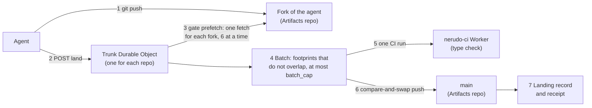

The chart shows the path of one change. The steps and their times on Cloudflare:

| Step | What occurs | Time on Cloudflare | Source |
|---|---|---|---|
| 1 | The agent pushes its commit to its own fork. | 233 to 336 ms (p50) | [`repos.md`](repos.md#results) |
| 2 | The agent asks the Trunk object to land the change. | 73 to 124 ms (p50) | [`repos.md`](repos.md#results) |
| 3 | The gate gets the queued commits: one fetch for each fork, up to 6 fetches at the same time. | 270 to 350 ms for each fetch | [`stages.md`](stages.md#summary) |
| 4 | The sequencer picks a batch. | Little CPU | [`stages.md`](stages.md#summary) |
| 5 | One type check for the batch, if `nerudo.toml` has `[ci] typecheck`. | 0.1 to 2.3 s | [`ci.md`](ci.md#the-time-of-one-check) |
| 6 | One push moves `main` from the old tip to the new tip. | 0.4 to 0.9 s for a batch of 16 | [`stages.md`](stages.md#summary) |
| 7 | One atomic write records the landings. The receipt says `landed`. | Little CPU | [`stages.md`](stages.md#summary) |

At 1 change each second or less, a change lands alone in approximately 650 ms
([`repos.md`](repos.md#the-limit-of-one-trunk)).

## How a read finds its repo

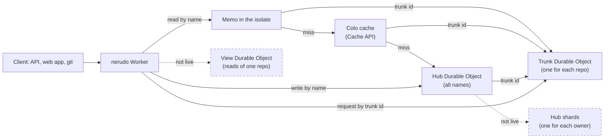

The chart shows the path of a request by name to the Trunk object. The dashed parts are not
live.

| Part | What it does | Live | Source |
|---|---|---|---|
| Memo in the isolate | Keeps the Hub record of each name. A public record lives 30 s. A private record and "no such name" live 3 s. Only reads use it. | Yes | [`hub-next.md`](hub-next.md#what-changed) |
| Colo cache | The Cache API of the colo. All isolates in one colo share it. It divides the Hub load of the memo by 2 to 9. | Yes | [`hub-next.md`](hub-next.md#the-colo-layer) |
| Hub | One object for all names. It gets each write by name and each read that misses both layers. | Yes | [`hub.md`](hub.md#the-cause) |
| View | A second object for each repo that serves `stats`, `queue` and receipts. Then the Trunk object only lands changes. | No: branch `reads-split` | `cf/scale/reads.md` on branch `reads-split` |
| Hub shards | One object for each owner (an org or a user). | No: a design only | [`hub-next.md`](hub-next.md#split-the-hub-a-design-not-code) |

## Results

### Many repos at once

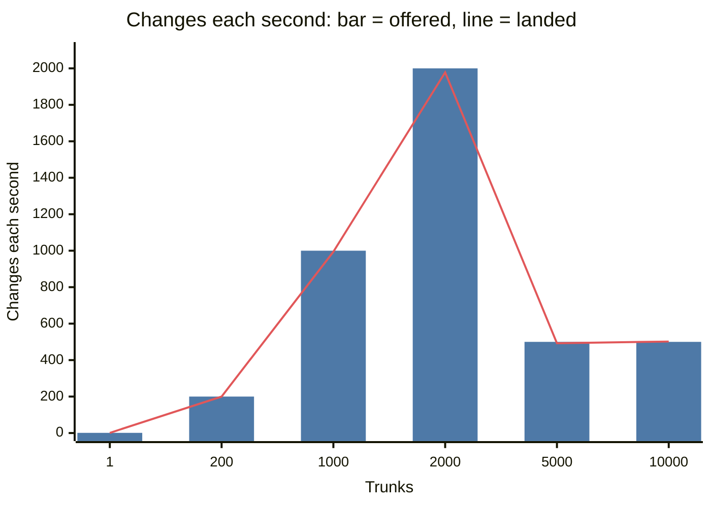

The landed rate follows the offered rate at each step. At 5,000 and 10,000 trunks, each
trunk got fewer changes (0.1 and 0.05 each second), so that the account stayed below the
limit of Artifacts. The driver ran inside Cloudflare, because the edge blocks one IP address
at approximately 2,000 requests each second.

| Trunks | Offered to each trunk | Offered | Landed each second | Landed ÷ offered | p50 latency |
|---|---|---|---|---|---|
| 1 | 1 each second | 1 | 1.00 | 1.00 | 675 ms |
| 200 | 1 each second | 200 | 200.0 | 1.00 | 640 ms |
| 1,000 | 1 each second | 1,000 | 994.3 | 0.99 | 660 ms |
| 2,000 | 1 each second | 2,000 | 1,977.9 | 0.99 | 700 ms |
| 5,000 | 0.1 each second | 500 | 492.5 | 0.98 | 745 ms |
| 10,000 | 0.05 each second | 500 | 501.9 | 1.00 | 970 ms |

Source: [`10k.md`](10k.md#result),
[`../evidence/scale-10k-20261012.json`](../evidence/scale-10k-20261012.json). The 200-trunk
run from one computer gave the same result: 199.99 landings each second, p50 641 ms
([`repos.md`](repos.md#result),
[`../evidence/scale-repos-20261012.json`](../evidence/scale-repos-20261012.json)).

Notes on the table:

- The 2,000-trunk run stopped after 131 s. Its window is 30 s to 120 s, before the failures.
  The evidence summary uses a window to 135 s, with the failures: 1,934.7 each second (0.97).
- At 1,000 and 2,000 trunks, the missing 0.6% to 1% came from slow pushes of the agents to
  their forks, not from Nerudo ([`10k.md`](10k.md#late-agents)).
- Each change that Nerudo accepted landed once, except 2 changes that the gate ejected at
  2,000 trunks (`fetch returned no packfile`). The freeze build keeps such a change queued
  ([`freeze.md`](freeze.md#contents), commit `0730147`).
- `nerudo verify` passed on 120 sampled trunks.

A quiet trunk landed slower when its history was longer. At 10,000 trunks, each trunk got 1
change each 20 s:

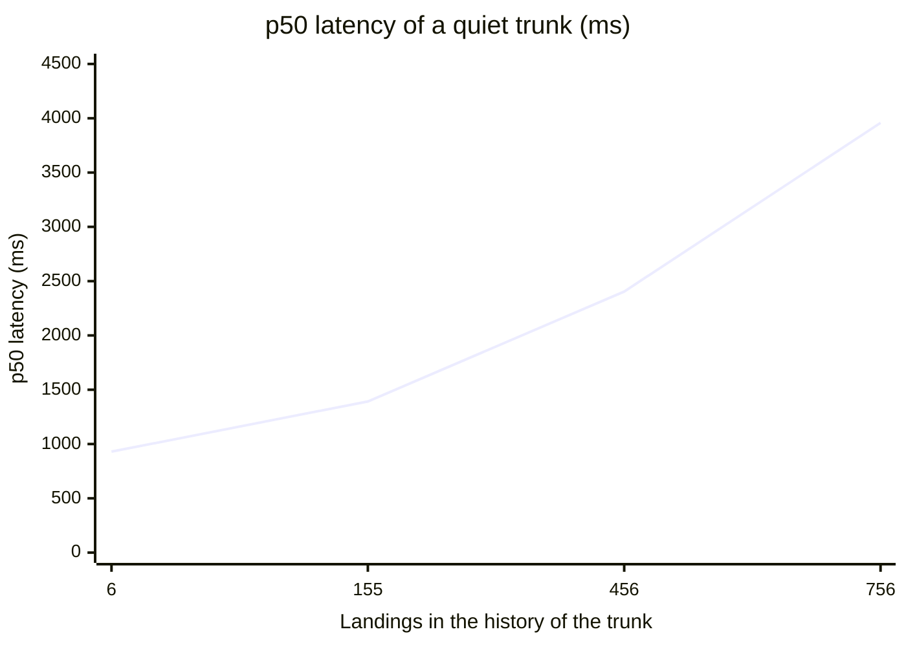

| Landings in the history | 6 | 155 | 456 | 756 |
|---|---|---|---|---|
| p50 latency (ms) | 930 | 1,392 | 2,404 | 3,958 |

The probable cause is a hypothesis: a Trunk object that is not in memory fetched all of
the history of `main`. The trunk read at depth 1 of the large-repo work does not fetch the
history, and that build is live now. But nobody measured this latency on the live build.
The repos of the 10,000-trunk test are deleted ([`10k.md`](10k.md#result), result 5).

A call to the Artifacts binding kept a Trunk object in memory, and billed, for 11 minutes
or more. Commit `34d2439` disposes the results of binding calls. To make 800 trunks cost
48,360 GB-s before the fix. To make 1,000 trunks cost 1,665 GB-s after it
([`10k.md`](10k.md#idle-trunks-stayed-billed-after-a-binding-call)).

### One repo: the gate prefetch

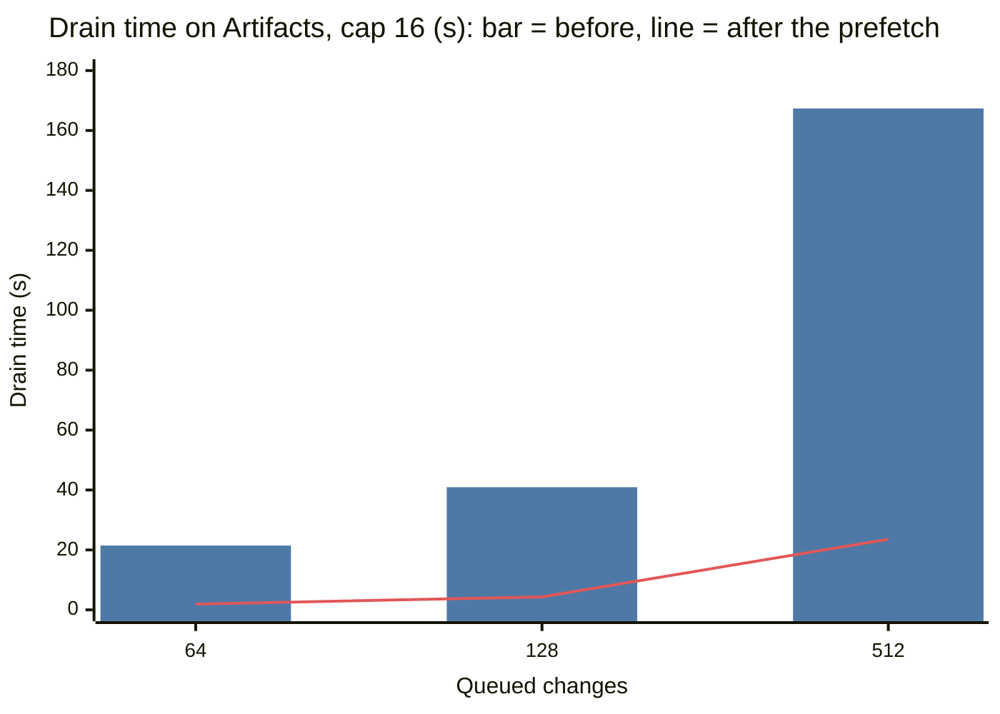

Before the fix, the gate fetched each queued change with its own request, one request after
the other. Each fetch took approximately 300 ms on Artifacts. Now the gate asks each fork
once for all of its queued commits, and it asks up to 6 forks at the same time. The drain
time decreased by a factor of 7 to 14. After the fix, the push sets the rate.

| Queued changes | Batch cap | Drain before (s) | Drain after (s) | First landing before (s) | First landing after (s) | Fetch requests before | Fetch requests after |
|---|---|---|---|---|---|---|---|
| 64 | 16 | 21.46 | 1.91 | 19.92 | 0.79 | 64 | 4 |
| 128 | 16 | 40.93 | 4.33 | 37.50 | 0.93 | 128 | 4 |
| 512 | 16 | 167.35 | 23.56 | 143.47 | 1.35 | 512 | 4 |
| 128 | 64 | 37.66 | 2.08 | 36.62 | 1.11 | 128 | 4 |
| 512 | 64 | 163.86 | 12.01 | 152.92 | 1.79 | 512 | 4 |

Source: [`stages.md`](stages.md#before-and-after),
[`../evidence/scale-stages-20261012.json`](../evidence/scale-stages-20261012.json). Each
burst had 4 forks and no CI.

At 512 changes, the rate is now 21.7 changes each second at cap 16 and 42.6 at cap 64.
Before, it was 3.1. Runs at 512 changes vary by several seconds: 20 to 30 s for the same
burst ([`stages.md`](stages.md#limits)).

The same burst of 512 changes on the later builds: 17.8 s on the build with the large-repo
store, and 22.1 s with step 3 of mono-next ([`mono.md`](mono.md#step-3-the-ui-release-notes-plain-git-push-and-import)).

### Big repos

All memory values in this section are the reported `wasm_memory_bytes` peak. They
exclude other JavaScript/V8/isolate allocations and are not a total RAM measurement.

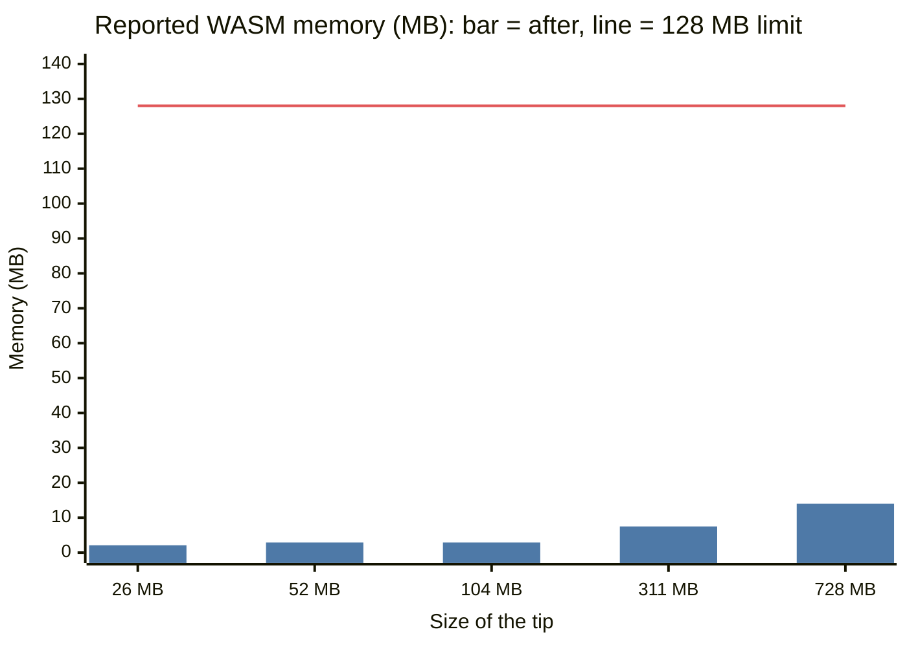

Before the change, the sequencer read all of the history and all files of `main` into
memory. A tip of 26 MB used 76 MB, and a tip of 52 MB or more reset the isolate. Now the
sequencer reads one commit and its trees. It reads a file only when a landing needs it. The
memory follows the number of files and directories, not their size.

| Repo | Files | Tip | Memory before | Memory after | One landing after | Batch of 5 after |
|---|---|---|---|---|---|---|
| m25 | 5,026 | 25.9 MB | 76 MB | 2.1 MB | 2.3 s | 7.4 s |
| m50 | 10,026 | 51.9 MB | Fails | 2.9 MB | 3.5 s | 8.9 s |
| m100 | 10,026 | 104 MB | Fails | 2.9 MB | 2.7 s | 7.5 s |
| m300 | 50,026 | 311 MB | Not tried | 7.5 MB | 5.1 s | 15.1 s |
| m700 | 70,026 | 728 MB | Not tried | 14 MB | 6.6 s | 19.3 s |
| d120k (lazy mode) | 120,026 | 57 MB | Not tried | 1.8 MB | 10.7 to 11.4 s | 16.1 s (batch of 3) |

Source: [`mono.md`](mono.md#before-and-after),
[`../evidence/scale-mono-20261012.json`](../evidence/scale-mono-20261012.json), and for
d120k [`mono.md`](mono.md#step-2-trees-one-at-a-time-through-the-binding),
[`../evidence/scale-mono-next-20261012.json`](../evidence/scale-mono-next-20261012.json).

Artifacts answers HTTP 500 to each git fetch of a tree with approximately 120,000 files in
19,200 directories. In lazy mode, the sequencer reads such a tree through the Artifacts
binding, one tree object at a time. It keeps each object in its storage. On the freeze
build, m700 landed one change in 5.8 s with 13.6 MB of memory. d120k landed one change in
10.6 s with 1.9 MB ([`freeze.md`](freeze.md#tests-of-this-merge)).

### The Hub

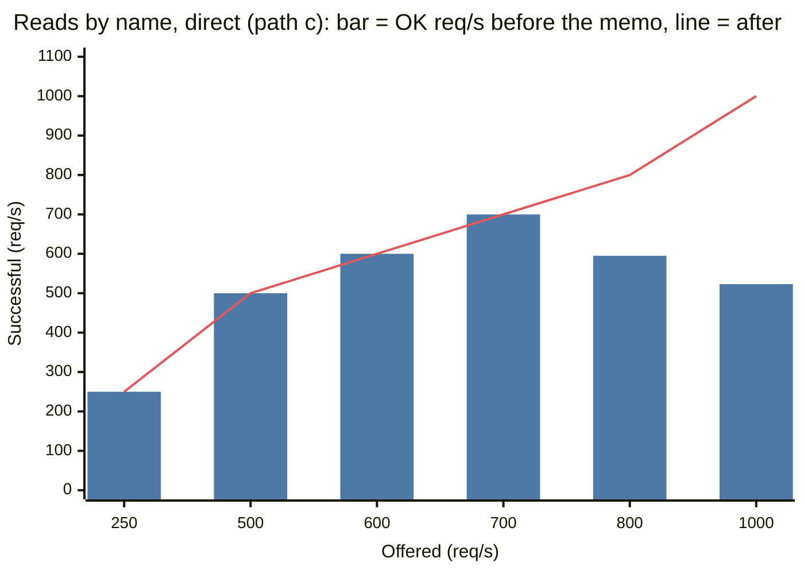

Before the memo, each request by name asked the one Hub object for the trunk id. The Hub
served approximately 600 requests each second. Above that, the runtime refused requests,
and the Worker gave HTTP 500. With the memo, the Hub got 0.02 requests for each request by
name, not 0.90 to 1.0.

| Offered (req/s) | 250 | 500 | 600 | 700 | 800 | 1,000 |
|---|---|---|---|---|---|---|
| Successful before the memo (req/s) | 250 | 500 | 600 | 700 | 595 | 523 |
| Successful after the memo (req/s) | 250 | 500 | 600 | 700 | 800 | 1,000 |
| p95 after the memo (ms) | 65 | 66 | 68 | 62 | 80 | 74 |

Source: [`hub.md`](hub.md#all-steps),
[`../evidence/scale-hub-20261012.json`](../evidence/scale-hub-20261012.json). Through the
driver inside Cloudflare, reads by name then served 2,000 requests each second with no
error. At 4,000, 2,722 succeeded: the same as requests by trunk id with no Hub (2,737).
Thus the Trunk objects are now the limit, not the Hub.

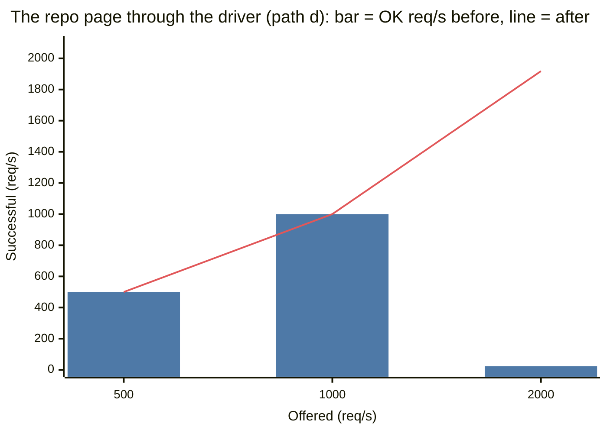

The repo page of the web app read the Hub on each view. Now the memo keeps the Hub record of
the repo, and the colo cache shares it in each colo. The Hub got 0.0002 to 0.0005 requests
for each view, not 1.0.

| Offered (req/s) | 500 | 1,000 | 2,000 | 4,000 |
|---|---|---|---|---|
| Successful before (req/s) | 499 | 1,000 | 23 | Not tested |
| Successful after (req/s) | 500 | 1,000 | 1,918 | 2,374 |

Source: [`hub-next.md`](hub-next.md#all-steps),
[`../evidence/hub-next-20261012.json`](../evidence/hub-next-20261012.json). The driver
gives harder load than a direct client at the same rate, so do not compare the two charts.
At 4,000 requests each second after the change, busy trunks answered HTTP 503 for their own
repos only. Before, the Hub failed at 2,000 for all repos.

### CI

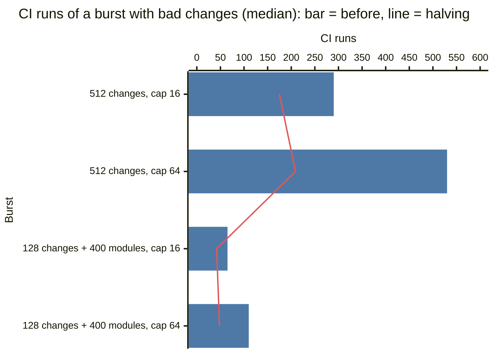

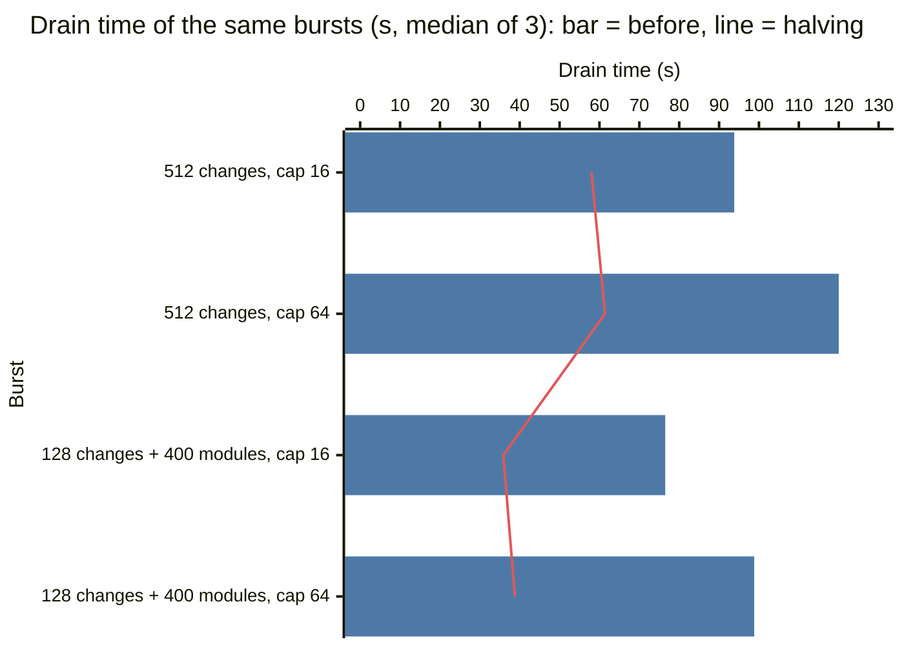

When the type check of a batch fails, the sequencer must find the change that broke it.
Before, it checked each prefix of the batch in order. Now it halves the range (change 1 of
`ci.md`), so it checks at most 4 prefixes at cap 16 and 6 at cap 64. In these bursts, 5%
of the changes had a type error.

| Burst | Batch cap | CI runs before | CI runs after | Drain before (s) | Drain after (s) |
|---|---|---|---|---|---|
| 512 changes, 26 bad | 16 | 290 | 175 | 93.8 | 58.0 |
| 512 changes, 26 bad | 64 | 530 | 209 | 120.0 | 61.4 |
| 128 changes, 6 bad, 400 more modules | 16 | 65 | 42 | 76.5 | 35.9 |
| 128 changes, 6 bad, 400 more modules | 64 | 110 | 48 | 98.8 | 38.8 |

Source: [`ci.md`](ci.md#three-runs-of-the-main-cases),
[`../evidence/scale-ci-20261012.json`](../evidence/scale-ci-20261012.json). The values are
medians of 3 runs.

One check through the service binding took approximately 0.1 s for a small project, 1.2 s
for 400 modules and 2.3 s for 800 modules. The CPU of one check changed by up to 2 times
between runs. Changes 2 and 3 of `ci.md` decrease the pushes (44 to 32 and 26 to 9). They
are not live.

### Faults

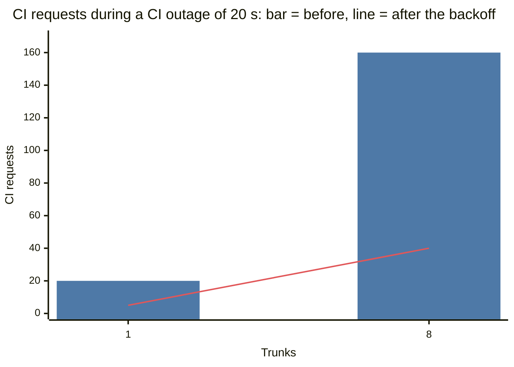

Before, the landing loop tried again each second. Now, after a failed run, it waits 1 s, 2
s, 4 s and more, to at most 30 s. The queue shows a `stall` field with the cause. The cost
is a slower recovery: the changes land when the next try comes.

| Check | Before | After |
|---|---|---|
| CI requests in an outage of 20 s, 1 trunk | 20 | 5 (budget 8) |
| CI requests in an outage of 20 s, 8 trunks | 160 | 40 |
| Time to land after CI is available again | 0.7 to 1.3 s | 13 to 19 s |
| Second CI request when each request hangs 45 s | After 46 s | After 26 s (deadline 25 s) |
| A git host that holds the connection open for 40 s | The loop waits for the full fault. The queue shows nothing. | The request stops at 30 s. The queue shows `git_unavailable`. |
| Fault harness, all cases | 81 passes, 6 known gaps | 100 passes, 0 known gaps |

Source: [`resilience.md`](resilience.md#results-of-the-fault-tests),
[`../evidence/faults-20261012-resilience.json`](../evidence/faults-20261012-resilience.json),
[`../faults/README.md`](../faults/README.md#results-on-2026-10-12),
[`../evidence/faults-20261012-103449.json`](../evidence/faults-20261012-103449.json). On
Cloudflare, a CI outage of 90 s gave 7 failed tries, and an overloaded Hub gave HTTP 503
with `Retry-After: 1`, not HTTP 500
([`../evidence/resilience-cloudflare-20261012.json`](../evidence/resilience-cloudflare-20261012.json)).

### Reads on the Trunk object (not live)

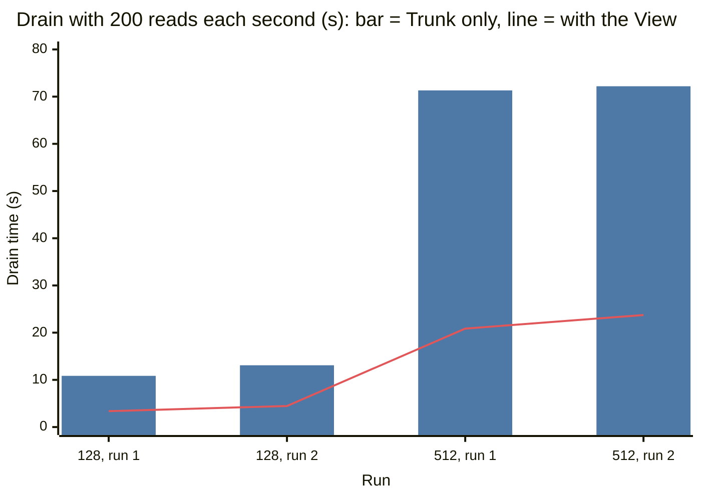

A Durable Object runs one event at a time. Before the View, 200 reads each second on one
trunk made its merges 2.4 to 3.7 times slower. With the View, the readers did not slow the
merges. The drain time with readers was in the range of the drain time with no readers: 3.9
to 5.5 s at 128 changes, and 19.3 to 27.7 s at 512.

| Queued changes | Drain with readers, Trunk only (s) | Drain with readers, with the View (s) | Read p50, Trunk only (ms) | Read p50, with the View (ms) |
|---|---|---|---|---|
| 128 | 10.85, 13.09 | 3.37, 4.46 | 391 to 428 | 51 to 79 |
| 512 | 71.32, 72.20 | 20.86, 23.73 | 654 to 772 | 50 to 63 |

Source: `cf/scale/reads.md` and `cf/evidence/scale-reads-20261012.json` on branch
`reads-split`. These files are not in this tree. The View is not in the live build.

## Recorded deployment and current source

The historical campaign recorded Worker version `9f91490a`, branch `freeze` at
`52f21d9`, plus a then-uncommitted patch to `hub.rs` and `trunk/app.rs`. This is not
a statement of the deployment that is serving today. A source checkout does not
confirm a deployed version. [SUBMISSION.md](../../SUBMISSION.md) separates the current
source candidate from the deployment verification; [freeze.md](freeze.md#contents)
preserves the original build record.

| Work | Source/campaign status | Document |
|---|---|---|
| The gate prefetch: one fetch for each fork, 6 at a time | Recorded in the historical deployment | [`stages.md`](stages.md#the-fix) |
| Stage timings of each round (`GET .../timings`) | Recorded in the historical deployment | [`stages.md`](stages.md#measurements-in-the-worker) |
| The memo of names, then of Hub records, and the colo cache | Recorded in the historical deployment | [`hub.md`](hub.md#the-memo-of-names), [`hub-next.md`](hub-next.md#what-changed) |
| The trunk read at depth 1 with trees only, and lazy trees through the binding | Recorded in the historical deployment | [`mono.md`](mono.md#the-design) |
| Deadlines, the backoff, the `stall` field, the same push again, HTTP 503 on overload | Recorded in the historical deployment | [`resilience.md`](resilience.md#the-rule) |
| The disposal of Artifacts binding results | Recorded in the historical deployment | [`10k.md`](10k.md#idle-trunks-stayed-billed-after-a-binding-call) |
| The search that halves a failed batch (change 1) | Recorded in the historical deployment | [`ci.md`](ci.md#1-find-the-culprit-by-halving-10c3a6e) |
| A fetch with no packfile keeps the change queued | Recorded in the historical deployment | [`freeze.md`](freeze.md#contents) |
| The body fix of `to_trunk` and the metric points | Present in source; the historical deployment had no `METRICS` binding and wrote no metric points. | [`freeze.md`](freeze.md#contents) |

## Work outside the historical freeze

| Work | Where | Why |
|---|---|---|
| Changes 2 and 3 of the CI work: apply the rest of the batch again, and check the next batch during the push | Branch `ci-queue`, [`ci.md`](ci.md#the-freeze) | The gain was not larger than the spread between runs. They need more runs. |
| The View object for reads | Branch `reads-split`, `cf/scale/reads.md` | Not merged before the freeze |
| The split of the Hub | [`hub-next.md`](hub-next.md#split-the-hub-a-design-not-code) | A design only. It changes the storage of the live Worker and needs a migration. |
| The `METRICS` binding, the SLOs and the alert Worker | [`ops.md`](ops.md), [`slo.md`](slo.md) | The freeze build has the code but no binding, so the metric points write nothing. Nobody deployed the alert Worker. |
| Stale branches and terminal/ordered PR revisions (T-7/T-8/T-9) | Current source; [`backlog.md`](backlog.md), [`branches-fix.md`](branches-fix.md) | Implemented and tested after the historical freeze rollback. Verify the deployed version separately. |
| A window of the queue for the gate, and a larger batch cap | [`stages.md`](stages.md#proposals-that-this-work-does-not-do) | Proposals only |

## Limits

| Limit | Value | Source |
|---|---|---|
| Git requests of one Artifacts account | Pushes failed in bursts (HTTP 503 and 500) at approximately 5,000 to 10,000 git requests each second. Each change made 5 git requests (2 for the push to the fork, 1 fetch by the gate, 2 for the push to `main`). These samples reached 1,000 to 2,000 landings each second before or during failures. This is an observed range, not an official quota; the cause is not known. Nobody asked Cloudflare. | [`10k.md`](10k.md#errors) |
| Git requests of one Artifacts repo | 2,000 for each 10 s (documented) | [`mono.md`](mono.md#limits-of-artifacts) |
| Size of one Artifacts repo | 1 GB for each repo, 32 MB for each file (documented). A git fetch fails at approximately 120,000 files in 19,200 directories. A push of 1,000,026 files fails. | [`mono.md`](mono.md#limits-of-artifacts) |
| A push or a fork of a big repo | A push to d120k takes 7 s. A fork of a big repo takes 1 to 5 minutes. | [`mono.md`](mono.md#what-remains-after-mono-next) |
| One trunk, no CI | The push sets the rate: 0.4 to 0.9 s for each batch of 16. That is 21.7 changes each second at cap 16 in a burst. Conflicts and CI make it lower. | [`stages.md`](stages.md#before-and-after) |
| Requests to one Durable Object | Approximately 250 to 350 simple reads each second for one Trunk object. Approximately 600 lookups each second for the Hub. | [`hub.md`](hub.md#the-trunk-objects) |
| Floods of different unknown names | They still go to the Hub. The Hub limit for them is between 1,000 and 2,000 requests each second. | [`hub-next.md`](hub-next.md#unknown-names) |
| Load from one computer | The Cloudflare edge blocked one IP address at approximately 2,000 requests each second. | [`hub.md`](hub.md#the-edge-limit) |
| Cost of a landing | Approximately 19.7 storage rows written for each landed change, the largest cost of the Durable Objects. Starting on 2026-10-14, Artifacts bills $0.15 for each 1,000 operations: the historical estimate is $135–225 per 300,000 changes before repository storage and other services. Requests versus billed operations were not reconciled. | [`10k.md`](10k.md#cost) |

Limits of the tests:

- One client location. Cloudflare probably put most objects in one region.
- The changes came at fixed intervals. They did not overlap, so there were no conflicts.
- Most conditions ran one time. Runs on Artifacts vary: 20 to 30 s for the same burst of
  512 changes.
- Nobody measured the latency of quiet trunks with a long history on the build with the
  trunk read at depth 1.
- The analytics of Cloudflare are estimates from samples.

## Cost

| Test | Cost at list price | Source |
|---|---|---|
| 200 trunks | $2.30 or less | [`repos.md`](repos.md#cost) |
| The Hub | Approximately $0.90 | [`hub.md`](hub.md#cost) |
| The Hub records and the colo cache | Approximately $1.50 | [`hub-next.md`](hub-next.md#cost) |
| 1,000 to 10,000 trunks | Approximately $19 to $20 | [`10k.md`](10k.md#cost) |

The other documents do not give a complete cost per useful landing. Included Workers
Paid allowances are not subtracted. The campaign ran before Artifacts billing started
on October 14, 2026. At $0.15 per 1,000 operations and $0.50 per GB-month, operation
and repository/fork storage charges must be added, along with actual Worker CPU,
Durable Object execution/storage, retries, model inference and runtime CI. See
[official pricing](https://developers.cloudflare.com/artifacts/platform/pricing/) and
[the historical operation-accounting range](10k.md#cost).

## Next steps

1. Ask Cloudflare about the limit of an Artifacts account, and about the HTTP 500 for a big
   tree.
2. Find the cause of the bare HTTP 500 answers of `land`: 3 in the 10,000-trunk test, and
   248 in one burst of the ops test ([`ops.md`](ops.md#results)).
3. Do more runs of changes 2 and 3 of the CI work on one trunk object. Then ship them
   ([`ci.md`](ci.md#later-steps)).
4. Merge the View, and then move the app state and git clones off the Trunk object
   (`cf/scale/reads.md` on branch `reads-split`).
5. Write the split of the Hub into code, with its migration
   ([`hub-next.md`](hub-next.md#migration-of-the-keys-of-today)).
6. Add the `METRICS` binding, and deploy the alert Worker
   ([`ops.md`](ops.md#turn-the-metrics-on), [`slo.md`](slo.md#the-alert-worker)).

## Related work

- The older contention bench measured one repo with synthetic agents and a Zipf workload: 52.5
  landings each minute at 8 agents, with 0 broken commits on `main`
  ([`../README.md`](../README.md#measured)).
- The work of this campaign is on the live repo `nerudo/nerudo` as 21 PRs. At the end of
  that run, 20 of them had merged, and the release v0.2.0 waited for a signature
  ([`dogfood.md`](dogfood.md)). The notes to sign are in
  [`release-v0.2.0.md`](release-v0.2.0.md).

## Documents and evidence

| Document | Topic | Evidence |
|---|---|---|
| [`repos.md`](repos.md) | 1 to 200 trunks from one computer | [`scale-repos-20261012.json`](../evidence/scale-repos-20261012.json) |
| [`10k.md`](10k.md) | 1,000 to 10,000 trunks from a driver inside Cloudflare | [`scale-10k-20261012.json`](../evidence/scale-10k-20261012.json) |
| [`stages.md`](stages.md) | The stages of the landing loop, and the gate prefetch | [`scale-stages-20261012.json`](../evidence/scale-stages-20261012.json) |
| [`mono.md`](mono.md) | Big repos | [`scale-mono-20261012.json`](../evidence/scale-mono-20261012.json), [`scale-mono-combined-20261012.json`](../evidence/scale-mono-combined-20261012.json), [`scale-mono-next-20261012.json`](../evidence/scale-mono-next-20261012.json) |
| [`hub.md`](hub.md) | The Hub and the memo of names | [`scale-hub-20261012.json`](../evidence/scale-hub-20261012.json) |
| [`hub-next.md`](hub-next.md) | The memo of records, the colo cache, the split of the Hub | [`hub-next-20261012.json`](../evidence/hub-next-20261012.json) |
| [`ci.md`](ci.md) | CI as the limit of one trunk | [`scale-ci-20261012.json`](../evidence/scale-ci-20261012.json) |
| [`resilience.md`](resilience.md) | Deadlines, the backoff and stalls | [`faults-20261012-resilience.json`](../evidence/faults-20261012-resilience.json), [`resilience-cloudflare-20261012.json`](../evidence/resilience-cloudflare-20261012.json), [`faults-20261012-git_hang-before.json`](../evidence/faults-20261012-git_hang-before.json) |
| [`freeze.md`](freeze.md) | The freeze build and its tests | [`freeze-20261012.json`](../evidence/freeze-20261012.json), [`faults-20261012-freeze.json`](../evidence/faults-20261012-freeze.json), [`faults-20261012-freeze-mono.json`](../evidence/faults-20261012-freeze-mono.json) |
| [`../faults/README.md`](../faults/README.md) | The local fault harness | [`faults-20261012-103449.json`](../evidence/faults-20261012-103449.json), [`faults-20261012-fixes.json`](../evidence/faults-20261012-fixes.json), [`faults-20261012-growth512.json`](../evidence/faults-20261012-growth512.json) |
| [`ops.md`](ops.md) | Metrics, the test of the SLOs and the alerts, the CI workflow, the flake of `approvals` | [`ops-20261012.json`](../evidence/ops-20261012.json) |
| [`slo.md`](slo.md) | The SLOs, the queries, the report and the alert Worker | [`ops-20261012.json`](../evidence/ops-20261012.json) |
| [`dogfood.md`](dogfood.md) | The work of the campaign as tasks, PRs and a release on `nerudo/nerudo` | [`dogfood-20261012.json`](../evidence/dogfood-20261012.json) |
| [`release-v0.2.0.md`](release-v0.2.0.md) | The notes of release v0.2.0, for the signature | None |
| [`backlog.md`](backlog.md) | T-8 and T-9: the revisions of a pull request (not live) | [`faults-t8-t9-20261012.json`](../evidence/faults-t8-t9-20261012.json) |
| [`branches-fix.md`](branches-fix.md) | The branches view and the web UI's copy of trunk on a big repo | [`ui-memory-20261012.json`](../evidence/ui-memory-20261012.json), [`branches-fix-gates-20261013.json`](../evidence/branches-fix-gates-20261013.json) |
| [`docs-review.md`](docs-review.md) | The review of these documents for Simplified Technical English | None |

This document is on another branch, not in this tree:

| Document | Branch | Topic |
|---|---|---|
| `cf/scale/reads.md` | `reads-split` | The View object (not shipped) |
