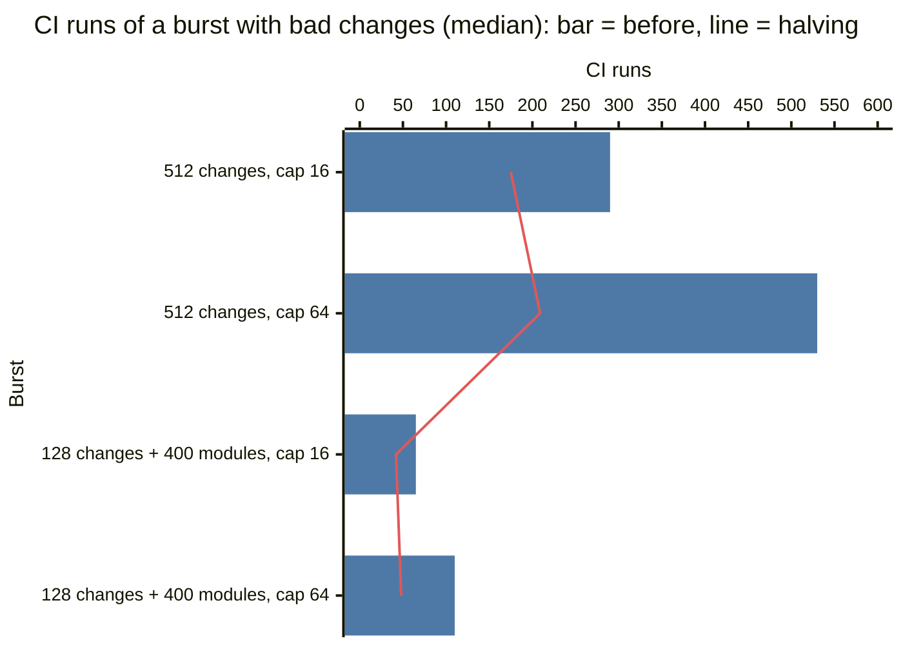
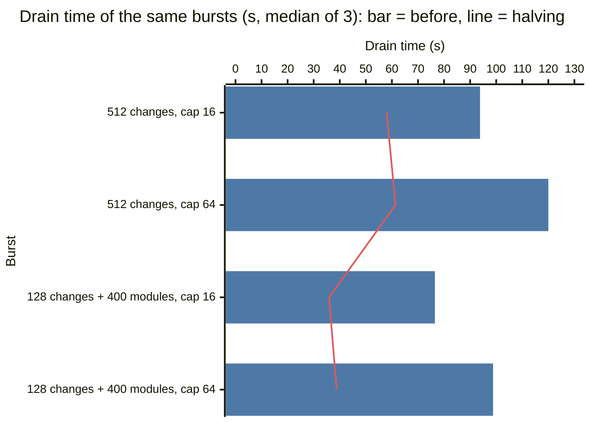

> In this build (branch `freeze`), only change 1 (find the culprit by halving, `trunk/culprit.rs`) is present. Changes 2 and 3 are not.

# CI as the limit of one trunk

This document tells how the type check (`[ci] typecheck` in `nerudo.toml`) limits the
landing rate of one trunk. It gives the time of one check on Cloudflare, and the drain time
of bursts with and without type errors. It also gives three changes to the landing loop, and the
results before and after them. Then it tells which parts are safe to ship before the freeze.

All runs are from 2026-10-12, on Cloudflare with Artifacts. The data is in
[`../evidence/scale-ci-20261012.json`](../evidence/scale-ci-20261012.json).

## Summary

- One check through the `CI` service binding took approximately 0.1 s for a small project
  and 0.5 s for 200 modules. It took approximately 1.2 s for 400 modules and 2.3 s for 800 modules. The README gives
  40 to 50 ms and 210 to 280 ms: those numbers are from local workerd.
- Checks sent at the same time gave no consistent gain. Four checks of 400 modules took 4.4
  to 5.6 s at the same time, and 2.6 to 4.2 s one after the other. Six checks of 400 modules took 7.3 to 8.0 s
  at the same time, and 3.7 to 6.2 s one after the other. The CI Worker runs on the same thread as its caller. Thus this work does
  not send the checks of a search at the same time.
- A check runs while its caller waits on I/O. A check of 400 modules and a wait of 800 ms took
  1.15 s together (median), not 1.7 s.
- Before the changes, a batch with a type error cost many CI runs and one more push. The
  sequencer checked each prefix of the batch in order (up to n-1 runs). It left the
  changes after the culprit for a new round. With 5% bad changes, a burst of 512 changes took
  65 to 98 s at batch cap 16 (35 s with no bad change). At cap 64, it took 120 to 125 s (15 s
  with no bad change).
  With 400 more modules in the project, 128 changes took 47 to 118 s (5 to 24 s with no bad
  change).
- Change 1 halves the range to find the culprit: at most ceil(log2(n)) prefix checks. Change
  2 ejects the culprit, applies the changes after it again, and checks the new tip, so one
  push carries the batch. Change 3 checks the next batch while the push of this batch waits.
- With 5% bad changes and 512 changes, change 1 decreased the CI runs from 290 to 175 at cap
  16. At cap 64, it decreased them from 530 to 209. The median drain of three runs decreased from 94 s to 58 s
  and from 120 s to 61 s. With 400 more modules (128 changes), it decreased from 77 s to 36 s
  and from 99 s to 39 s.
- Changes 2 and 3 decreased the pushes to one for each full batch (44 to 32, 26 to 9). In
  these runs, they did not decrease the drain by more than the spread between runs. That spread is
  up to ×2: the CPU of one check changed from 0.5 s to 1.1 s between bursts of the same build.
- Safe for the freeze: change 1 only. See [The freeze](#the-freeze).

## Method

### The Workers

| Worker | Contents |
|---|---|
| `nerudo-scale-ciq` | The nerudo Worker of this branch, deployed only for these tests. Artifacts namespace `nerudo-scale`. Its `CI` binding goes to `nerudo-ci-scale`. |
| `nerudo-ci-scale` | A copy of `nerudo-ci` for the scale tests. Other agents also used it. |
| `nerudo-scale-ciq-driver` | `ci_driver.js`, deployed only for the latency tests and then deleted. Its `CI` binding goes to `nerudo-ci-scale`. |

The tests measured four builds of `nerudo-scale-ciq`: before (`128b641`), change 1 (`bda6db4`),
changes 1 and 2 (`82adb3a`), and all three changes (`66daa45`). Build `bda6db4` has the same code as `10c3a6e`. The
first version of change 3 (`9b789c8`) ran 12 bursts; they are in the evidence file. The live
Worker and the live `nerudo-ci` got no load.

### Bursts

`ci.py` makes each burst on a new trunk:

1. The seed is the bench tree, `tsconfig.json` (strict), `src/price.ts`, `src/index.ts` and
   `[ci] typecheck = { tsconfig = "tsconfig.json" }`. With `--files M`, the seed also has M
   modules of approximately 1 KB (`src/mod/m<i>.ts`). Each module imports the module before
   it.
2. 4 agents, each with a fork. The script pauses the trunk.
3. N changes. Each change adds `src/changes/<id>.ts`, so no two changes overlap. A bad change
   adds `export const <id>: number = 'bad';` (TS2322). The bad changes are a random sample of
   round(N × rate) changes, at least 1 when the rate is not 0.
4. The land requests go 16 at a time, so the queue order is random. Thus the position of a
   bad change in its batch is random.
5. The script resumes the trunk and waits until the queue is empty.

Each burst checks that the sequencer ejects each bad change as `ci_failed`. It also checks that each other change
lands, and that no change is in the log two times. All bursts passed these checks.

The drain is from the first alarm to the last landing record, on the clock of the Worker.
"Fetch" is the fetch of the gate in the first round (all queued commits from 4 forks). It
took 0.4 to 1.3 s, and it is not part of CI.

### Two effects in the fixture

- The checked project grows during a burst. Each landed change adds one `.ts` file, so the
  last check of a burst of 512 reads approximately 515 files, not 3. A check late in a burst
  thus takes more time than a check early in it.
- All changes add a file to one directory. Each commit has a new tree for that directory. Thus
  the pack of a batch grows during the burst: from 5 KB to 760 KB at cap 64 and 512 changes.
  This is the hot directory of [`stages.md`](stages.md).

### The clock

The clock of a Worker moves only at I/O. The CI Worker runs on the same thread as the trunk
object, and a check through the service binding does not move the clock. Thus `ci_ms` in
`GET .../timings` is near 0 on Cloudflare. The time of the checks shows in the next stage
that waits on the network, usually `push_ms`. The drain time is correct. Each round now also
records `ci_runs`, the number of checks in the round.

### Spread

The time of one check changed by up to ×2 from burst to burst. In one burst with 400 modules,
`wrangler tail` of `nerudo-ci-scale` showed 0.96 to 1.56 s of CPU for each check. The burst had 25 checks
(one at 2.5 s, all `ok`, no memory errors). In other bursts with the same project, the drain
tells 0.65 s for each check. A trunk object and its checks run on one machine, so the speed
of that machine is a probable cause. Other agents also used `nerudo-ci-scale`.

Thus the
tables give the CI runs and the pushes, which do not depend on the speed. For the main cases,
they also give the drain of three runs.

## The time of one check

`ci_latency.py` sent one request at a time to the driver Worker, from this computer. A request
that does nothing took 114 to 134 ms (median 118 ms). "Check" is the median minus 118 ms. Each
size had one warm-up request, then 5 requests.

| Files in the project | Request body (KB) | Request (ms) | Median (ms) | Check (ms) |
|---|---|---|---|---|
| 3 | 0.4 | 179–581 | 201 | 83 |
| 13 | 7 | 208–451 | 230 | 112 |
| 53 | 35 | 268–579 | 477 | 359 |
| 103 | 69 | 458–603 | 583 | 465 |
| 203 | 140 | 481–856 | 611 | 493 |
| 403 | 282 | 918–1,565 | 1,284 | 1,166 |
| 803 | 564 | 1,490–2,880 | 2,389 | 2,271 |

A tree with a type error took the same time: 309 ms (13 files) and 756 ms (403 files),
median.

### Checks at the same time

One request made k checks of the same project, one after the other or all at the same time.
Times are for the full request, in ms, 3 requests each.

| Files | k | One after the other | At the same time |
|---|---|---|---|
| 13 | 2 | 355–701 (406) | 449–959 (694) |
| 13 | 4 | 543–573 (546) | 830–1,359 (1,106) |
| 13 | 6 | 1,066–4,590 (1,822) | 995–1,146 (1,080) |
| 403 | 2 | 1,796–2,842 (2,629) | 1,546–2,987 (1,713) |
| 403 | 4 | 2,614–4,189 (3,769) | 4,374–5,590 (4,652) |
| 403 | 6 | 3,689–6,151 (4,398) | 7,345–7,984 (7,347) |

Checks at the same time gave no consistent gain. They were faster in 2 of the 6 cases (13
files at k = 6, 403 files at k = 2). They were slower in 4, and much slower with 403 files at k = 4 and 6.

In the first driver run, the clock inside the driver showed 0 ms for some checks. The check
ran on the thread of the driver, with no I/O. Thus a search that sends several prefix checks
at the same time does not save time. This work does not do it.

### A check during an I/O wait

One request made one check and a timer of 800 ms at the same time. Times in ms, median of 5
requests, each with the round trip of approximately 118 ms.

| Files | Check alone | Timer alone | Check and timer |
|---|---|---|---|
| 13 | 485 | 917 | 939 |
| 403 | 880 | 916 | 1,148 |

A check runs while its caller waits. A push of a batch waits 0.5 to 2 s on Artifacts. Change 3
uses that time.

## Before the changes

When the tip of a batch failed, the sequencer did these steps:

1. Check main. If main fails, eject nobody, and try again after 30 s.
2. Check prefix 0, 1, 2 ... in order. The first prefix that fails names the culprit.
3. Push the changes before the culprit. Eject the culprit. The changes after it stay queued
   for the next round.

A culprit at position k cost k + 3 checks (tip, main, prefixes 0 to k). It also cost one more round
with a push for the changes after it. With few bad changes, the culprit is anywhere in the
batch, so the scan is long. At cap 64 and 1%, one burst of 64 needed 47 checks for one bad
change.

Times in s. One run of each.

| N | Modules | Cap | Bad | Pushes | CI runs | CI runs per landing | Drain | Drain after fetch |
|---|---|---|---|---|---|---|---|---|
| 64 | 0 | 16 | 0 | 4 | 4 | 0.06 | 3.0 | 2.6 |
| 128 | 0 | 16 | 0 | 8 | 8 | 0.06 | 5.3 | 4.9 |
| 512 | 0 | 16 | 0 | 32 | 32 | 0.06 | 35.3 | 34.4 |
| 64 | 0 | 16 | 1 | 5 | 11 | 0.17 | 4.3 | 3.8 |
| 128 | 0 | 16 | 1 | 9 | 13 | 0.10 | 8.4 | 7.9 |
| 512 | 0 | 16 | 5 | 34 | 89 | 0.18 | 33.1 | 32.3 |
| 64 | 0 | 16 | 3 | 6 | 35 | 0.57 | 6.2 | 5.8 |
| 128 | 0 | 16 | 6 | 11 | 67 | 0.55 | 19.2 | 18.7 |
| 512 | 0 | 16 | 26 | 44 | 290 | 0.60 | 98.0 | 96.7 |
| 64 | 0 | 64 | 0 | 1 | 1 | 0.02 | 1.7 | 1.2 |
| 128 | 0 | 64 | 0 | 2 | 2 | 0.02 | 2.8 | 2.2 |
| 512 | 0 | 64 | 0 | 8 | 8 | 0.02 | 15.2 | 14.1 |
| 64 | 0 | 64 | 1 | 2 | 47 | 0.75 | 9.9 | 9.4 |
| 128 | 0 | 64 | 1 | 3 | 15 | 0.12 | 4.0 | 3.6 |
| 512 | 0 | 64 | 5 | 11 | 207 | 0.41 | 50.7 | 49.8 |
| 64 | 0 | 64 | 3 | 3 | 69 | 1.13 | 13.6 | 13.2 |
| 128 | 0 | 64 | 6 | 7 | 113 | 0.93 | 12.9 | 12.5 |
| 512 | 0 | 64 | 26 | 25 | 530 | 1.09 | 124.6 | 123.6 |
| 128 | 400 | 16 | 0 | 8 | 8 | 0.06 | 23.5 | 23.0 |
| 128 | 400 | 16 | 6 | 12 | 60 | 0.49 | 76.5 | 76.0 |
| 128 | 400 | 64 | 0 | 2 | 2 | 0.02 | 5.1 | 4.7 |
| 128 | 400 | 64 | 6 | 7 | 110 | 0.90 | 83.9 | 83.5 |

"Modules" is the number of modules that `--files` adds to the seed project (3 files). Each
landed change adds one more file.

With no bad change,
the push sets the rate of a small project, as in `stages.md`, and CI costs one check for each
batch. With bad changes, CI sets the rate. A least-squares fit of the small-project bursts
gives approximately 0.2 s for each check. It gives 0.6 s (cap 16) or 1.3 s (cap 64) for each push.
At cap 64 the scans are longer, so 5% bad changes cost more at cap 64 than at cap 16.

## The changes

### 1. Find the culprit by halving (`10c3a6e`)

`trunk/culprit.rs` keeps two prefixes: `lo` passes (main at the start) and `hi` fails (the tip
at the start). It checks the prefix in the middle and moves `lo` or `hi` to it, until `hi` is
`lo` + 1. Then `hi` is the culprit: its prefix fails, and the prefix before it passed. The
search checks at most ceil(log2(n)) prefixes: 4 at cap 16 and 6 at cap 64. The scan checked up
to n - 1.

When an error stays after the change that adds it, every prefix from the culprit on fails.
Then the search and the scan find the same change (a unit test checks this for every position
and n up to 64). When a later change fixes an error of an earlier change, the two can find
different changes. The change that the search finds also turned a tree that passed into a tree that
failed. The changes before it land on a tree that passed. A unit test checks this for every
pass and fail pattern up to n = 12.

The sequencer still checks main first, and a red main ejects nobody. The receipts record `ci_runs` as
before: 1 for the tip, 1 for main, and 1 for each prefix that the search checks.

### 2. Apply the rest of the batch again (`82adb3a`)

After the search ejects the culprit, the sequencer applies the changes after it again, on the
prefix that passes, and checks the new tip. If the new tip fails, it searches again, between
that prefix and the new tip. One push then carries all changes of the batch except the
culprits. The loop stops after 32 CI runs in one round (`CI_RUNS_PER_ROUND`). The changes that
it did not check stay queued, as before change 2.

Each culprit costs the search and one more check, but no more round and no more push. The
apply loop is now `apply_onto`, so the first apply and the second apply are the same code.
The receipt of a later culprit names, in `moved`, the landings under it, from the prefix that
passed. Those landings are in the same push.

### 3. Check the next batch during the push (`9b789c8`, `66daa45`)

When changes wait for a later batch, the sequencer picks the next batch the same way. The rules are: in
order, footprint-disjoint, at most the cap, and a change to `nerudo.toml` last. It applies them
on the tip that it pushes and sends the check of that tree with the push (`trunk/ahead.rs`).
The push and the check race. The landing record never waits for the check.

The next round
uses the check if its tip has the same tree and the same tsconfig. Otherwise it drops the
check and checks as before. A dropped check still runs to its end in the CI Worker, so the new
check can wait for it on the same thread. If the check failed to run, the next round checks
again.

A check reads only the files of the tree, so the verdict of a tree is the verdict of every
commit with that tree. A wrong guess costs one check that nobody uses. It never gives a wrong
verdict. There is no guess after a batch that changes `nerudo.toml`. The receipts record
`ci_runs` as before: a check made ahead counts for the batch that uses it. Each round records
`ci_ahead` (a check went with the push) and `ci_ahead_hit` (the tip used one).

In the bursts, every round after the first used the check made during the previous push.

### What this work does not do

- **Prefix checks at the same time.** The checks run on one thread (see above), so they do not
  finish sooner. A search sends one check at a time. Change 3 sends one check with the push:
  2 connections at most.
- **An adaptive batch cap.** With changes 1 and 2, a culprit costs log2(cap) + 1 checks and no
  push, and a larger cap needs fewer pushes. The model gives no gain from a smaller cap after
  failures. A smaller cap helps only before change 2, when a failure ends the round.
- **A split that depends on the failure rate.** A simulation of the search (first bad change
  at a random position, each change bad with probability p) gives these mean prefix checks:

  | Cap | p | Scan (before) | Halving | Split at the median of the first failure |
  |---|---|---|---|---|
  | 16 | 0.01 | 8.2 | 4.0 | 4.0 |
  | 16 | 0.05 | 7.5 | 4.0 | 4.0 |
  | 16 | 0.5 | 2.0 | 4.0 | 2.0 |
  | 64 | 0.01 | 29.2 | 6.0 | 6.0 |
  | 64 | 0.05 | 17.3 | 6.0 | 5.6 |
  | 64 | 0.5 | 2.0 | 6.0 | 2.0 |

  When most changes fail (for example agents that race on one signature), the scan is better
  than halving. A split at the median of the first failure, with p estimated from the recent
  rounds, is as good as the better of the two. It needs an estimate of p, so it is a later
  step.
- **Skip the check of main.** Main was the tip of the last push, so it passed. A memory of that
  saves one check for each batch that fails. This work keeps the check: the `ci_red` scenario and
  the README describe it.

## Results

### Three runs of the main cases

Times in s. "Changes 1-3" is commit `66daa45`; one run of 400 modules at cap 64 is the run
with `wrangler tail` (four runs).

| N | Modules | Cap | Bad | Build | Runs | Drain, median (range) | Drain after fetch, median | CI runs, median | Pushes, median |
|---|---|---|---|---|---|---|---|---|---|
| 512 | 0 | 16 | 26 | before | 3 | 93.8 (64.7–98.0) | 92.8 | 290 | 44 |
| 512 | 0 | 16 | 26 | change 1 | 3 | 58.0 (48.7–62.3) | 57.2 | 175 | 43 |
| 512 | 0 | 16 | 26 | changes 1-3 | 3 | 57.0 (40.9–62.8) | 56.2 | 178 | 32 |
| 512 | 0 | 64 | 26 | before | 3 | 120.0 (119.9–124.6) | 119.1 | 530 | 26 |
| 512 | 0 | 64 | 26 | change 1 | 3 | 61.4 (50.1–66.3) | 60.6 | 209 | 27 |
| 512 | 0 | 64 | 26 | changes 1-3 | 3 | 57.8 (42.4–58.1) | 57.0 | 183 | 9 |
| 128 | 400 | 16 | 0 | before | 3 | 15.5 (11.7–23.5) | 15.0 | 8 | 8 |
| 128 | 400 | 16 | 0 | change 1 | 2 | 13.9 (9.4–18.5) | 13.5 | 8 | 8 |
| 128 | 400 | 16 | 0 | changes 1-3 | 3 | 16.1 (11.4–23.6) | 15.5 | 8 | 8 |
| 128 | 400 | 16 | 6 | before | 3 | 76.5 (46.5–93.6) | 76.0 | 65 | 11 |
| 128 | 400 | 16 | 6 | change 1 | 3 | 35.9 (30.7–36.3) | 35.5 | 42 | 11 |
| 128 | 400 | 16 | 6 | changes 1-3 | 3 | 42.6 (32.5–51.1) | 42.3 | 42 | 8 |
| 128 | 400 | 64 | 0 | before | 3 | 7.2 (5.1–12.4) | 4.7 | 2 | 2 |
| 128 | 400 | 64 | 0 | change 1 | 2 | 4.7 (3.3–6.1) | 4.3 | 2 | 2 |
| 128 | 400 | 64 | 0 | changes 1-3 | 3 | 8.0 (6.1–8.8) | 7.5 | 2 | 2 |
| 128 | 400 | 64 | 6 | before | 3 | 98.8 (83.9–118.4) | 98.2 | 110 | 6 |
| 128 | 400 | 64 | 6 | change 1 | 3 | 38.8 (38.3–39.4) | 38.4 | 48 | 7 |
| 128 | 400 | 64 | 6 | changes 1-3 | 4 | 40.7 (30.8–53.5) | 40.3 | 40 | 2 |

With 0 bad changes, change 1 does nothing (no search), so its rows show the spread between
runs of the same code: 9.4 to 23.5 s for the same burst.

The charts show the medians of the four cases with bad changes, before and with change 1
(the build of the freeze). The bar is the value before, and the line is the value with
change 1. The numbers are in the table above.





### Each change, one run

The CI runs and the pushes of each build, for the cases with bad changes. The full table of
all builds is in the evidence file.

| N | Modules | Cap | Bad | Build | Pushes | CI runs | Drain (s) |
|---|---|---|---|---|---|---|---|
| 512 | 0 | 16 | 5 | before | 34 | 89 | 33.1 |
| 512 | 0 | 16 | 5 | change 1 | 36 | 59 | 35.9 |
| 512 | 0 | 16 | 5 | changes 1, 2 | 32 | 62 | 42.5 |
| 512 | 0 | 16 | 5 | changes 1-3 | 32 | 61 | 25.1 |
| 512 | 0 | 16 | 26 | before | 44 | 290 | 98.0 |
| 512 | 0 | 16 | 26 | change 1 | 43 | 174 | 58.0 |
| 512 | 0 | 16 | 26 | changes 1, 2 | 32 | 178 | 64.1 |
| 512 | 0 | 16 | 26 | changes 1-3 | 32 | 182 | 62.8 |
| 512 | 0 | 64 | 5 | before | 11 | 207 | 50.7 |
| 512 | 0 | 64 | 5 | change 1 | 12 | 46 | 16.0 |
| 512 | 0 | 64 | 5 | changes 1, 2 | 8 | 46 | 25.6 |
| 512 | 0 | 64 | 5 | changes 1-3 | 8 | 47 | 28.3 |
| 512 | 0 | 64 | 26 | before | 25 | 530 | 124.6 |
| 512 | 0 | 64 | 26 | change 1 | 27 | 209 | 61.4 |
| 512 | 0 | 64 | 26 | changes 1, 2 | 9 | 186 | 37.1 |
| 512 | 0 | 64 | 26 | changes 1-3 | 9 | 186 | 57.8 |
| 128 | 0 | 64 | 6 | before | 7 | 113 | 12.9 |
| 128 | 0 | 64 | 6 | change 1 | 6 | 48 | 15.7 |
| 128 | 0 | 64 | 6 | changes 1, 2 | 2 | 39 | 10.0 |
| 128 | 0 | 64 | 6 | changes 1-3 | 2 | 42 | 6.8 |
| 128 | 400 | 16 | 6 | before | 12 | 60 | 76.5 |
| 128 | 400 | 16 | 6 | change 1 | 11 | 41 | 35.9 |
| 128 | 400 | 16 | 6 | changes 1, 2 | 8 | 42 | 78.1 |
| 128 | 400 | 16 | 6 | changes 1-3 | 8 | 40 | 51.1 |
| 128 | 400 | 64 | 6 | before | 7 | 110 | 83.9 |
| 128 | 400 | 64 | 6 | change 1 | 7 | 49 | 38.8 |
| 128 | 400 | 64 | 6 | changes 1, 2 | 2 | 40 | 55.4 |
| 128 | 400 | 64 | 6 | changes 1-3 | 2 | 39 | 45.4 |

The full matrix of commit `66daa45` (all sizes, both caps, 0%, 1% and 5%) is in the evidence
file. Each burst landed each good change once and ejected each bad change as `ci_failed`.

### The time of a check in the bursts

`wrangler tail` of `nerudo-ci-scale` ran during the repeated runs. In the bursts with 400
modules and 6 bad changes, the median CPU of one check was:

| Build | Median CPU of a check in each burst (ms) |
|---|---|
| before | 492, 806, 972, 1,091 |
| change 1 | 516, 613, 667, 718 |
| changes 1-3 | 568, 642, 1,054 |

All checks ended `ok`. The tail dropped some events (for example 47 of 71 checks). The CPU of
a check changed by ×2 between bursts of the same build, and the ranges of the builds overlap.
Thus the code did not make the checks slower or faster. With 400 modules, the drain is
approximately the number of CI runs times the CPU of one check.

### What the numbers tell

- Change 1 removes most of the CI runs. At 512 changes and 5%, the CI runs went from 290 to 175
  and from 530 to 209. At 1% and cap 64, they went from 207 to 46, and with 400 modules from 110 to 48. The median drain decreases by 38%
  to 61% in all main cases with bad changes, and the ranges of before and after do not
  overlap. This is the largest gain.
- Change 2 makes the pushes N / cap: 43 to 32, 27 to 9, and 7 to 2. The CI runs stay the
  same. It saves time when a push costs more than a check. With the small project at cap
  64, the median was 61.4 s with change 1 and 57.8 s with changes 1-3. One run with
  changes 1 and 2 took 37.1 s. With 400 modules, the checks set the drain, and the medians do
  not show a gain larger than the spread.
- Change 3: every round after the first used the check made during the previous push. With 0
  bad changes, the drains of the three builds have the same range. A check made ahead saves at
  most the time of one push in each round, and the spread between runs is larger than that.
  These runs do not show that change 3 helps.
- Before, cap 64 was worse than cap 16 with bad changes (120 s and 94 s). After, cap 64 is as
  good as cap 16 or better, and it needs fewer pushes.

## Guarantees

- The tip that the sequencer pushes passed CI. This was true before, and it is the only check
  of a batch with no failure. The sequencer never checked the prefixes of a batch that passed.
- When the tip fails, the sequencer checks main first. If main fails, it ejects nobody
  (`ci_red` passes on Artifacts and in the fault harness).
- A culprit has a prefix that fails and a tree under it that passes (unit tests).
- Each change lands once: the intent record and the landing record did not change. In all
  bursts, each other change landed once, and the sequencer ejected each bad change as `ci_failed`.
- The receipts have `ci_runs`, `ci_failed` or `ci_crashed` with the diagnostics, and `moved`,
  as before (`ci`, `compare` and `beaten` pass on Artifacts). One burst of commit `66daa45`
  had 512 changes, cap 64, 26 bad, and 2 to 5 culprits in each round. In that burst, each of the 26 receipts names
  only the file of its own change in `diagnostics`, and `moved` names changes that landed.

## Tests

| Test | Result |
|---|---|
| `cargo test -p nerudo-core -p nerudo-git -p nerudo-cli -p nerudo-worker` | All pass. The worker has 20 tests: 6 for the search, 3 for the pick of the next batch. |
| `cargo check -p nerudo-worker --target wasm32-unknown-unknown` | Pass |
| `nix run .#faults` (all cases), on `9b789c8` | 82 passed, 5 known gaps, 0 failed |
| `nix run .#faults` (all cases), on `66daa45` | 49 passed, 3 known gaps, 1 failed: the setup of `ci_down` got "Network connection lost" from `wrangler dev` (a known local flake). `--cases ci_down` again: 38 passed, 4 known gaps, 0 failed. |
| Scenarios `ci`, `ci_red`, `compare`, `beaten` on Artifacts (`nerudo-scale-ciq`) | Pass on `10c3a6e` and on `66daa45` |

The known gaps are the gaps of `faults/run.py`: no backoff and no timeout for CI. This work
does not change them.

## The freeze

The three changes change the landing loop. Change 1 is small, and changes 2 and 3 are larger:

| Change | Size | Risk | Proposal |
|---|---|---|---|
| 1. Halving (`10c3a6e`) | A pure function with exhaustive tests, and 15 lines in the loop | It can blame a different change than the scan, only when a later change fixes an earlier error | Safe to ship if the freeze takes a change of the landing loop. It removes most of the CI runs. |
| 2. Apply again (`82adb3a`) | The apply loop moves to `apply_onto`; the CI block becomes a loop | A batch that fails now pushes more changes. The apply again is new code on the path of each failure. The commits of the first apply after a culprit stay in the in-memory store, not pushed. | After the freeze |
| 3. Check ahead (`9b789c8`, `66daa45`) | A new module, a race of the push and a check, a future kept across rounds | The gain was not clear in these runs. Each guess writes its commits (and, for a wrong guess, its trees) into the in-memory store of the object, and they are never pushed. This branch does not prune that store. | After the freeze, with more runs |

The safe subset is commit `10c3a6e` alone. It does not depend on the other commits of this
branch. Its two `tm.ci_runs` lines need `trunk/timings.rs` from `scale-stages`. On a branch
without that file, remove these two lines. On `scale-all`, the check of each prefix needs
`typecheck_files` before it, as the scan had. If the freeze takes no change to the landing
loop, ship nothing from this branch except the docs and `ci.py`.

## Later steps

- A red main and a batch `[fix, bad]` wait forever. The tip fails (bad), main fails, the sequencer
  ejects nobody, and the same batch returns after 30 s. This is true before and after this work.
  A search from main that is red could find `bad`; this needs a design.
- The split at the median of the first failure (above).
- Integration with `mono-repos`: that branch fetches the blobs of a tree before each check
  (`typecheck_files`). The search, the apply again and the check of the new tip need it before
  each `ci::typecheck`. The check ahead calls `ci::request`, which fails on a missing blob;
  then there is no guess, and the next round checks as before.
- An A/B of change 3 on one trunk object, so that the speed of the machine is the same.
- Changes 2 and 3 leave commits in the in-memory store that are never pushed. A guess that is
  right leaves one commit object for each change of the next batch (its trees are used again).
  A wrong guess or an apply again also leaves trees. Do not store the guessed commits, or
  prune the store.

## Limits

- One fixture. The checked project and the pack grow during a burst (see above).
- Most cases ran once. The main cases ran three times. The time of a check changed by up to ×2
  between bursts.
- Other agents also used `nerudo-ci-scale`.
- The latency tests ran from one computer, one request at a time. The times include the round
  trip.

## Files

The four recorder/latency scripts below were recovered from the original `ci-queue`
commit `660b17c1d0d476ec72e26f7d2018de2e25adfca9` for this submission. Public
brand, CLI/config paths and environment names were adapted to NERUDO; the latency
client also checks the exact test hostname before reading its private token file. Their generator,
repetition counts and accounting method were preserved.
[Provenance and original SHA-256 hashes](../evidence/workflow-provenance-20261013.json)
identify the source. Restoring the scripts does not rerun the historical measurements.

| File | Contents |
|---|---|
| `ci.py` | The bursts with a type check |
| `ci_report.py` | It makes the evidence file and the tables |
| `ci_driver.js`, `ci_latency.py` | The driver Worker and the latency tests |
| `../nerudo-worker/src/trunk/culprit.rs` | Change 1 |
| `../nerudo-worker/src/trunk.rs` | The CI block of `schedule_with`, and `apply_onto` (change 2) |
| `../nerudo-worker/src/trunk/ahead.rs` | Change 3 |
| `../nerudo-worker/src/ci.rs` | `request` and `send` |
| `../evidence/scale-ci-20261012.json` | All bursts with all rounds, the latency tests |

To do the bursts again:

1. Deploy a Worker only for the test, with a `CI` binding to a copy of `nerudo-ci`. Do not
   use the live Worker.
2. Write its URL and two new tokens in a file.
3. Run the bursts:

```sh
NERUDO_VARS=<vars file> python3 -I cf/scale/ci.py --sizes 64,128,512 --caps 16,64 \
    --rates 0,0.01,0.05 --out ci.json
NERUDO_VARS=<vars file> python3 -I cf/scale/ci.py --sizes 128 --caps 16,64 --rates 0,0.05 \
    --files 400 --out ci-400.json
```

The historical Artifacts repos of these tests were in the namespace `nerudo-scale`, with names that start
with `ciq-`. The original test did not delete them; this packet does not assert that they remain accessible.

For the latency driver, use a throwaway `nerudo-scale-*` Worker with `main` set to
`cf/scale/ci_driver.js`, a `CI` service binding to the test CI Worker, and a private
`DRIVER_TOKEN` secret. Keep its configuration and token file outside Git. After explicitly
deploying that isolated driver:

```sh
python3 -B cf/scale/ci_latency.py --url https://nerudo-scale-ci-driver.<account>.workers.dev/measure \
  --token-file /absolute/private/driver.vars --out /absolute/private/ci-latency.json
python3 -B cf/scale/ci_report.py --run candidate=/absolute/private/ci.json \
  --latency /absolute/private/ci-latency.json --out /absolute/private/ci-summary.json
```

`ci.py` and `ci_latency.py` create paid test load and need authenticated private files;
`ci_report.py` is an offline transform. Inspect raw reports before publishing them.
Do not overwrite the dated historical evidence with a new build's results.
