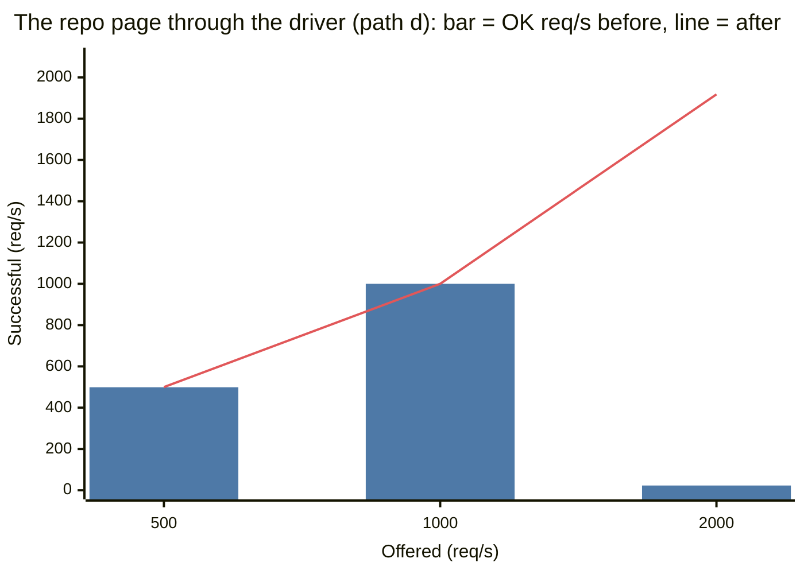

# The Hub off the hot paths: a memo of records, a cache for each colo, and a plan to split it

One `Hub` Durable Object (`id_from_name("hub")`) keeps all names of Nerudo (formerly
nerudo): orgs, users, repos and the trunk of each repo. One object serves approximately
600 requests each second (req/s) (`hub.md`). The memo of names in `names.rs` removed the
Hub from reads by name (`/v1/repos/{org}/{repo}/...` and git). This change removes the Hub from more paths:

- The repo page of the web app. The app asks `GET /v1/hub/repos/{org}/{repo}` for each view
  of `/{org}/{repo}`, and `GET /v1/hub/trunks/{trunk}` for each view of `/app/{trunk}`.
- Requests for names that do not exist.
- Requests in a new isolate (after a deploy, or when Cloudflare starts more isolates).

It also gives a design to split the Hub into many objects. That part is not code.

## Results

"Hub/req" is Hub requests for each request to the Worker, from the analytics (estimates
from samples, for the minutes of the step). "OK at" is the highest rate (through the
driver) with 95% or more successful requests.

| Path | Before: Hub/req | After: Hub/req | Before: OK at | After: OK at |
|---|---|---|---|---|
| d: the repo page, `GET /v1/hub/repos/{org}/{repo}` | 1.0 | 0.0002 to 0.0005 | 1,000 req/s (p95 546 ms). At 2,000: 1.1% OK. | 2,000 req/s (95.9% OK). At 4,000: 2,374 req/s OK. The trunks are the limit (503). |
| e: the page `/app/{trunk}`, `GET /v1/hub/trunks/{trunk}` | 1.0 | 0.0001 to 0.001 | 1,000 req/s (96.9% OK, p95 2.9 s). At 2,000: 29% OK. | 2,000 req/s (99.2% OK) |
| a: one unknown name | 1.0 | 0.0004 to 0.0008 | 1,000 req/s, but p50 2.1 s. At 2,000: 6% OK. | 4,000 req/s, p99 35 ms (the highest rate tested) |
| r: a new unknown name each time | 1.0 | 1.0 | 1,000 req/s (2,000 not tested) | 1,000 req/s. At 2,000: 21% OK. No change, as expected. |
| c: reads by name (the memo of `hub.md` is in both) | 0.007 to 0.026 | 0.0015 | 2,000 req/s | 2,000 req/s |

- **The repo page no longer uses the Hub.** Before, each view of a repo page asked the Hub,
  and the Hub limited all repo pages together to 1,000 to 2,000 req/s. After, the limit is
  the trunk of each repo: approximately 250 to 300 summaries each second for each trunk
  (8 trunks gave 2,374 req/s). Many repos give more total rate.
- **When a trunk is over its rate, only its repo fails, and it fails fast.** At 4,000 req/s
  on path d, the failures were 503 from busy trunks. Before, the Hub collapsed at 2,000
  req/s, and 99% of the requests got HTTP 500 or no answer in 15 s, for all repos.
- **A flood of one unknown name no longer reaches the Hub.** It also became fast. Before,
  each read of an unknown name in a busy isolate waited 2 s for the lookup of another
  request. This is the wait of `hub.md`, "Cold start". Then the read asked the Hub itself:
  p50 2.1 s at 500 req/s. After, the memo keeps "no such name" for 3 s.
- **A flood of different unknown names still reaches the Hub** (path r). The Hub limit for
  this path is between 1,000 and 2,000 req/s. Only a split of the Hub can change this.
- **The colo cache works on `workers.dev`.** The Cloudflare documentation says that the Cache
  API has no effect on `*.workers.dev`. A test on 2026-10-12 showed that it keeps entries
  there, for requests from the internet and through a service binding. The test also showed
  that the two share entries (see "The colo layer").
- **The colo cache divides the Hub load of the memo by 2 to 9.** See "The colo layer".

Latency at 200 req/s from the Mac (direct, p50 / p95 ms):

| Path | Before | After | After2 (the colo put after the response) |
|---|---|---|---|
| d | 71 / 98 | 58 / 76 | 78 / 95 |
| e | 68 / 91 | 56 / 69 | 78 / 94 |
| a | 50 / 84 | 39 / 47 | 40 / 47 |
| r | 50 / 61 | 69 / 95 | 75 / 86 |
| c | 55 / 72 | 57 / 71 | 77 / 93 |

The after2 steps ran from colo YVR, and the trunks are near SJC. All paths that call a
trunk (d, e, c) became approximately 20 ms slower together. This includes path c, which did
not change between after and after2. Thus compare after2 only with itself.

On path r, after is 19 ms slower than before. A lookup that misses the isolate also reads
the colo cache (3 to 7 ms for each Cache API call, measured). Before after2, it also waited
for the put.

Path d through the driver, before and after the change (from [All steps](#all-steps)). The
bar is the rate of successful requests before, and the line is the rate after. At 4,000
req/s, after the change, 2,374 req/s succeeded. Before, 4,000 was not tested.



| Offered (req/s) | 500 | 1,000 | 2,000 |
|---|---|---|---|
| Successful before (req/s) | 499 | 1,000 | 23 |
| Successful after (req/s) | 500 | 1,000 | 1,918 |

## What changed

`names.rs` was a memo of `{org}/{repo}` → trunk id in each isolate. Now it keeps the Hub's
record of a repo, and it has two layers:

1. A map in each isolate (as before).
2. The Cache API of the colo (`caches.default`). All isolates of the Worker in one colo
   share it.

The keys are the keys of the Hub:

| Key | Value |
|---|---|
| `repo:{org}/{repo}` | The repo with that name (`org`, `repo`, `trunk`, `description`, `upstream`, `public`, `created_ms`), or "no such name" |
| `trunk:{trunk}` | The repo that names that trunk, or "no such name" |

A request goes to the map first, then to the colo, and then to the Hub.

### Rules

| Rule | Reason |
|---|---|
| The memo keeps records, not access decisions. | The trunk decides who can read. See "The page of a repo". |
| Only reads use the memo: GET, HEAD, a clone or a fetch. | A write by name (land, a new fork, a push) asks the Hub each time. Thus a write cannot go to a trunk that lost the name. The answer of the Hub refreshes the map. This rule did not change. |
| A public record lives 30 s from the answer of the Hub, in both layers together. | The colo keeps the time of expiry in the entry (`x-nerudo-until`). A map entry that comes from the colo gets the same time. Thus a record is never older than 30 s, and not 30 s + 30 s. The `max-age` of the entry only lets Cloudflare delete it. |
| A private record and "no such name" live 3 s. | The repo page gives 404 from them to an anonymous viewer, without the trunk. Thus a repo made public or made new shows in all isolates after 3 s or less. A flood of one unknown name still does not go to the Hub (see "Unknown names"). |
| A name change removes the keys at once in the isolate that made the change, and in its colo. | `put_repo` removes `repo:{name}`, `trunk:{trunk}`, the old name of the trunk, and each trunk that lost the name. `delete_repo` removes `repo:{name}` and `trunk:{trunk}`. Thus the isolate that made a repo finds it at once ("make the repo, then clone it"). |
| The memo does not keep an answer that started before a name change in the same isolate, in the map or in the colo. | A counter (`gen`) finds this case, as before. It now also applies to "no such name", and to the colo. |
| In each isolate, only one request at a time asks for a key. Other reads of that key wait for its answer, at most 2 s. | As before (`hub.md`, "Cold start"). The request that asks reads the colo first, and the Hub only when the colo has no entry. |
| The colo key contains the id of the Hub object of this Worker: `https://hub-cache.nerudo.internal/{hub id}/repo/{org}/{repo}`. | Two Workers on one account can share a cache. The id of a Durable Object is different for each Worker, and it does not change between deploys. Thus a test Worker cannot put a record into the cache of the live Worker. |
| An answer of the Hub goes into the colo after the response (`wait_until` in `lib.rs`). | A lookup does not wait for the put. A name change in the isolate between the lookup and the put drops the put. |
| An error of the Cache API is a miss. | The colo is an optimization. The Hub is always the last source. |
| At most 10,000 records in each isolate (approximately 3 MB). | As before. |

### The page of a repo

`lib.rs` sends `GET /v1/hub/repos/{org}/{repo}` and `GET /v1/hub/trunks/{trunk}` to
`hub::cached_view` first. It answers only requests without the admin token:

| The record in the memo | The viewer | The answer |
|---|---|---|
| No such name | Any viewer | 404, the same body as before |
| A private repo | Anonymous (no `X-Nerudo-User` and no `X-Nerudo-Key`) | 404, the same body as before |
| A private repo | With `X-Nerudo-User` or `X-Nerudo-Key` | The Hub API answers, as before. A person on the repo can see a private repo (the uncommitted patch of the live Worker adds this). |
| A public repo | Any viewer | The Worker reads the summary of the trunk now. If the trunk says `public: true`, the answer is the record and the summary. If the trunk says `public: false`, the record is old: the Worker removes it, and the Hub API answers. If the trunk did not answer, the answer is 503 with `Retry-After: 1`. |

All other requests go to the Hub API, as before. The admin token always goes to the Hub
API, so the CLI always sees the newest record.

Why this is safe:

- A public repo has one view for all viewers. The view is the record and the summary of
  the trunk. The Worker reads the summary with the admin token, and the summary does not
  depend on the viewer. This is true with and without the live patch.
- The memo never shows a private repo. For a public record, the trunk must also say that it
  is public, at the time of the request. `put_repo` sets the visibility of the trunk before
  it writes the Hub. Thus, when a repo becomes private, the trunk is private first, and an
  old record in an isolate cannot show it.
- The Worker reads the summary for each request, as before. Only the record can be old.
- The answer has `Cache-Control: private, no-store` and the same `Vary` as the live patch.

### Unknown names

Before, each request for a name that does not exist went to the Hub. Now the memo keeps
"no such name" for 3 s, in the isolate and in the colo. A flood of one unknown name gives
approximately one Hub request each 3 s in each colo. An example is a CI job that clones a repo
that was deleted.

This does not help against a flood of many different names: each new name goes to the
Hub. Path `r` measures this. The fix is to split the Hub (see below): then different names
go to different objects.

### A trunk that does not answer

The page of a repo reads the summary of the trunk. When the trunk does not answer (for
example, it is over its rate), the answer is 503. The request does not go to the Hub API.
Before, the Hub API also read the summary, and it gave the record with no summary. If
`cached_view` sent such requests to the Hub API, the load of one busy repo would go to the
Hub too. The Hub serves all repos.

## The colo layer

### Does the Cache API work on `workers.dev`?

The documentation of the Cache API says: "Cache API operations in the Cloudflare Workers
dashboard editor, Playground previews, and any `*.workers.dev` deployments will have no
impact." nerudo runs on `workers.dev`, and the web app calls it through a service
binding. Thus a first test examined this, with a small Worker that puts an entry and reads
it again:

| Request | First read | Put | Second read |
|---|---|---|---|
| From the internet, key 1 | miss | ok | hit |
| From the internet, key 1, again | hit | | hit |
| Through a service binding (the Worker to itself), key 2 | miss | ok | hit |
| Through the service binding, key 1 | hit (the entry from the internet) | | hit |
| From the internet, key 2 | hit (the entry from the binding) | | hit |

The Cache API worked on `workers.dev` on 2026-10-12 (colo SJC). A second test Worker
measured the time of each call from colo YVR: 3 to 7 ms for a miss, a put and a hit. Both
test Workers were deleted at once.

If Cloudflare makes the Cache API a no-op on `workers.dev` (as the documentation says),
the memo still works as before, without the colo layer. Then each miss of the colo is a miss,
and the Hub answers.

### Hub requests with and without the colo layer

The "nocolo" build is the same code, but it does not use `colo_get` and `colo_put`. Both builds
ran the same steps through the driver, 10 minutes apart. In each "cold" step, the script
deployed the same build again 30 s into a 120 s step. Thus new isolates started with an
empty memo.

| Step | Hub requests in each minute: nocolo | after |
|---|---|---|
| c at 1,000 req/s, warm | 200, 266 | 50, 0 |
| d at 1,000 req/s, a deploy at +30 s | 335, 307 | 52, 34 |
| a at 2,000 req/s, a deploy at +30 s | 47, 140, 92 | 18, 74, 61 |

With the memo only, the Hub gets approximately (isolates × names) ÷ 30 s. Here that was 200
to 300 requests each minute for 8 names, so approximately 12 to 20 isolates. With the colo
layer, it gets approximately (colos × names) ÷ 30 s, plus the races between isolates. After
a deploy, the new isolates find the records in the colo, because the key of the colo does
not change between versions.

These counts are small at this scale. They matter with many names. With 10,000 names in
use and 100 isolates, the memo alone gives at most 33,000 Hub requests each second. That is
more than the Hub can serve. With the colo layer, 10,000 names in 20 colos give at most
approximately 6,700. That is still too many for one object: see "Split the Hub".

## Limits

- **Old public records for up to 30 s.** A name change removes the keys only in the isolate
  and the colo that made it. Other isolates and colos keep an old public record for up to
  30 s. A renamed repo can still answer at its old name for that time, and a new
  description can take 30 s to show. A public record never shows a private repo: the trunk
  must agree, as above.
- **A repo made public shows after up to 3 s** in other isolates (a private record lives
  3 s). A test made `hubn/r7` private and public 3 times, with 20 anonymous reads each
  second. While the repo was private, 0 of 280 reads got 200. After the change to public, the
  last 404 came 0.7 s, 1.1 s and 2.4 s after the change (`flip.json` in the evidence).
- **A race in the colo.** Isolate A changes a name and removes the colo entry. Isolate B in
  the same colo started a lookup before the change, and gets the old answer after it. B
  then puts the old record into the colo. The counter `gen` is only for one isolate, so it
  does not see this. The old record then lives up to 30 s in that colo. It is the same
  limit as above.
- **A miss of both layers costs one more Cache API call.** A lookup that is not in the isolate
  reads the colo first (3 to 7 ms). For a flood of different unknown names, each request
  pays this time, and also a put after the response.
- **A new repo takes up to 3 s in other isolates.** This occurs if one of them asked for the
  name in the 3 s before the repo existed.
- **A full memo drops all entries.** At 10,000 live entries in an isolate, all go, also the
  public records that are in use. A flood of different unknown names fills the memo with
  "no such name" entries (3 s each). Thus this occurs above approximately 3,300 new names
  each second in one isolate. The Hub is over its rate long before that (path r).
- **The colo cache is only for one colo.** Cloudflare has approximately 300. The Hub load
  with the memo is approximately (colos with traffic × names in use) ÷ 30 s.
- **Viewers of a private repo who send a user or a key still ask the Hub** (twice with the live
  patch: the user and the repo). This is the Hub API, unchanged.
- **The list pages still ask the Hub for each view.** `GET /v1/hub/orgs`, an org page and
  a profile page each read the full list of orgs, users and repos (`GET orgs` on the Hub).
  An org page also reads the repos of the org. With many repos, this full list is the
  largest load of the Hub. See "Split the Hub".

## Split the Hub (a design, not code)

The memo and the colo cache remove most reads from the Hub. Three loads stay on the one
object:

1. Lookups of names that are not in the memo: new isolates, new colos, names that are not
   used often, and floods of different unknown names.
2. The list pages: each view reads the full list of orgs, users and repos. This load
   increases with the number of repos.
3. All writes (these are few).

The design below puts each owner (an org or a user) in its own object. Then no single
object is on the path of requests for many names.

### Objects and keys

| Object | `id_from_name` | Keys | Load |
|---|---|---|---|
| Directory | `hub` (the object of today) | `org:{org}`, `user:{user}`, and for each owner a count of public repos | The home page; writes of orgs and users. Small: owners only, no repos. |
| Owner shard | `hub/{owner}` | `repo:{owner}/{repo}` for the repos of that owner | Lookups by name of that owner's repos; the org page. |
| Trunk | the Trunk object of the repo (exists today) | `name`: its `{owner}/{repo}`, next to `vis` | Lookups by trunk id. |

Why one shard for each owner, and not `hash(owner) % N`:

- No new split is necessary when the number of repos increases. A hash with N objects needs
  a migration each time N changes.
- A lookup by name needs only the name.
- A flood of different unknown owners goes to many different objects. No object gets all
  of it.
- An org is the unit of the org page, so the org page reads one object.

The Hub class can be the owner shard with small changes: its `repo:` keys already start
with the owner. The front Worker picks the object from the name (`hub/{org}`), not always
`hub`.

### Reads

| Read | Today | After the split |
|---|---|---|
| A repo by name (`/v1/repos/...`, git, the repo page) | Hub `repo/{org}/{repo}` | Shard `hub/{org}`. The memo and the colo cache stay in front. |
| A repo by trunk id (`/v1/hub/trunks/{trunk}`) | Hub `trunk/{trunk}` | The Trunk object gives its name N. Then shard `hub/{owner of N}` must say that N points to this trunk. If not, the trunk has no name. |
| The repos of an org (org page) | Hub `repos/{org}`, plus the full list for the user names | Shard `hub/{org}`, plus the directory (owners only) |
| The home page (`/v1/hub/orgs`) | Hub `orgs`: all orgs, users and repos | The directory: owners and their counts. A list of all repos must use pages over the shards. |
| A profile (repos where the user is a person) | Hub `orgs`, then up to 50 trunk summaries | Needs an index for each user, which the trunks write when `nerudo.toml` changes. This is not in this design. |

### Writes, and what is not atomic

Today one `put_multiple` in one object writes `repo:`, `trunk:` and `org:` together, so each
write is atomic. After the split, a write can touch more than one object. Durable Objects
have no transaction across objects. Each step below is a compare-and-set in one object, so
a retry of the full write is safe.

| Write | Objects | Order of the steps |
|---|---|---|
| A new org or user | Directory | One object, as today. The rule "orgs and users share names" stays atomic. |
| A new repo name | Directory, trunk, shard | 1. Directory: make the owner if it does not exist (an org with no repos is harmless). 2. Trunk: visibility and name (today the trunk is also first). 3. Shard: `repo:{name}` → trunk. |
| **The name moves to another trunk** | Shard, new trunk, old trunk | The shard writes the new trunk and gives the old trunk. Then the old trunk gets "remove the name N if N is still your name", and it becomes private. **Not atomic across objects.** |
| **A rename, also to another owner** | Trunk, old shard, new shard | The trunk gives its old name. The new shard writes the new name. The old shard gets "delete `repo:{old}` if it still points to this trunk". **Not atomic across objects.** |
| Delete a repo | Shard, trunk | Shard first (the name no longer works), then the trunk: private, no name (compare-and-clear). |
| Counts of public repos | Shard, directory | After the shard write, the directory adds or subtracts. **Eventually consistent**: a failure between the two leaves a wrong count until a repair recounts the shard. |

When a step fails, the state can be:

- A trunk with a name that its shard does not confirm. Readers by trunk id see "no name",
  because they check the shard.
- An old name that still points to a trunk that has a new name. A reader by name gets that
  trunk for a short time. The trunk still checks access. The admin repeats the write, or a
  repair (an admin `fsck` that compares each shard with the trunks) deletes the old name.

The rule for readers: the shard is the authority for name → trunk. The trunk's own name is
only a hint, and a reader checks it against the shard.

### Migration of the keys of today

The keys `org:` and `user:` stay in the object `hub`, which becomes the directory. Only
`repo:` and `trunk:` move. A flag `NERUDO_HUB_SPLIT` controls the steps:

| Step | Flag | Writes | Reads |
|---|---|---|---|
| 1 | `off` | The old Hub (as today), and also the shards and the trunk names | The old Hub |
| 2 | `off` | An admin call `POST /v1/hub/migrate` copies each `repo:` key to its shard and each `trunk:` key to its trunk. It writes the same values, so it is safe to run again. Then it compares each record. | The old Hub |
| 3 | `read` | Both, as in step 1 | The shards and the trunks. To return to reads from the old Hub, set the flag to `off`. |
| 4 | `on` | The shards and the trunks only | The shards and the trunks |
| 5 | `on` | | Delete the old `repo:` and `trunk:` keys from the directory. |

### What the split gives

- The rate for the names of one org is the rate of one shard (approximately 600 req/s
  without the memo). Many orgs give more total rate.
- A flood of different unknown names spreads over the shards of those owners.
- The home page reads owners only. The size of that read does not increase with the number
  of repos.
- The memo and the colo cache stay in front, with the same rules.

It does not help one busy org: all its names are in one shard. The memo protects that shard
for reads. The design changes the storage of the live Worker and needs the migration above.
Thus this work did not put the design into code before the feature freeze.

## Method

All load went to Workers that were deployed only for this test. The live Worker did not
get load. The ladder read the front page of the live Worker every 20 s. A second script
read the front pages of `nerudo` and `nerudo-web` every 3 minutes. Each answer
was 200.

| Item | Value |
|---|---|
| Worker under test | `nerudo-scale-hubn`, built with `worker-build --release`. `CI` goes to `nerudo-ci-scale`; no `AI` binding. |
| Load driver | `nerudo-scale-hubn-driver` (`hub_driver.js`), with a service binding to the Worker under test. 20 calls for each request to the driver. |
| Trunks | 8 trunks on Artifacts, namespace `nerudo-scale`, ids `hubn-0-154806` to `hubn-7-154806`. Names `hubn/r0` to `hubn/r7`, public. Seed tree: the bench repo. |
| Load tool | vegeta, open loop at a constant rate, HTTP/1.1 with keep-alive, timeout 15 s. At most 200 req/s from the Mac; above that, through the driver. |
| Client | One Mac, one IP address. Colo SJC at the start (from `cf-ray`). At 17:20 MDT the Mac went to colo YVR (from a test Worker); the after2 steps ran then. |
| Steps | 60 s for each rate. A ladder stops after the first step with more than 5% failed requests, except where the table says otherwise. |
| Counts of Hub requests | The Cloudflare GraphQL Analytics API, for each minute and each object (`durableObjectsInvocationsAdaptiveGroups`, `workersInvocationsAdaptive`). These counts are estimates from samples. The Hub is the object with id `2829e3e9…`. |

### Paths

| Path | Request | Before | After |
|---|---|---|---|
| d | `GET /v1/hub/repos/hubn/r{i}`, no key (the repo page of the web app) | The Hub, then the trunk summary | The memo, then the trunk summary |
| e | `GET /v1/hub/trunks/{id}`, no key (the page `/app/{trunk}`) | The same | The same |
| a | `GET /v1/repos/hubn/nope/stats`, one unknown name | The Hub | The memo ("no such name", 3 s) |
| r | `GET /v1/repos/hubn/nope-{n}/stats`, a new unknown name for each request | The Hub | The Hub (no change expected) |
| c | `GET /v1/repos/hubn/r{i}/stats`, by name (the memo of `hub.md` is in both versions) | The memo, then the trunk | The same |

### Versions

| Code in the tables | Commit | Version of `nerudo-scale-hubn` |
|---|---|---|
| before | `128b641` (`scale-safe`: the memo of trunk ids, 30 s) | `936734c8` |
| after | `4ed2257`: the memo of records, the colo cache, "no such name" for 3 s, the cached repo page | `13a72392`; for the colo steps `935a7791`, then `b517781a` and `af1b336f` (the deploys in the cold steps) |
| nocolo | `4ed2257`, but `colo_get` and `colo_put` are not used (only for this measurement, not committed) | `e39c2e80`, then `ddf97b83` and `15d1cdc2` |
| after2 | `070dd10`: as after, and the colo put after the response | `a3f15a9b` (the direct steps and the scenarios) |
| after3 | `571c79c`: as after2, and a private record lives 3 s | `37da7fce` (two driver steps, the visibility test and the scenarios) |

The driver was version `ef0ea1cc` (before), `1faef263` (after), `dc423726` (the colo
steps) and `5fe835a5` (after3). It was deleted after each of these four sets.

## Tests

| Test | Result |
|---|---|
| `cargo test -p nerudo-worker` | 16 passed. New: the cache rules (`names.rs`) and the table of `cached_view` (`hub.rs`). The cache rules cover expiry, "no such name" and the time to live of public and private records. They also cover a name change during a lookup, the colo key and the put after the response. |
| `cargo check -p nerudo-worker --target wasm32-unknown-unknown`, `cargo clippy` | No warnings in the changed files |
| `nix run .#faults` (all cases) | On `4ed2257`: 82 passed, 5 known gaps, 0 failed. On `070dd10` and on `571c79c`: 81 passed, 5 known gaps, 1 failed. The failure was the scenario approvals: `wrangler dev` said "Network connection lost" on a close request. This is a known flake of the local runtime, and the request does not go through the changed code. Then `--cases parity --scenarios approvals,hub,users,aliases` on `571c79c` passed 2 times of 2. |
| `nix run .#faults -- --cases parity --scenarios hub,users,aliases,git,identity` | hub, users and aliases pass. git and identity fail, and they fail in the same way on `128b641`. The cause: this harness uses Gitea, and these two scenarios need Artifacts. |
| Scenarios on `nerudo-scale-hubn` (Artifacts): hub, users, aliases, git, identity | All pass, on after2 and on after3 |
| The colo put after the response (after3, driver, 1,000 req/s) | Hub requests in each minute: 80 (the first minute after the deploy), 41, 51. Without the colo layer the same load gave 200 to 300. Thus the puts land. |
| The live patch (`deployed-6019cf7b-uncommitted.patch`) | `git apply --check` passes on this branch. With the patch applied, the worker builds for wasm, and its tests pass. |

## All steps

"OK/s" is the rate of successful requests. For the driver, the rate and the times are those of the calls to the Worker under test. "driver_failed" is a request to the driver with no answer in 15 s (20 calls). "http_503" is the answer of `cached_view` when the trunk did not answer. "http_500" is an error of the Worker, here the overloaded Hub.

| Via | Path | Code | Offered/s | OK/s | OK % | p50 ms | p95 ms | p99 ms | Failures |
|---|---|---|---|---|---|---|---|---|---|
| direct | d | before | 200 | 200 | 100.0 | 71 | 98 | 142 | none |
| direct | d | after | 200 | 200 | 100.0 | 58 | 76 | 122 | none |
| direct | d | after2 | 200 | 200 | 100.0 | 78 | 95 | 146 | none |
| driver | d | before | 500 | 499 | 99.9 | 57 | 124 | 202 | driver_failed 40 |
| driver | d | before | 1,000 | 1,000 | 100.0 | 148 | 546 | 826 | none |
| driver | d | before | 2,000 | 23 | 1.1 | 18 | 12,116 | 14,601 | driver_failed 92,760, http_500 25,858 |
| driver | d | after | 500 | 500 | 100.0 | 24 | 57 | 119 | none |
| driver | d | after | 1,000 | 1,000 | 100.0 | 28 | 111 | 262 | none |
| driver | d | after | 2,000 | 1,918 | 95.9 | 43 | 2,642 | 10,504 | driver_failed 2,960, http_503 1,965 |
| driver | d | after | 4,000 | 2,374 | 59.3 | 44 | 10,007 | 12,711 | driver_failed 53,960, http_503 43,618 |
| driver | d | after3 | 1,000 | 1,000 | 100.0 | 63 | 165 | 279 | none |
| driver | d | nocolocold | 1,000 | 1,000 | 100.0 | 25 | 75 | 180 | none |
| driver | d | aftercold | 1,000 | 1,000 | 100.0 | 42 | 117 | 250 | none |
| direct | e | before | 200 | 200 | 100.0 | 68 | 91 | 137 | none |
| direct | e | after | 200 | 200 | 100.0 | 56 | 69 | 104 | none |
| direct | e | after2 | 200 | 200 | 100.0 | 78 | 94 | 197 | none |
| driver | e | before | 500 | 500 | 100.0 | 59 | 131 | 310 | none |
| driver | e | before | 1,000 | 969 | 96.9 | 503 | 2,892 | 4,549 | http_500 1,868 |
| driver | e | before | 2,000 | 582 | 29.1 | 38 | 11,362 | 13,669 | http_500 54,509, driver_failed 30,580 |
| driver | e | after | 500 | 500 | 100.0 | 20 | 36 | 78 | none |
| driver | e | after | 1,000 | 1,000 | 100.0 | 26 | 91 | 232 | none |
| driver | e | after | 2,000 | 1,985 | 99.2 | 46 | 2,084 | 4,776 | http_503 906 |
| direct | a | before | 200 | 200 | 100.0 | 50 | 84 | 354 | none |
| direct | a | after | 200 | 200 | 100.0 | 39 | 47 | 64 | none |
| direct | a | after2 | 200 | 200 | 100.0 | 40 | 47 | 75 | none |
| driver | a | before | 500 | 500 | 100.0 | 2,130 | 2,161 | 2,216 | none |
| driver | a | before | 1,000 | 1,000 | 100.0 | 2,152 | 2,274 | 2,392 | none |
| driver | a | before | 2,000 | 121 | 6.0 | 2,126 | 13,776 | 14,629 | driver_failed 88,340, http_500 24,415 |
| driver | a | after | 500 | 500 | 100.0 | 0 | 0 | 35 | none |
| driver | a | after | 1,000 | 1,000 | 100.0 | 0 | 0 | 35 | none |
| driver | a | after | 2,000 | 2,000 | 100.0 | 0 | 0 | 35 | none |
| driver | a | after | 4,000 | 4,000 | 100.0 | 0 | 0 | 35 | none |
| driver | a | nocolocold | 2,000 | 2,000 | 100.0 | 0 | 0 | 35 | none |
| driver | a | aftercold | 2,000 | 2,000 | 100.0 | 0 | 15 | 58 | none |
| direct | r | before | 200 | 200 | 100.0 | 50 | 61 | 102 | none |
| direct | r | after | 200 | 200 | 100.0 | 69 | 95 | 130 | none |
| direct | r | after2 | 200 | 200 | 100.0 | 75 | 86 | 100 | none |
| driver | r | before | 500 | 500 | 100.0 | 30 | 59 | 191 | none |
| driver | r | before | 1,000 | 1,000 | 100.0 | 47 | 187 | 352 | none |
| driver | r | after | 500 | 500 | 100.0 | 47 | 99 | 158 | none |
| driver | r | after | 1,000 | 1,000 | 100.0 | 90 | 288 | 455 | driver_failed 20 |
| driver | r | after | 2,000 | 424 | 21.2 | 910 | 13,335 | 14,695 | driver_failed 52,500, http_500 42,067 |
| driver | r | nocolowarm | 1,000 | 1,000 | 100.0 | 140 | 1,550 | 3,468 | http_500 14 |
| driver | r | afterwarm | 1,000 | 1,000 | 100.0 | 77 | 706 | 1,034 | none |
| direct | c | before | 200 | 200 | 100.0 | 55 | 72 | 125 | none |
| direct | c | after | 200 | 200 | 100.0 | 57 | 71 | 94 | none |
| direct | c | after2 | 200 | 200 | 100.0 | 77 | 93 | 112 | none |
| driver | c | before | 1,000 | 1,000 | 100.0 | 25 | 61 | 164 | none |
| driver | c | before | 2,000 | 2,000 | 100.0 | 38 | 2,552 | 5,193 | none |
| driver | c | after | 1,000 | 1,000 | 100.0 | 95 | 146 | 349 | none |
| driver | c | after | 2,000 | 2,000 | 100.0 | 108 | 552 | 1,637 | none |
| driver | c | after3 | 1,000 | 1,000 | 100.0 | 58 | 99 | 227 | none |
| driver | c | nocolowarm | 1,000 | 1,000 | 100.0 | 51 | 133 | 374 | none |
| driver | c | afterwarm | 1,000 | 1,000 | 100.0 | 24 | 57 | 246 | none |

Notes:

- The cold steps (`nocolocold`, `aftercold`) lasted 120 s, with a deploy at +30 s.
- The driver measures time with `Date.now()`, which moves only at I/O. A memo hit on path a
  has no I/O, so its time is 0 ms.
- The driver steps of path c for after (p50 95 ms) ran immediately after path r at 2,000 req/s,
  which overloaded the Hub. The step `afterwarm` of path c ran in normal conditions: p50
  24 ms, as before (25 ms). Path c does not use the new code on a memo hit.
- Times through the driver changed between runs by up to 2× with the same code (for
  example, path r: `nocolowarm` 140 ms and `afterwarm` 77 ms, 10 minutes apart). Compare
  the rates and the Hub requests, not small differences in time.

## Cost

| Item | Count |
|---|---|
| Requests that the script counted (each call through the driver counts, and each request to the driver) | 3,834,000 |
| Price at list price (Workers $0.30 and Durable Objects $0.15 for each million requests) | approximately $1.10 for the Worker, approximately $0.40 for the Hub and the trunks, and a few cents of duration |

The included monthly usage of Workers Paid is not subtracted.

## Run it again

As in `hub.md`, "Run it again", with these changes:

1. `python3 -I cf/scale/hub_load.py setup --vars VARS --out repos.json --org ORG --prefix PREFIX --public`.
   The repos must be public for the paths d and e.
2. The driver needs the var `ORG` with the same org.
3. The paths are `d`, `e`, `a`, `r` and `c`:

   ```sh
   python3 -I cf/scale/hub_load.py ladder --vars VARS --repos repos.json --path d --label after --outdir OUT --rates 200
   python3 -I cf/scale/hub_load.py ladder --vars VARS --repos repos.json --path d --label after --outdir OUT --via driver --n 20 --rates 500,1000,2000,4000
   ```

Do not send more than 200 req/s from one computer that other tests share. The edge blocked
this Mac at approximately 2,000 req/s (`hub.md`).

## Files

| File | Contents |
|---|---|
| `../nerudo-worker/src/names.rs` | The memo of records: the isolate, the colo, "no such name", the put after the response |
| `../nerudo-worker/src/hub.rs` | `cached_view` (the repo page), and the names that `put_repo` and `delete_repo` forget |
| `../nerudo-worker/src/lib.rs` | The route to `cached_view`, and `wait_until` for the colo puts |
| `hub_load.py`, `hub_driver.js` | The paths d, e and r, and `--org`, `--prefix`, `--public` |
| `../evidence/hub-next-20261012.json` | Each step, and the Hub requests for each minute from the analytics |
