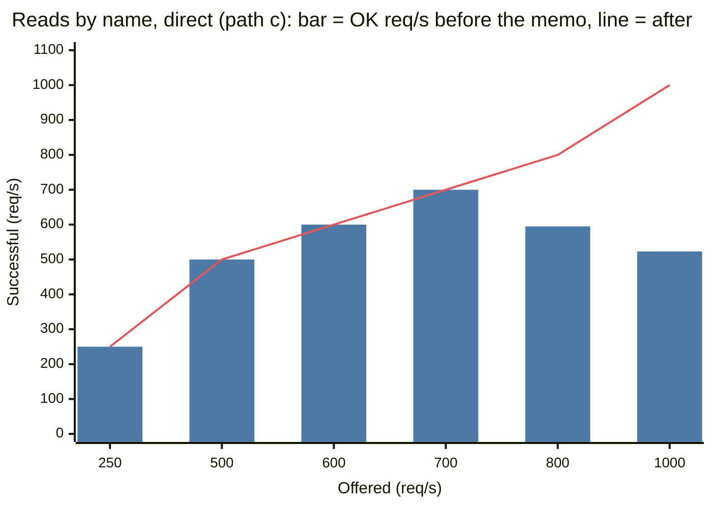

# The Hub object: its request rate, before and after a memo of names

One `Hub` Durable Object (`id_from_name("hub")`) maps each name `{org}/{repo}` to a trunk
id. Before this change, each request by name asked the Hub for the trunk id. That is each
`/v1/repos/{org}/{repo}/...` request and each git request by name
(`/{org}/{repo}.git/...`). Thus one object was on the path of all traffic by name.
Cloudflare gives a soft limit of approximately 1,000 requests each second (req/s) for one
Durable Object.

This test measures the rate that the Hub can serve. Then it adds a memo of names in each
isolate (`nerudo-worker/src/names.rs`) and measures again.

## Results

| Path | Before the memo | After the memo |
|---|---|---|
| a: the Hub lookup only (an unknown name) | 600 req/s with no errors. At 700 req/s and more, approximately 590 req/s succeed, and the others get HTTP 500. | after: the same. 577 req/s succeed at 600, 566 at 700. The memo does not keep unknown names. Not measured on after2. |
| c: by name, the Hub and then one of 8 trunks | 700 req/s with no errors, but p95 is 1.5 s. At 800 and 1,000 req/s, 595 and 523 req/s succeed. | after: 1,000 req/s from one computer with no errors, p95 74 ms. after2, through the driver: 2,000 req/s with no errors; at 4,000 req/s, 2,722 req/s succeed. |
| b: by trunk id, 8 trunks, no Hub (control) | 1,000 req/s with no errors. 2,000 req/s: 99.4% succeed. 4,000 req/s: 2,737 req/s succeed. | Not measured again. The memo is not on this path. |
| Hub requests for each request on path c | 0.90 to 1.0 | 0.02 (after and after2) |

"after" and "after2" are two versions of the memo (see "Versions").

- The Hub limited all traffic by name to approximately 600 req/s. This is less than the
  soft limit of 1,000 req/s.
- After the memo, traffic by name has the same limit as traffic by trunk id. That limit
  comes from the Trunk objects, one for each repo (see "The Trunk objects").
- Below the limit, the memo also makes requests by name faster. At 500 req/s on path c,
  p95 went from 468 ms to 66 ms. At 250 req/s, p50 went from 68 ms to 52 ms.
- The first version of the memo had errors for 26 s after a deploy at 1,000 req/s. The
  second version asks the Hub only once for each name in each isolate at a time. It had no
  error after a deploy (see "Cold start").

Path c on the direct path, before and after the memo (from [All steps](#all-steps)). The bar
is the rate of successful requests before the memo, and the line is the rate after it.



| Offered (req/s) | 250 | 500 | 600 | 700 | 800 | 1,000 |
|---|---|---|---|---|---|---|
| Successful before the memo (req/s) | 250 | 500 | 600 | 700 | 595 | 523 |
| Successful after the memo (req/s) | 250 | 500 | 600 | 700 | 800 | 1,000 |

## Method

All load went to Workers that were deployed only for this test. The live Worker did not
get load. The script read the front page of the live Worker every 20 s, and it stopped the
load when the answer was not 200. The answer was 200 each time.

| Item | Value |
|---|---|
| Worker under test | `nerudo-scale-hub`, built with `worker-build --release`. No `CI` binding and no `AI` binding: the test trunks have no `[ci]` section. |
| Load driver | `nerudo-scale-hub-driver` (`hub_driver.js`). It is a Worker with a service binding to `nerudo-scale-hub`. |
| Trunks | 8 trunks on Artifacts, namespace `nerudo-scale`, ids `hub-0-134536` to `hub-7-134536`. Names `hubscale/r0` to `hubscale/r7`, private. Seed tree: the bench repo. |
| Load tool | vegeta 12.12.0, open loop at a constant rate, HTTP/1.1 with keep-alive, timeout 15 s, IPv4 only |
| Client | One Mac, one IP address. Cloudflare colo SJC (from `cf-ray`). |
| Steps | 60 s for each rate. The ladder stops after the first step with more than 5% failed requests. |
| Counts of objects | The Cloudflare GraphQL Analytics API, for each minute and each object (`durableObjectsInvocationsAdaptiveGroups`, `workersInvocationsAdaptive`). These counts are estimates from samples. |
| Error messages | `wrangler tail --format json --sampling-rate 0.003` |

### Versions

| Code in the tables | Commit | Version of `nerudo-scale-hub` |
|---|---|---|
| before | `3b28852` (no memo) | `8e49493f` |
| after | `efdfa86`: the memo, 30 s, reads only | `ea829a2f` |
| after2 | `a25cc6f`: the memo, and one Hub lookup at a time for each name in an isolate | `1944b0fb` |

The driver was version `e767c642` for all runs.

### Paths

| Path | Request | Durable Objects on the path |
|---|---|---|
| base | `GET /` | None. The Worker gives its usage text. |
| a | `GET /v1/repos/hubscale/nope/stats` | The Hub only. The name does not exist, so the answer is 404 `unknown repo`. This is exactly the lookup that each request by name makes. A 404 with `unknown repo` counts as a success on this path. |
| b | `GET /v1/trunks/{id}/stats` | One of 8 Trunk objects, in turn. No Hub. This is the control. |
| c | `GET /v1/repos/hubscale/r{i}/stats` | The Hub, then one of 8 Trunk objects, in turn. |

Paths b and c send the agent token. Each Trunk object gets 1/8 of the load on b and c.

### Two ways to send the load

**Direct.** vegeta sends each request from the Mac to `nerudo-scale-hub`.

**Driver.** At 2,000 req/s from the Mac, the Cloudflare edge blocked the Mac (see "The
edge limit"). Thus, above 1,000 req/s, vegeta sends requests to the driver. For each
request, the driver makes 20 calls at the same time to `nerudo-scale-hub` through its
service binding. Then it returns the status and the time of each call.

A service binding does not go through the edge security of `workers.dev`. The Worker code,
the Hub and the Trunk objects are the same as on the direct path.

The rate in the tables is the rate of calls to `nerudo-scale-hub`. The time of a call is
from the driver to the answer. It does not include the network between the Mac and
Cloudflare.

The driver sends 20 calls together, so the calls come to the Durable Objects in groups.
Thus the driver gives worse results than the direct path at the same rate. At 1,000 req/s
on path a, the direct path had 59.5% success and the driver had 11.1%.

## All steps

"OK/s" is the rate of successful requests. "worker_text" is the answer of the Worker when
its code fails: HTTP 500, body `INTERNAL SERVER ERROR`. "http_500" is the same answer
through the driver. "The edge limit" explains "edge_page" and "client".

"driver_failed" is a request to the driver that got no answer in 15 s. For "driver_failed",
the times of the calls are not known. Thus the p50, p95 and p99 of that step include only the
calls that got an answer.

| Via | Path | Code | Offered/s | Sent/s | OK/s | OK % | p50 ms | p95 ms | p99 ms | Failures |
|---|---|---|---|---|---|---|---|---|---|---|
| direct | base | before | 250 | 250 | 250 | 100.0 | 37 | 41 | 48 | none |
| direct | base | before | 500 | 500 | 500 | 100.0 | 38 | 46 | 60 | none |
| direct | base | before | 1,000 | 1,000 | 1,000 | 100.0 | 38 | 48 | 67 | none |
| direct | base | before | 2,000 | 1,055 | 600 | 56.8 | 2,254 | 12,164 | 15,000 | edge_page 25,058, client 2,280 |
| direct | a | before | 250 | 250 | 250 | 100.0 | 53 | 86 | 160 | none |
| direct | a | before | 500 | 500 | 500 | 100.0 | 62 | 205 | 450 | none |
| direct | a | before | 600 | 600 | 600 | 100.0 | 140 | 654 | 874 | none |
| direct | a | before | 700 | 700 | 591 | 84.4 | 737 | 3,230 | 4,377 | worker_text 6,555 |
| direct | a | before | 1,000 | 1,000 | 595 | 59.5 | 863 | 4,239 | 4,920 | worker_text 24,310 |
| direct | a | after | 500 | 500 | 500 | 100.0 | 58 | 155 | 290 | none |
| direct | a | after | 600 | 600 | 577 | 96.1 | 222 | 2,428 | 3,537 | worker_text 1,395 |
| direct | a | after | 700 | 700 | 566 | 80.9 | 929 | 3,578 | 4,450 | worker_text 8,017 |
| direct | c | before | 250 | 250 | 250 | 100.0 | 68 | 110 | 190 | none |
| direct | c | before | 500 | 500 | 500 | 100.0 | 100 | 468 | 952 | none |
| direct | c | before | 600 | 600 | 600 | 100.0 | 157 | 695 | 977 | none |
| direct | c | before | 700 | 700 | 700 | 100.0 | 286 | 1,496 | 2,229 | none |
| direct | c | before | 800 | 800 | 595 | 74.4 | 1,353 | 4,512 | 5,458 | worker_text 12,301 |
| direct | c | before | 1,000 | 1,000 | 523 | 52.3 | 399 | 6,128 | 8,042 | worker_text 28,620, client 1 |
| direct | c | after | 250 | 250 | 250 | 100.0 | 52 | 65 | 87 | none |
| direct | c | after | 500 | 500 | 500 | 100.0 | 50 | 66 | 543 | none |
| direct | c | after | 600 | 600 | 600 | 100.0 | 50 | 68 | 214 | none |
| direct | c | after | 700 | 700 | 700 | 100.0 | 48 | 62 | 96 | none |
| direct | c | after | 800 | 800 | 800 | 100.0 | 51 | 80 | 166 | none |
| direct | c | after | 1,000 | 1,000 | 1,000 | 100.0 | 50 | 74 | 147 | none |
| direct | c | after2 | 1,000 | 1,000 | 1,000 | 100.0 | 52 | 136 | 764 | none |
| driver | a | before | 1,000 | 1,000 | 112 | 11.1 | 7,989 | 13,837 | 14,652 | driver_failed 37,780, http_500 15,533 |
| driver | b | before | 1,000 | 1,000 | 1,000 | 100.0 | 39 | 172 | 383 | none |
| driver | b | before | 2,000 | 2,000 | 1,988 | 99.4 | 44 | 2,017 | 6,102 | http_500 740 |
| driver | b | before | 4,000 | 4,000 | 2,737 | 68.4 | 51 | 7,243 | 9,617 | http_500 75,755, driver_failed 20 |
| driver | c | before | 1,000 | 1,000 | 164 | 16.4 | 30 | 12,956 | 14,317 | driver_failed 31,920, http_500 18,270 |
| driver | c | after | 1,000 | 1,000 | 820 | 82.0 | 19 | 10,993 | 13,558 | http_500 6,871, driver_failed 3,940 |
| driver | c | after2 | 1,000 | 1,000 | 1,000 | 100.0 | 18 | 59 | 295 | none |
| driver | c | after2 | 2,000 | 2,000 | 2,000 | 100.0 | 29 | 593 | 1,830 | none |
| driver | c | after2 | 4,000 | 4,000 | 2,722 | 68.0 | 50 | 6,449 | 8,260 | http_500 76,692 |

The driver ladder for "after" stopped at 1,000 because of the cold start. The "after2"
ladder used `--past-ceiling`, so it continued to 4,000.

## The cause

The Hub is one object, and each request by name waits for it. The analytics show this:

| Time (MDT) | Load | Worker requests | Hub requests | Hub requests for each Worker request |
|---|---|---|---|---|
| 14:18 to 14:20 | before, direct c, 600 to 800 req/s | 104,039 | 94,085 | 0.90 |
| 14:25 to 14:31 | after, direct c, 500 to 1,000 req/s | 217,754 | 4,854 | 0.022 |
| 14:37 to 14:40 | after2, driver c, 1,000 to 4,000 req/s | 416,756 | 8,497 | 0.020 |

In the minutes of the before run with no errors, the ratio is 1.0. At 14:20 the Hub was
over its rate. Then the Worker sent requests that the Hub did not accept, and those
requests are not in the count of the Hub.

When the Hub is over its rate, these things occur:

1. Requests wait in the queue of the Hub. The p95 time increases before any error. On path
   a it was 205 ms at 500 req/s and 654 ms at 600 req/s.
2. The runtime refuses the requests that wait too long. The Worker gets the error
   `Durable Object is overloaded. Requests queued for too long.` or `Durable Object is
   overloaded. Too many requests queued.` The Worker does not catch the error, so it gives
   HTTP 500 `INTERNAL SERVER ERROR`.
3. The errors come in groups. In some seconds all requests succeed, and in the next
   seconds most of them fail. Approximately 590 req/s succeed on average.
4. Through the driver, isolates of the Worker went above their memory limit (`Worker
   exceeded memory limit`, 8,222 requests in the analytics). This occurred only when the
   Hub was over its rate. The runtime then stopped all requests in those isolates. Some of
   those requests did not use the Hub. Thus an overload of the Hub can also stop requests
   that do not need it.

The analytics show at most 46,438 Hub requests in one minute (774 req/s), through the
driver.

## The memo of names

`names.rs` keeps `{org}/{repo}` → trunk id in each isolate of the Worker. `hub::forward`
uses it. The Hub API (`/v1/hub/...`) and `hub::lookup` do not use it.

| Rule | Reason |
|---|---|
| The memo keeps only the trunk id. | The Trunk object still decides who can read. The `public` flag of the repo is not in the memo, so no access decision comes from the memo. |
| Only reads use the memo: GET, HEAD, and a clone or fetch (`git-upload-pack`). | A write by name (land, a new fork, a push, and the ref list of a push, `info/refs?service=git-receive-pack`) asks the Hub each time. Thus a write cannot go to a trunk that lost the name. The answer of the Hub also refreshes the memo. `is_read` has tests. |
| An entry lives 30 s. | Short enough for a name change, long enough to remove almost all lookups. |
| A name change removes the entry at once in the isolate that made the change. | `put_repo` removes the name, and the old name when the trunk had another name. `delete_repo` removes the name. |
| The memo does not keep an answer that started before a name change in the same isolate. | A lookup can be in progress when `put_repo` removes the name. A counter (`gen`) finds this case. |
| The memo does not keep "not found". | A new repo must work at once in each isolate, for example "create the repo, then clone it". A memo of "not found" also does not help against a flood of different unknown names. |
| In each isolate, only one request at a time asks the Hub for a name. Other reads of that name wait for its answer, at most 2 s. | See "Cold start". The wait uses timers and the memo only. A request never waits for an object (a promise or a stream) that another request made, because the Workers runtime does not allow that safely. |
| An ask counts as "in progress" for at most 2 s after it starts. | If the runtime stops a request and does not run its destructor, the name is not held for longer. |
| At most 10,000 names in each isolate (approximately 1 MB). | When the memo is full, expired names go first. If no name is expired, all names go. |

### Cold start

After a deploy, each isolate starts with an empty memo. The first version of the memo
asked the Hub for each read that missed. Many reads missed at the same time, so the Hub
got more than its rate. Its answers came late, and during that time more reads missed.

The first 60 s of driver c at 1,000 req/s, immediately after a deploy:

| Version | Seconds 0 to 2 | Seconds 3 to 25 | Seconds 26 to 59 |
|---|---|---|---|
| after | No answer in 15 s | 0% to 82% HTTP 500 in each second | 100% success |
| after2 | 100% success | 100% success | 100% success |

The second version asks the Hub only once for each name in each isolate at a time. Thus a
cold isolate asks at most 8 times for these 8 names. Before, it asked once for each read.
The analytics show the difference in the first minute of each run:

| Time (MDT) | Version | Seconds of the step in this minute | Worker requests | Hub requests | Hub requests for each Worker request |
|---|---|---|---|---|---|
| 14:23 | after | 0 to 38 | 57,751 | 14,402 | 0.25 |
| 14:37 | after2 | 5 to 65 | 55,607 | 248 | 0.004 |

The first 5 s of the after2 step are in the minute 14:36, together with the load of path a.
Thus they are not in this table. Each version had one cold start in this test.

## The Trunk objects

The control (path b) shows a second limit. Each Trunk object also has a rate limit. At
2,000 req/s over 8 trunks (250 req/s for each trunk), p95 was 2.0 s and 740 calls failed.
At 4,000 req/s (500 req/s for each trunk), 2,737 req/s succeeded. The errors were the same
as for the Hub: `Durable Object is overloaded. Requests queued for too long.` and `Too many
requests queued.`

After the memo, path c has the same results as path b at 4,000 req/s: 2,722 req/s against
2,737 req/s. Thus the Hub is no longer the limit. Now the Trunk object of each repo limits
that repo, at approximately 250 to 350 req/s for this simple read. Many repos give more total
rate. One busy repo does not.

The 8 Trunk objects can be in one isolate. Then they share one thread, and the limit of
the 8 together can be less than 8 times the limit of one. This test did not measure one
Trunk object alone.

## Limits of the memo

- **Old names for up to 30 s.** A name change removes the entry only in the isolate that
  made the change. Other isolates send reads by the old name to the old trunk for up to
  30 s. The old trunk is private after the change, and it still checks access. This does
  not affect writes.
- **Unknown names still go to the Hub.** Path a did not change. A flood of requests for
  unknown names can still put the Hub over its rate. Then writes by name, and reads of names
  that are not in the memo, fail for all users. A memo of "not found" does not help against
  many different names. To prevent this, use more than one Hub object (split the names by
  a hash), or limit the rate of 404 answers.

  In after2, reads of one unknown name in an isolate wait for the lookup in progress (at most
  2 s). Then they ask the Hub themselves. Thus a flood of one unknown name gives fewer Hub
  requests but slower answers. This test did not measure it.
- **The Hub API does not use the memo.** `/v1/hub/...` reads still ask the Hub each time,
  because they use the `public` flag, and `view` also reads the trunk summary. If the web
  app reads names through `/v1/hub/...` on each page, that traffic still has the limit of
  the Hub. This test did not examine the web app.
- **The Hub load depends on isolates and names.** With the memo, the Hub gets approximately
  (isolates × names in use) ÷ 30 s. Here that was 1 to 64 req/s for 8 names. With many
  thousands of active repos, each isolate sees each name less often, and the memo helps
  less. A cache for each colo (the Cache API) or more Hub objects is then necessary.
- **An overload of the Hub is not contained.** The call to the Hub has no time limit, and
  its error becomes HTTP 500. A short time limit on the Hub call, and HTTP 503 with
  `Retry-After`, would give clients an answer that they can try again. Also, requests that
  wait would then not fill the memory of an isolate.
- **2 s of wait.** When the Hub is slow, a read can wait up to 2 s for the lookup of
  another request. After that, it asks the Hub itself.

## Limits of the test

- One client and one colo (SJC). The Hub object was in or near that colo. Requests from
  far colos to the Hub take longer, but the rate limit of the object is the same.
- The test used `stats`, a small read. Requests that do more work in a Trunk object give
  a lower rate for each trunk. The Hub lookup is the same for all requests by name.
- The driver sends calls in groups of 20. That is harder for the objects than the direct
  path at the same rate.
- The counts from analytics are estimates from samples.
- The test did not measure many names, or the memo across many colos.

## The edge limit

At 2,000 req/s from the Mac (path base, no Durable Object), the times increased to
seconds. Then, 15 s into the step, the Cloudflare edge answered HTTP 403 "Attention
Required! | Cloudflare. Sorry, you have been blocked. You are unable to access
patrickdeutsch.workers.dev" (colo SJC). 25,058 of the 63,322 requests got this page, and
2,280 got no answer in 15 s ("client"). The script stopped the load. The live Worker gave
200 during this time and after.

This shows a limit of the test, not of Nerudo (formerly nerudo):

- One client cannot send more than approximately 1,000 to 2,000 req/s to `workers.dev`. The
  edge blocks it first.
- Thus a test from one computer cannot find a limit of a Durable Object above that rate.
  Measure such a limit from inside Cloudflare, for example with the driver.
- Real load comes from many IP addresses, so this block does not limit real traffic in the
  same way.

The block page names the whole `patrickdeutsch.workers.dev` subdomain, so a block can also
stop your own access to the live Worker and the web app. At 1,000 req/s and less, no step
got an edge error. But after a block the address can stay marked. Thus, after a block, send
at most 500 req/s from that computer.

Stop the load at the first 403 or challenge page. Then wait at least 15 minutes. Before and
after each step, read the front pages of `nerudo` and `nerudo-web`. If either one shows a
block page, stop all load.

## Cost

| Item | Count |
|---|---|
| Requests counted by the script (each call through the driver counts) | 2,057,422 |
| Worker invocations of `nerudo-scale-hub` (analytics) | 1,980,748 |
| Requests to the driver | 51,000 |
| Hub requests | 564,593 |
| Trunk requests | 1,250,845 |
| Price at list price (Workers $0.30 and Durable Objects $0.15 for each million requests) | $0.88, and approximately $0.02 of duration |

The included monthly usage of Workers Paid is not subtracted.

## Run it again

You need Nix, wrangler, and a Cloudflare account with Workers Paid and Artifacts.

1. Write a wrangler configuration for a Worker with a new name. Use the bindings of
   `nerudo-worker/wrangler.toml`, but use an Artifacts namespace that is only for the test.
   Do not add the `CI` and `AI` bindings. Deploy the Worker. Set `NERUDO_ADMIN_TOKEN` and
   `NERUDO_AGENT_TOKEN` to new random values.
2. Write a vars file with `NERUDO_ADMIN_TOKEN`, `NERUDO_AGENT_TOKEN` and
   `NERUDO_WORKER=<the URL of your Worker>`.
3. `python3 -I cf/scale/hub_load.py setup --vars VARS --out repos.json`
4. For the driver, deploy `hub_driver.js` with these settings:
   - A service binding `TARGET` to your Worker.
   - The secrets `DRIVER_KEY` (a new random value) and `AGENT` (the agent token).
   - The vars `ORG = "hubscale"` and `REPOS` (the `repos` list from `repos.json`, as a JSON
     string).

   Add `NERUDO_DRIVER=<its URL>` and `NERUDO_DRIVER_KEY` to the vars file.
5. In `nix shell nixpkgs#vegeta`:

   ```sh
   python3 -I cf/scale/hub_load.py ladder --vars VARS --repos repos.json --path c --label before --outdir OUT --rates 250,500,600,700,800,1000
   python3 -I cf/scale/hub_load.py ladder --vars VARS --repos repos.json --path c --label before --outdir OUT --via driver --n 20 --rates 1000,2000,4000
   python3 -I cf/scale/hub_load.py report --outdir OUT --out cf/evidence/scale-hub-DATE.json
   ```

6. For the error messages, run `wrangler tail <worker> --format json --sampling-rate 0.003 > tail.jsonl`
   during the load. Then run `python3 -I cf/scale/hub_load.py tail tail.jsonl`.

Do not send more than 1,000 req/s from one computer to `workers.dev`. After a block, do not
send more than 500 (see "The edge limit").

## Files

| File | Contents |
|---|---|
| `hub_load.py` | Setup, the rate ladder, the report, and the summary of `wrangler tail` |
| `hub_driver.js` | The load driver Worker |
| `../evidence/scale-hub-20261012.json` | Each step with samples of each error, the analytics for each minute, and the error messages from the tail |
| `../nerudo-worker/src/names.rs` | The memo of names |
