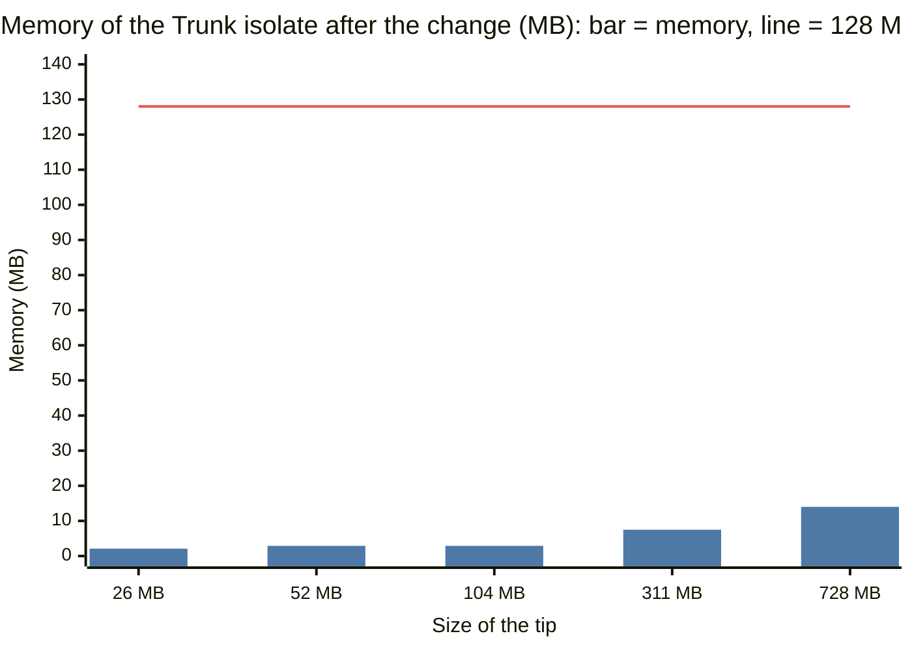

# Big repos (monorepos)

This document tells how big a trunk the sequencer can land on, why, and what we changed.
The sequencer is the Trunk Durable Object (`cf/nerudo-worker/src/trunk.rs`). One Trunk
object serves one repo. One Durable Object isolate has 128 MB of memory.

All the measurements ran on a throwaway Worker, `nerudo-scale-mono`, with the Artifacts
namespace `nerudo-scale`. They did not use the live Worker. The raw results are in
`cf/evidence/scale-mono-20261012.json`.

## Summary

| | Before (3b28852) | After (this branch) |
|---|---|---|
| Largest tip that lands | 26 MB (5,026 files) | 728 MB (70,026 files) |
| A repo that fails | 52 MB tip: init does not complete | 120,026 files in 19,200 directories: Artifacts answers HTTP 500 to each fetch |
| History in memory | All of it | One commit |
| Memory at a 26 MB tip | 76 MB | 2.1 MB |
| Memory at a 728 MB tip | fails | 14 MB |

Before the change, the sequencer read all of trunk's history and every file into memory.
The memory was approximately 3 times the size of the tip. The limit was a tip of
approximately 40 MB, or less with a long history.

After the change, the sequencer reads one commit of trunk and its trees. It reads a file
only when a landing reads it. The memory follows the number of files and directories in
the tree, not their size and not the history. The work for each landing follows the size
of the change.

Now Artifacts sets the limit, not the sequencer. Artifacts stores at most 1 GB for each
repo. It refuses a push of 1 million files. It answers HTTP 500 to each fetch of a repo with
120,000 files in 19,200 directories, also when the tip is only 57 MB. See "What Artifacts
supports".

## How we measured

1. `cf/scale/gen_monorepo.py` makes a synthetic monorepo with git fast-import. The tree is
   `svc/pkgNNN/<dirs>/<files>`, plus the files that the landing rules use (nerudo.toml,
   CHANGELOG.md, migrations/, deps/ and deps.lock). The text is pseudo source code. It
   compresses approximately 2.7 times, as source code does.
2. `cf/scale/mono_bench.py` pushes the repo to Artifacts. It deploys the Worker again, so
   that the trunk starts in a new isolate. Then it starts a trunk on the repo, gets a fork
   for one agent, and lands one change. Then it lands a batch of 5 changes that it built on
   the old head. Each change edits one file in a package and adds a line to CHANGELOG.md.
3. After the landings, the bench fetches main from Artifacts. It checks that each change is
   on main one time, that CHANGELOG.md has each line, and that `git fsck` finds every object.
4. The memory is `wasm_memory_bytes` from `GET .../stats`. It is the size of the WebAssembly
   linear memory of the isolate. It only increases, so it is the peak. `wrangler tail` records
   the result of each request (`exceededMemory`, for example) and its CPU time.

The local fault harness does not show this limit: `wrangler dev` does not apply the 128 MB
limit. Use a deployed Worker.

## The limit before the change

Code at 3b28852. "Memory" is the WebAssembly memory after the step.

| Repo | Files | Tip | Commits | Pack | Init | Land 1 | Batch of 5 | Memory |
|---|---|---|---|---|---|---|---|---|
| t10m | 2,026 | 10.3 MB | 6 | 4.2 MB | 3.1 s | 1.1 s | 2.6 s (4) | 32 MB |
| m25 | 5,026 | 25.9 MB | 21 | 10.8 MB | 6.9 s | 1.5 s | 4.8 s | 76 MB |
| m50 | 10,026 | 51.9 MB | 21 | 20.8 MB | fails | - | - | - |
| m100 | 10,026 | 104 MB | 21 | 38.8 MB | fails | - | - | - |
| h1000 | 2,026 | 10.3 MB | 1,001 | 25.4 MB | fails | - | - | - |

The failure modes:

- m100: init stops after 11.5 s with HTTP 500. The tail shows `exceededMemory`: "Durable
  Object's isolate exceeded its memory limit and was reset."
- m50 and h1000: init does not reply in 150 s, and the client stops. The isolate is new
  after this (its memory is 1.4 MB and it holds no objects), so the old isolate was reset.
- h1000 has a 10 MB tip, the same as t10m. It fails because of its history: the sequencer
  read all 1,001 commits.

We did not try m300 and m1g with the old code. m50 already shows the limit.

## What Artifacts supports

`cf/scale/probe_artifacts.py` sends protocol v2 requests to an Artifacts repo and counts the
objects in each reply. The server calls itself `gitty/1.0`. It advertises
`fetch=shallow filter sideband-all` and `ls-refs=unborn`.

| Request | Result |
|---|---|
| `deepen 1` | Yes. One commit, its trees and its files. |
| `filter blob:none` | Yes. Commits and trees, no files. |
| `deepen 1` and `filter blob:none` | Yes. One commit and its trees. |
| `filter tree:0`, `tree:1` | No. HTTP 400: "only blob:none is supported". |
| `have <parent>` with `deepen 1` | Yes. Only the objects that changed. |
| `want` a commit that is not a branch tip | Yes. |
| `want` a tree | Yes. The tree and all its subtrees (and files without the filter). |
| `want` a file (blob), or several | Yes. Each file whole, not as a delta. |
| `object-info` | No. It is not advertised. |

So, over the git protocol, the sequencer can read one commit and all its trees in one
request. It can also read any set of files by id in one request. It cannot read one tree alone over the
git protocol: `want <tree>` sends all the subtrees too, and there is no `tree:<depth>`
filter.

The Workers binding can read one tree alone. The documentation of the binding
(`developers.cloudflare.com/artifacts/api/workers-binding/`) gives `readTree(hash)`, which
returns the immediate children of one tree, and `readBlob(hash)`, `readCommit(hash)` and
`readFile({ ref, path })`. The sequencer does not use them yet (design item 9).

### Limits of Artifacts

The documented limits (`developers.cloudflare.com/artifacts/platform/limits/`):

| Limit | Value |
|---|---|
| Storage for each repo | 1 GB |
| One file (blob) | 32 MB |
| Git requests | 2,000 for each 10 seconds for each repo |
| Control-plane requests | 2,000 for each 10 seconds for each namespace |

The limits we measured. They are not in the documentation.

| Repo | Files | Directories | Tip | Pack | Push | Fetch |
|---|---|---|---|---|---|---|
| m700 | 70,026 | 2,800 | 728 MB | 261 MB | accepted, 138 s | works |
| d120k | 120,026 | 19,200 | 57 MB | 41 MB | accepted, 152 s | HTTP 500 |
| m1g | 120,026 | 19,200 | 1.07 GB | 388 MB | accepted, 282 s | HTTP 500 |
| f1m | 1,000,026 | 40,000 | 132 MB | 151 MB | HTTP 500 | - |

For d120k and m1g, every fetch that reads the whole tree fails after approximately 2 s with
HTTP 500. This is true for a full fetch, `deepen 1`, `filter blob:none`, `want` of the root tree, and `deepen 1`
with `have` of the parent commit. A fetch of one package (`want svc/pkg000`, 85 trees)
works. d120k has the same tree as m1g and 5% of its size. Thus the failure follows the
number of trees and files, not the 1 GB limit. A `git clone` of these repos fails too.

## Where the memory went (before)

Line numbers are at 3b28852.

| Place | What it did | Cost |
|---|---|---|
| `trunk.rs:432` (init), `trunk.rs:870` (each run), `trunk.rs:944` (base) | `fetch(head)` with no `deepen` and no filter | All history and all files |
| `nerudo-git/src/pack.rs:105`, `:118`, `:121` | `parse_pack` copied each whole object and each delta base | Twice the inflated pack |
| `nerudo-git/src/client.rs:143`, `:147` | The response and the pack are two copies before the parse | The pack, twice |
| `trunk.rs:347` | `put_store` gave the same objects to the web UI's store | A second map of all objects |
| `nerudo-core/src/merge.rs:113` (`footprint`, `edits`, `apply_change`) | Flattened the base and the change | Two full trees for each call |
| `nerudo-core/src/merge.rs:137`, `:251` | Flattened head, then wrote every tree again | A full tree |
| `nerudo-core/src/gates.rs:24`, `:25` | `seal_boundaries` flattened base and change | Two full trees |
| `trunk/prinfo.rs:26`, `:27` | `change_size` flattened base and change | Two full trees |
| `trunk/decide.rs:198`, `:199` | `risk_state` flattened base and change (with `[decide]`) | Two full trees |
| `trunk.rs:1077` | Flattened the new tip for `trunk_checks` | A full tree |
| `trunk.rs:1157` | `missing_from(tip, [head])` walked all of head's history | Every object ever |
| `trunk.rs:1447`, `:1480` | `read_rules`, `touched_rules` flattened trees | Full trees |
| `trunk/compare.rs:167`, `:184` | A task trial flattened the tip and head | Two full trees |

The first two rows set the limit: memory was approximately 3 times the inflated history.
The flattens set the CPU: each one parses every tree and makes a string for each path.

## The design

The target model: the sequencer holds the trunk head as a tree of ids. It reads a file only
when a gate or a landing reads it. The memory follows the tree's size in entries. The CPU,
the requests and the bytes for each landing follow the size of the change.

1. **Trunk at depth 1, trees only.** The sequencer fetches head with `deepen 1` and
   `filter blob:none`. It does not keep history. Trunk's trees are approximately 40 bytes
   for each file entry: 5 MB for 120,000 files.
2. **A change from its fork, as trees.** The sequencer fetches the change's base from
   trunk first (`want base`, `have head`, `deepen 1`, no files). Then it fetches the change's
   commit and trees from the fork, with `have head` and `have base`. The fork sends only the
   trees that the change made.
3. **A tree diff, not a flatten.** `Store::diff` compares two trees. It descends only where
   the subtree ids differ. Its result is the same as a comparison of two flattened trees.
4. **Files only where they are read.** `merge::blobs_needed` names the files that the gate
   and the landing read. First, it names each edited file at the base, in the change, and on head (where
   head changed it since the base). It also names head's nerudo.toml, the commutative
   files, and the source directory of each derived file. The sequencer fetches them by id
   in one request to the fork and one to trunk.
5. **A landing writes only its paths.** `Store::edit_tree` writes the trees on the edited
   paths. The other subtrees keep their ids. The result is the same tree that `write_tree`
   makes from the flattened files.
6. **Checks read only their directories.** The rules name a directory for each check
   (`migrations/`, `deps/`). `gates::check_files` reads those directories, nerudo.toml and
   the derived files. The checks give the same result as on the whole tree.
7. **The push sends only the change.** `Store::new_objects` compares each new commit with
   its parent and takes the objects on the changed paths. It never walks history.
8. **A bounded cache.** The store gets the trees and files of each landing. When it holds
   more than twice one read of head's trees, and more than 32 MB, the sequencer empties it.
   The next run reads head's trees again.
9. **Next: read trees one at a time, and keep them in Durable Object storage.** The binding's
   `readTree(hash)` reads one tree. With it, the sequencer reads head's root tree. Then it
   descends only along the paths that a change edits, and along the directories that the rules
   name. It never reads all of head's trees, so a repo that Artifacts cannot send whole
   (d120k) can still land.

   Each tree that the sequencer reads goes into Durable Object
   storage by id (a SQLite-backed object holds 10 GB). A new isolate reads trees from
   storage, not from Artifacts. The memory holds only a bounded cache of parsed trees.

   The work: the sequencer makes the tree object from the entries that `readTree` returns.
   It also checks that the object's id is the hash it asked for. A pure function that meets a
   missing tree returns its id, and the sequencer reads that tree and runs the function
   again.

### A gate never passes on a file it could not read

Before the change, `gates.rs` read a missing file as empty text. With a full store this did
not occur. With a partial store it is dangerous: a test ratchet would see "no tests before"
and ask for no seal.

Now a file that is not in the store is an error. The gate ejects the
change as `missing`. In a 3-way merge, a missing side is `missing`, not a conflict. The
landing fetches a missing file from trunk and tries again, at most 3 times.

## What the first increment changed

Commits 7a1c3dd (`cf: the sequencer reads trunk's trees, not its history or its file
contents`) and 1c197e7 (init records the size of the trees it read):

- `nerudo-git`: `fetch_with` and `FetchOpts` (`deepen`, `filter blob:none`). If the server
  refuses the filter (any answer that is not a network error or HTTP 5xx), `fetch_with` sends
  the request again without the filter. Thus, on a git server that refuses filters (git
  without `uploadpack.allowFilter`), the sequencer reads all of trunk's files again, and the
  old limit applies. Artifacts accepts the filter. `Store::file`, `flatten_dir`, `diff`,
  `edit_tree`, `new_objects`, `bytes`. `parse_pack` moves each object and reads delta
  bases in place.
- `nerudo-core`: `footprint`, `edits`, `apply_change` and `seal_boundaries` use the tree
  diff. `apply_change` reads head through an overlay of its edits and writes with
  `edit_tree`. New: `merge::blobs_needed`, `gates::check_files`. A missing file is an error.
- `nerudo-worker`: all trunk reads use `FetchOpts::TREES`. The gate reads the base, the
  change's trees and the needed files. The landing uses `check_files` and `new_objects`.
  `read_rules` and `touched_rules` read one path. A conflict receipt and a CI receipt fetch
  the trunk commits since the base, without files (`load_history`). The type check fetches
  the TypeScript and JSON files it sends. The landing store does not share objects with the
  web UI's store, and it has the bound in item 8.

Tests:

- `nerudo-git/tests/trees.rs`: `diff`, `edit_tree`, `file`, `flatten_dir` and
  `new_objects` against `flatten`, `write_tree` and `missing_from`, on 400 random trees
  each. The trees have names that sort differently as files and as directories, files that
  become directories, and the reverse.
- `nerudo-core/tests/partial.rs`: a store with only trees, plus the files that
  `blobs_needed` names, lands the same commit, byte for byte, as a store with every object.
  Without those files, `seal_boundaries` is an error and `apply_change` is `missing`.

Other tests on the final code:

- `cargo test` for nerudo-core, nerudo-git and nerudo-cli, and `cargo check -p
  nerudo-worker --target wasm32-unknown-unknown`: all pass.
- The local fault harness, `nix run .#faults -- --cases parity`: 4 of 4 scenarios pass. One
  earlier run had 1 failure: `wrangler dev` lost the connection on a request that closes a
  PR, and the same code passed the next run.
- The harness with 14 scenarios: 10 pass. `beaten`, `git`, `context` and `identity` fail
  with the same errors on the code before the change (3b28852): they need the Artifacts host.
- On the throwaway Worker with Artifacts, `approvals`, `beaten`, `git`, `context` and
  `release` pass (trunk names start with `mono-scn-`). `compare` fails there only because
  the throwaway Worker has no `CI` binding, so `[ci] typecheck` cannot run. It passes on
  the local harness, which has CI.

## Before and after

The same repos, the same changes. "Memory" is the WebAssembly memory after all landings.
"Held" is the number of objects in the landing store after all landings.

| Repo | Tip | Before | After: init | Land 1 | Batch of 5 | Memory | Held |
|---|---|---|---|---|---|---|---|
| m25 | 25.9 MB | lands; 76 MB, 6,717 objects | 2.4 s | 2.3 s | 7.4 s | 2.1 MB | 356 |
| m50 | 51.9 MB | fails | 3.9 s | 3.5 s | 8.9 s | 2.9 MB | 629 |
| m100 | 104 MB | fails | 4.1 s | 2.7 s | 7.5 s | 2.9 MB | 629 |
| h1000 | 10.3 MB, 1,001 commits | fails | 1.8 s | 9.7 s | 35.7 s (4 land, 1 conflict) | 1.9 MB | 204 |
| m300 | 311 MB | not tried | 6.2 s | 5.1 s | 15.1 s | 7.5 MB | 2,729 |
| m700 | 728 MB | not tried | 8.3 s | 6.6 s | 19.3 s | 14 MB | 3,779 |
| m1g | 1.07 GB | not tried | HTTP 500 from Artifacts | - | - | - | - |

The chart shows the memory after the change from the table, against the limit of 128 MB of
an isolate. Before the change, m25 used 76 MB, and m50 and m100 failed.



Each run that landed passed the read-back check: each change is on main one time,
CHANGELOG.md has each line, and `git fsck` finds every object. In h1000, the fifth change of
the batch edits the same line as the first landing (the repo has only 5 packages). The
sequencer ejected it as a conflict, and its receipt names the landing that beat it. That is
the correct result. It also shows that `load_history` read the trunk commits since the base.

The time and the requests:

- A landing makes more requests than before: 19 git requests for 6 landings in 3 batches,
  before 12. The new requests read the base, the change's files and head's files by id. On
  m25 one landing takes 2.3 s, before 1.5 s. The sequencer trades these requests for memory.
- The tail reports 1 to 27 ms of CPU for each landing run, before and after (m25 before:
  17 ms). CPU was not the limit at these sizes.
- The time of a landing is the time of the requests to Artifacts. One landing takes 9.7 s
  on h1000 (1,001 commits) and 2.7 s on m100 (21 commits), with the same CPU. So Artifacts is
  probably slower for each request on a repo with a long history. We did not time each
  request.
- The first fork of a big repo is slow: 7 s at 26 MB, 13 s at 104 MB, 58 s at 311 MB and
  94 s at 728 MB. The agent waits for it one time.

## What remains

The landing path no longer reads history or file contents it does not use. These parts are
still O(repo) or larger:

| Place | What it does | Effect |
|---|---|---|
| Head's trees in memory (`trunk.rs`, `FetchOpts::TREES`) | A new isolate reads all of head's trees in one fetch | Artifacts fails this fetch at 120,000 files in 19,200 directories. In memory, it is approximately 40 bytes for each file entry. Item 9 of the design removes both limits. |
| `nerudo-git/src/client.rs` (`fetch_once`), `transport.rs:28` | A reply is in memory as the JavaScript buffer, a copy in WebAssembly, and the pack | Three copies of the largest reply: the trees of head |
| `Store::file` | Parses each tree on the path each time | CPU for each lookup, with no cache of parsed trees |
| `trunk/ui.rs:195` (`ui_store`) and its callers in `app.rs`, `releases.rs`, `context.rs`, `compare.rs`, `git.rs:408` | The web UI, release notes, context and plain `git push` read a full copy of trunk with history | On m50 and larger, these pages and plain `git push` fail as landings did before. The API that agents use (`land`, `changes`, `queue`, `stats`, `log`) does not read this copy. |
| `ci.rs:34`, `trunk.rs` (`typecheck_files`) | `[ci] typecheck` sends every TypeScript and JSON file | The type check follows the size of the source, by design |
| `trunk/import.rs:94`, `:125`, `:141` | An import reads the start commit with all its files and writes all its trees | An import of a big repo fails. Artifacts has no server-side copy into a new repo that we can use. |
| `merge::blobs_needed` (derived files) | Reads every file of a derived file's source directory at each landing | Follows the size of that directory |
| `trunk/beaten.rs` (`load_history`) | Reads up to 200 trunk commits for a conflict receipt | Only on a conflict or a CI failure |
| Artifacts (`forks`) | The first fork of a big repo is slow: 13 s at 50 MB, 58 s at 311 MB | The agent waits for its first fork |
| Artifacts, deep history | One landing takes 9.7 s on h1000 (1,001 commits) and 2.7 s on m100 (21 commits), with the same CPU. The server is probably slower for each request. | The landing time probably follows the history on the server side |
| `fetch_with` without the filter | A git server that refuses `filter blob:none` gets the request again without it | On such a server (not Artifacts), the old memory limit applies |

## The combined build (scale-all)

Merge fd705d1 puts this work on scale-all, with the gate prefetch of scale-stages (daa9af4).
The data is in `cf/evidence/scale-mono-combined-20261012.json`.

### How the two fit

The prefetch of scale-stages asks each fork once for all its queued commits, at most 6 forks
at the same time. The trees-only store needs more reads, so the prefetch now has three
steps. In each step, all requests go at the same time, one to each host:

1. Trunk: the bases of the queued changes that the store does not have, as commits and trees.
2. Each fork: its queued commits, as commits and trees (`filter blob:none`).
3. Each fork: the files that its changes edit, at the base and in the change. Trunk: the files
   that head changed on those paths, nerudo.toml, and the derived sources.

The error rules of scale-stages do not change. If a request was for one change, its error is
the fetch of that change for the round. Other failed requests make the gate fetch one change
at a time. `fetch_body` now takes `FetchOpts`.

### Tests

- `cargo test` for nerudo-core, nerudo-git, nerudo-cli and nerudo-worker: all pass.
  `cargo check` and `clippy` for wasm: pass, with the same 4 warnings as 3b28852.
- `nix run .#faults`, all cases: 49 passed, 3 known gaps, 1 failure. The failure is in
  `ci_down`: `wrangler dev` lost the connection on `POST .../resume` to a paused trunk, so
  the case stopped. The second run of `ci_down`: 38 passed, 4 known gaps, 0 failures. All 5
  known gaps are the CI gaps.

### Measurements on Artifacts

The safe build is 128b641 (scale-safe). The combined build is fd705d1. Both ran on
`nerudo-scale-mono`, each with new trunks.

One change at a time, each on the new head (6 changes, the time from the land request to
the landing record):

| Repo | Safe: median | Combined: median | Safe: memory | Combined: memory |
|---|---|---|---|---|
| tiny (46 files, 23 KB) | 0.73 s | 0.85 s | 1.8 MB | 1.6 MB |
| m25 (5,026 files, 26 MB) | 1.50 s | 1.45 s | 76 MB | 2.1 MB |

The stage timings explain the difference. The safe build reads the change with one request
(0.27 s on tiny, 1.0 s on m25). The combined build reads the change's trees, then its files:
two requests, one after the other (0.5 s on tiny, 0.9 s on m25). Its push is smaller and
faster (0.33 s against 0.40 s on tiny). On tiny, the second request costs approximately
0.12 s for each landing. On m25, the smaller requests and push save more than that.

A burst of 512 changes from 4 forks, batch cap 16 (`stages.py`, trunk names that start with
`mono-stages-`, no requests to the live Worker):

| Build | Drain | First landing | Git requests | Landed | Ejected |
|---|---|---|---|---|---|
| scale-stages after its fix (`stages.md`) | 23.56 s | 1.35 s | 68 | 512 | 0 |
| Combined | 17.78 s | 1.51 s | 72 | 512 | 0 |

The first round makes 8 fetch requests in two steps (0.98 s), and later rounds make none.
The pushes take 16.8 s of the 17.8 s. Each push sends only the batch's new objects. This is
one run of each build, and runs at 512 changes vary by several seconds (`stages.md`).

The 728 MB repo (m700) still lands on the combined build, with 13.6 MB of memory. The times:
init 15.5 s, one change 4.3 s, a batch of 5 in 7.6 s. The read-back check passes.

## The next increments (branch mono-next)

The data is in `cf/evidence/scale-mono-next-20261012.json`. Each step has its own commit and
its own measurements, so each step can ship alone.

### Step 1: one fetch for a change on a small repo

Commit b2d223e. The combined build read a change in two requests, one after the other: the
trees, then the files. Now it reads a change in one request, as scale-safe does:

- The gate asks the fork for the change's commit with the trees and files that it adds. If
  the fork refuses, the gate asks again for the commits and trees only, and then reads the
  files by id. The gate does the same if the pack has a delta on a file that the store does
  not have.
- `merge::blobs_needed` asks for the base's version of a file only where something reads it:
  - a 3-way merge (head changed the file)
  - a commutative file
  - a test or migration that a seal rule reads (`gates::reads_base`)
  - a decision model
- The size of a PR still counts each edited file. The landing loop reads the base files that
  it needs from trunk while the push runs, and before it parks a change. Until then,
  `change_size` gives no size.

One change at a time, 6 changes, median time from the land request to the landing record:

| Repo | scale-safe | Combined (fd705d1) | Step 1 |
|---|---|---|---|
| tiny | 0.73 s | 0.85 s | 0.70 s |
| m25 | 1.50 s (76 MB) | 1.45 s (2.1 MB) | 1.49 s (2.1 MB) |

After its first landing, each round makes one fetch request (before: two). Every PR has its
size (2 files, +2 −1). m700 still lands (one change 4.1 s, a batch of 5 in 7.2 s, 14 MB of
memory), and the read-back check passes. `nix run .#faults`: 82 passed, 5 known gaps, 0
failures.

### Step 2: trees one at a time through the binding

Commits 719f3f5 and 83a0a6f. Artifacts answers HTTP 500 to every git fetch that walks a
tree of approximately 120,000 files in 19,000 directories (d120k, m1g). This includes a fetch of
one small commit with `have` of head. A fetch of files by id works (0.19 s), and a push
works (7 s). The Workers binding reads one tree with `readTree` in approximately 45 ms (6 reads at
the same time take 71 ms). It reads one commit with `readCommit`.

- A trunk goes to lazy mode when a git fetch of head's trees fails with HTTP 5xx. It also goes
  to lazy mode when the fetch gives more than 1 MB of trees (approximately 25,000 files). The object keeps `lazy_trees` in storage.
  A smaller trunk keeps one git fetch of head's trees: for it, that is faster than one read
  for each tree.
- In lazy mode the landing loop does not fetch head's trees. When the pure code returns
  "missing object: <id> (<kind>)", `objects::fill` reads that object and runs the code
  again. The source is, in order: this object's storage, the binding (trunk's repo, then
  the change's fork), and git.
- `readCommit` gives the fields of a commit without the time zones. The object makes the
  commit again with each time zone, and keeps the one whose id is the commit's id.
- Each object that the binding reads goes into the object's storage, and so does each new
  head. The storage keeps at most 50,000 objects; then the cache starts again empty.
- On any Artifacts trunk, a change that git cannot fetch from its fork comes through the
  binding. In lazy mode, after a fork answers HTTP 5xx, the gate does not try git for 10
  minutes.

Results on `nerudo-scale-mono`:

| Repo | Result |
|---|---|
| d120k (120,026 files, 19,200 directories) | Lands. Init 1.7 to 5.2 s. One change 10.7 to 11.4 s, a batch of 3 in 16.1 s. 1.8 MB of memory, 49 objects. The push takes 7 s of each round, because Artifacts is slow to receive a push to this repo. |
| m700, every cold start lazy (first version) | Init 2.1 s (git fetch of trees: 8.7 to 15 s), 1.6 MB of memory (git: 14 MB) |
| tiny, every trunk lazy (first version) | 0.90 s for one change (scale-safe 0.73 s). So we added the size rule. |
| tiny and m25, with the size rule | 0.73 s and 1.34 s (scale-safe 0.73 s and 1.50 s) |

Git cannot read d120k, so the bench checks it through the landing log and through the
binding. CHANGELOG.md on main has each line, and each edited file has its changed line.
`nix run .#faults`: 82 passed, 5 known gaps, 0 failures.

### Step 3: the UI, release notes, plain git push and import

Commit 8b2f403. These paths read a full copy of trunk with its history, so they failed on a
big trunk.

- The UI's copy of trunk (`ui_store`) is now a guard. When the guard drops, the object gets
  its copy again, also if the request stops early.
- On a trunk in lazy mode, the UI's copy fetches nothing. The store records each object
  that a page asked for and did not have (`Store::take_misses`), also where the page continued
  without it. The request then reads those objects and runs again, at most 32 times.
  It reads trees and commits through the binding, 8 at the same time, and files with one
  git request. Only reads run again. A release proposal or signature first reads what the
  draft needs (`warm_ui`).
- The change, landing, compare and release views compare two trees (`views::changed_files`)
  and do not flatten them. The file and directory views read one path (`views::path_view`).
  The history of a file compares one path in each commit.
- A plain git push (`push_base`) on a lazy trunk takes main's commits from the landing log.
  It reads the commits before the oldest landing one at a time. It fetches the pushed
  commits from the fork with haves that the store does not hold (`FetchOpts::any_haves`),
  or through the binding.
- An import from a URL makes the trunk repo as an Artifacts fork of the import. The object
  reads the root tree of the start commit through the binding. Then it pushes three
  objects: nerudo.toml, the new root tree and the new first commit. No file of the
  import goes through the object. `"whole": true` in the import keeps the old way.

Results:

| Path | m700 (lazy, 728 MB) | d120k (lazy) |
|---|---|---|
| `GET state` | 0.14 s | 0.22 s |
| `GET change/one` (first read) | 3.48 s, 2 files in the diff | 6.36 s, 2 files |
| `GET tree`, a directory, a file | 0.26 s, 0.73 s, 0.31 s | 0.21 s, 0.19 s, 0.41 s |
| `GET history`, and of one file | 0.29 s, 0.71 s (9 read rounds, 1 landing) | 0.20 s, 0.20 s |
| `GET release/draft` | 2.14 s | 409: nothing merged yet (correct) |
| plain `git push` of a branch | PR opened in 7.6 s, landed after 10.6 s | PR opened in 12.4 s, landed after 20.3 s |

- On the tiny repo (not lazy), all the same reads take 0.13 to 0.51 s. A plain git push
  lands in 1.8 s.
- An import of cloudflare/agents (depth 1) takes 14.9 s with 1.6 MB of memory. Main is one
  root commit with the upstream tree and nerudo.toml.
- One change at a time: tiny 0.67 s and m25 1.03 s (scale-safe 0.73 s and 1.50 s).
- A burst of 512 changes from 4 forks (cap 16): 22.1 s, first landing 1.4 s, 4 fetch
  requests in one step, 512 landed, 0 ejected. scale-stages after its fix: 23.6 s; the
  combined build: 17.8 s. The pushes take 21.4 s of the 22.1 s, and runs vary by several
  seconds.
- `nix run .#faults`: 82 passed, 5 known gaps, 0 failures.
- In the d120k run of step 3, the sequencer ejected the batch as conflicts. Earlier trunks on the
  same Artifacts repo edited the same lines, and the bench builds each change on the
  repo's first main. That ejection is correct.

### What remains after mono-next

| Item | Effect |
|---|---|
| A push to a repo like d120k takes 7 s on Artifacts | One batch takes at least 7 s on such a repo |
| A fork of a big repo takes 1 to 5 minutes on Artifacts | The agent's first fork, and an import, wait for it |
| Agents cannot `git clone` a repo like d120k from Artifacts (HTTP 500) | Such a repo needs another way to give agents the code |
| A cold UI read on a lazy trunk reads one tree after the other on each path | The first change view takes 3 to 6 s |
| `[ci] typecheck` sends every TypeScript and JSON file | The type check follows the size of the source |
| The 1 MB rule of lazy mode is a first guess | A trunk with 1 MB of trees reads them by git one time, then goes lazy |

## Run it

You need wrangler (logged in), git, Python 3, and a throwaway Worker. Do not use the live
Worker.

1. Make a wrangler config with the name of your Worker.
2. In the config, add the `TRUNK` and `HUB` Durable Object bindings and migrations.
3. In the config, add an `[[artifacts]]` binding to your own namespace. Do not bind `CI` or
   `AI`.
4. Put `NERUDO_ADMIN_TOKEN`, `NERUDO_AGENT_TOKEN` and `NERUDO_WORKER` in a vars file.
5. Set the two tokens as secrets of the Worker.

```sh
cd cf/nerudo-worker && worker-build --release && cd ../..
python3 -I cf/scale/gen_monorepo.py /tmp/m100 --files 10000 --bytes 100M
WRANGLER=path/to/wrangler python3 -I cf/scale/mono_bench.py --vars scale.vars \
  --repo /tmp/m100 --name mono-m100 --config wrangler.toml --out m100.json
python3 -I cf/scale/probe_artifacts.py <remote> <token.json>
```

The repos in the evidence:

| Repo | Arguments |
|---|---|
| t10m | `--files 2000 --bytes 10M --commits 5` |
| m25 | `--files 5000 --bytes 25M` |
| m50 | `--files 10000 --bytes 50M` |
| m100 | `--files 10000 --bytes 100M` |
| h1000 | `--files 2000 --bytes 10M --commits 1000 --churn 10` |
| m300 | `--files 50000 --bytes 300M` |
| m700 | `--files 70000 --bytes 700M` |
| m1g | `--files 120000 --bytes 1G --depth 3` |
| d120k | `--files 120000 --bytes 60M --depth 3` |
| f1m | `--files 1000000 --bytes 150M --depth 2 --fanout 4` |
