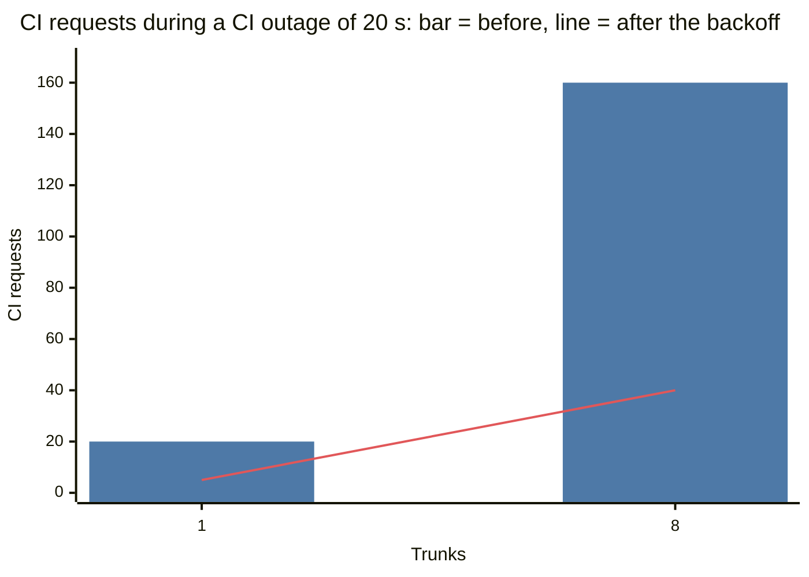

# Deadlines, intervals and stalls

This document gives one rule for each call that leaves the nerudo Worker. The rule has three
parts: a deadline, an interval before the next try that doubles, and a status that people and
agents can read.
It tells what the rule changed, the results of the fault tests before and after, and the
limits that stay.

All runs are from 2026-10-12. The local data is in
[`../evidence/faults-20261012-resilience.json`](../evidence/faults-20261012-resilience.json).
The data from Cloudflare is in
[`../evidence/resilience-cloudflare-20261012.json`](../evidence/resilience-cloudflare-20261012.json).

## Summary

- CI: a type check with no answer in 25 s fails as `ci_unavailable`. Before, the Worker
  waited for the full hang: 46 s between two CI requests in the `ci_hang` test. Now 26 s.
- After a failed run, the landing loop waits 1 s, 2 s, 4 s ... at most 30 s. Each interval is
  longer by a random 0 % to 25 %. Before, it tried again each second. In a CI outage of
  20 s, one trunk sent 20 CI requests before and 5 now. 8 trunks sent 160 before and 40 now.
- The queue, the summary and the receipt of a queued change have a `stall` field. The field
  tells why the loop waits, since when, the number of failed tries, and the time of the next
  try. The PR page shows
  it as a pending check. Before, nothing showed why the changes waited.
- git: each git request of the Trunk stops with no answer in 30 s, or when its answer stops
  for 30 s. Before, a git host that kept the connection open with no answer held the landing
  loop until the connection closed. The new `git_hang` test makes that fault two times, for
  40 s each. Now the loop stops the request at 30 s, shows `git_unavailable`, and lands again
  3 to 9 s after the host answers. Before, it showed nothing and waited for the full fault.
- The next run sends a push with no answer again as the same push, never as a new batch. Thus
  a push that lands late cannot land the same changes two times.
- When a Durable Object refuses a request because it is overloaded, the Worker gives HTTP 503
  with `Retry-After: 1`. Before, it gave HTTP 500. On Cloudflare, 1,000 Hub lookups each
  second gave 3,764 answers 503 of 20,000, and no 500. The CLI sends the request again, at
  most 3 times.
- On Cloudflare with Artifacts, a CI outage of 90 s gave 7 failed tries (before: one each
  second, thus approximately 90). The change landed 6.6 s after CI was available again. The
  scenarios approvals, recovery, ci, ci_red, git and identity passed.
- Cost: after CI is available again, the queue waits for its next try. In the test, the
  changes landed 13 to 19 s after CI was available again. Before, 0.7 to 1.3 s.

## The rule

| Call | Deadline | After a failure | What people see |
|---|---|---|---|
| CI, the type check (`ci.rs`) | 25 s for the answer | The run fails. The next run starts after the interval. | `stall.kind` = `ci_unavailable`; the type check row of the PR is pending |
| git, each request of the Trunk (`transport.rs`) | 30 s for the answer, plus 1 s for each MB that the request sends; 30 s for each pause in the body of the answer | A gate fetch: the change stays queued (`fetch_retry`, as before). Any other request: the run fails. | `stall.kind` = `git_unavailable`; a row "Sequencer" on the PR |
| Any other error of a run | None | The run fails. The next run starts after the interval. | `stall.kind` = `error` |
| A push with no answer | The git deadline | The next run reads trunk. If trunk did not move, it sends the same push again. | `stats.pushes_again` |
| A Hub or Trunk object refuses a request: overloaded (`lib.rs`) | None (the object refuses) | HTTP 503 with `Retry-After: 1`. The CLI tries again. | The JSON body: `error`, `retry_after_s` |

The interval (`retry.rs`, `backoff_ms`): 1 s after the first failure, then 2 s, 4 s, 8 s and
16 s, then 30 s. Each interval is longer by a random 0 % to 25 %. The jitter only adds time.
Thus trunks that failed at the same time do not all try again at the same time. Also, an
outage never gets more tries than with intervals that have no jitter.

A unit test checks the intervals against the budget of the fault harness. In an outage of T
seconds, the budget allows at most 2 + ⌈log2 T⌉ + T/30 tries. The test uses T from 1 s to
1 day.

### Why these values

- **CI, 25 s.** The CI Worker has 30 s of CPU. A check that needs more fails there anyway.
  25 s plus the first interval (1 s to 1.25 s) is less than 30 s, the budget of `ci_hang`.
  A tree whose check needs more than 25 s never lands; the stall says "no answer from the CI Worker in 25 s".
- **git, 30 s.** On Artifacts, the longest request that we measured took 8.3 s: the first
  read of a 728 MB repo (`mono.md`). One push took 24 s once under load (`repos.md`). The
  deadline is for the answer and for each pause, not for the full transfer. A large fetch
  can take more than 30 s if data continues to come.
- **The interval, 1 s to 30 s.** The first try comes soon, for a short fault. Then the load
  on a service that is down falls fast. At 30 s, 1,000 trunks send approximately 33 requests
  each second to a CI service that is down. Before, they sent 1,000.

## The stall

When a run of the landing loop fails, `alarm` records a stall in the storage of the Trunk
(`trunk/stall.rs`). Then it sets the alarm for the next run and returns Ok. The runtime thus
does not also try the alarm again on its own. The next run that succeeds deletes the stall.

```json
"stall": {
  "kind": "ci_unavailable",
  "detail": "ci_unavailable: the CI Worker answered HTTP 503: ci down (faults)",
  "since_ms": 1791845250123,
  "attempts": 4,
  "next_ms": 1791845265456
}
```

| Where | Field |
|---|---|
| `GET /v1/trunks/{trunk}/queue` | `stall`, null when the loop runs |
| `GET /v1/trunks/{trunk}/summary` | `stall` |
| `GET /v1/trunks/{trunk}/changes/{id}` | `stall`, only for a queued change and only during a stall |
| The PR page (`trunk/prinfo.rs`) | The type check row is pending: "CI is unavailable for 41 s (5 tries failed, next in 8 s): the CI Worker answered HTTP 503". For a stall of another kind, a row "Sequencer" is pending. The row also has the `stall` object. |

The record is in storage, so a restart keeps the count of failed tries. The Trunk does not
write the changes again during a stall: one write for each failed run.

## A push with no answer

A push can fail at its deadline while the git host still has it. The host can apply it after
that deadline. The landing loop writes the attempt record before the push. Thus the next run
reads trunk (`reconcile`):

- Trunk is at the tip of the attempt: the push landed. The run records the landings, as
  before.
- Trunk is at the start of the attempt: before this change, the run deleted the attempt and
  made a new batch from the same start. That is a different commit with the same `old` value.
  If the late push then landed first, the new push failed as an external move. Then the changes
  of the late push were on main with no landing record.
- Now (`trunk/repush.rs`) the run sends the same push again: the same `old` and the same
  `new`. The two pushes are one compare-and-swap. At most one of them changes main, and the
  result is the same. If the host refuses the push again and trunk is still at the start, the
  attempt record stays, and the next run asks again.

The push again needs the objects of the attempt in memory. After a restart they are gone, and
`reconcile` works as before. A restart also stops the push of the old process.

## Results of the fault tests

`cd cf && nix run .#faults` on this computer, with Gitea, toxiproxy and `wrangler dev`
(`../faults/README.md`).

Three full runs after the change: `d5e7c29`, `c7feca8` and `a22b93d` (the evidence file).
The table gives the range of the three runs.

| Case | Before (commit `3b28852` and the harness of `1a885ad`) | After |
|---|---|---|
| `ci_down`, 1 trunk, 20 s of HTTP 503 | 20 CI requests. Nothing showed the cause. Landed 0.7 s after CI was available again. | 5 CI requests (budget 8). The queue and the change showed `ci_unavailable`. Landed 13.3 to 15.7 s after CI was available again. |
| `ci_down`, 8 trunks | 160 CI requests, 20 for each trunk. Landed 1.2 s after. | 40 CI requests, 5 for each trunk. Landed 16.6 to 18.5 s after. No stall after CI was available again. |
| `ci_hang`, each request hangs 45 s | The second CI request came 46 s after the first. Landed 43 s after CI was available again. | The second request came 26 s after the first. During the hang, the queue showed `ci_unavailable: no answer in 25 s`. Landed 3.7 to 4.3 s after CI was available again. |
| `git_hang`, replies dropped for 40 s | See "git_hang before the change". | The queue showed `git_unavailable`. The next landing came 2.7 to 3.0 s after the host answered again. |
| `git_hang`, requests dropped for 40 s | See "git_hang before the change". | The queue showed `git_unavailable`. The next landing came 8.8 to 9.9 s after. The Worker sent 2 pushes again in each run. 6 of 6 changes landed once; no external move. |
| `git_flaky`, `kill9`, `growth`, `parity` | Pass | Pass. In the first run, the approvals scenario failed one time with the known local fault of `wrangler dev` ("Network connection lost" after a 403). It passed when it ran again. |

The chart shows the CI requests of `ci_down` from the table. The bar is the count before the
change, and the line is the count after it.



### git_hang before the change

The same `git_hang` case ran on the code before this work (`128b641`, with the new
`run.py`; [`../evidence/faults-20261012-git_hang-before.json`](../evidence/faults-20261012-git_hang-before.json)).
3 checks failed:

- During both faults, the queue showed no stall: nothing told why the changes waited.
- The Worker logged no deadline. The landing loop waited in the hung request for the full
  fault of 40 s.
- After each fault, the next landing came 3.1 to 3.5 s after the host answered again. That
  is as fast as after the change, because toxiproxy closes the connections of a `timeout`
  toxic when the harness removes the toxic. The hung request then failed with "Network
  connection lost", and the loop tried again after 1 s.

Thus this test cannot show the worst case: a host that keeps the connection open after the
fault, with no answer. Then a request with no deadline waits until a limit of the platform
ends it. The tests did not measure that limit on Cloudflare. The many-repo test saw one push
of 24 s.

## Results on Cloudflare

A throwaway Worker `nerudo-scale-resil` (the Worker code of this work, Artifacts namespace
`nerudo-scale`, no AI binding) ran three tests. The tests did not use the live Worker.

| Test | Result |
|---|---|
| Scenarios on Artifacts: approvals, recovery, ci, ci_red, git, identity (`scripts/scenarios.py`, CI bound to `nerudo-ci-scale`) | All passed. |
| CI outage of 90 s: one trunk with a type check, one change. A throwaway CI stub `nerudo-ci-scale-resil` answered 503, then sent each check to `nerudo-ci-scale` again. | 7 failed tries in 90 s (budget 12). The queue showed the stall during the outage; for example after 39 s: `ci_unavailable`, 6 failed tries, the next try in 30 s. The change landed 6.6 s after we deployed the stub again with CI on. This time includes the time for the new version to reach the edge. No stall after. |
| Overload: a throwaway driver Worker (`hub_driver.js`, deleted after the test) sent 1,000 Hub lookups each second for 20 s. It used a service binding (path a of `hub.md`). | 16,236 answers 404 (a success on this path) and 3,764 answers 503, with the body `busy, try again in 1 s: Error: Durable Object is overloaded. Requests queued for too long.` (or `Too many requests queued.`). A second step of 10 s showed the header `Retry-After: 1` on each 503. No 500. `hub.md` gave HTTP 500 for the same errors before. |

## Limits

- **Recovery is slower.** After CI is available again, the queue waits for its next try: at
  most one interval, so at most 37.5 s after a long outage. In the test, 13 to 19 s.
- **Calls that do not have the rule yet.** The plain-git proxy (`trunk/git.rs`) streams the
  push and fetch of a person's git client, and that client has its own time limit. The
  Artifacts REST calls (`host.rs`: create a repo, fork, tokens) and the decision model
  (`trunk/decide.rs`) have no deadline. The call to the Hub (`hub.rs`, `names.rs`) has no
  deadline: only its overload error becomes 503 (`hub.md`, "An overload of the Hub is not
  contained").
- **A slow type check is a limit now.** A tree whose type check needs 25 s to 30 s landed
  before this change. Now it never lands, and the stall says "no answer from the CI Worker in 25 s". Raise
  `ci::TIMEOUT_MS` for such a repo.
- **A failed run is not an alarm exception any more.** The alarm handler returns Ok after a
  failed run, so the metrics of Cloudflare do not count it as an error of the alarm. The
  signal is now the log line `landing loop: ...` (console error) and the `stall` field.
- **The detail of a stall is the text of the error.** For git it names the service
  (`POST git-receive-pack`), never a URL or a token. Agents and the web app read it.
- **The gate keeps its own interval** for a change that it cannot fetch (`fetch_retry`:
  1 s to 30 s, no jitter). It did not change, to keep the merge with the large-repo work
  simple.
- **Only the Hub got an overload.** The test on Cloudflare made the Hub refuse requests. A
  Trunk object refuses with the same errors (`hub.md`, "The Trunk objects"), and the same
  code in `lib.rs` maps them. But the test did not load that path. The local runtime does
  not refuse requests as an overloaded object; unit tests check which errors become 503.
- **The tests cannot make the race of a late push on demand.** toxiproxy delivers the data
  of one connection in order, so a late push reaches Gitea before a later read. `git_hang`
  sends 2 pushes again; `git_flaky` and `kill9` check exactly once with lost replies and
  crashes.
- **One test computer.** Several agents ran tests on the same computer at the same time.
  The times can vary.

## Run the tests again

- Local: `cd cf && nix run .#faults -- --cases ci_down,ci_hang,git_hang`, or all cases.
- Cloudflare:

  1. Deploy a throwaway Worker (never the live one) with CI bound to a small stub. The stub
     answers 503 when a variable says so. If not, it sends the check to the real CI Worker.
  2. Pause a trunk with `[ci] typecheck`.
  3. Send one change.
  4. Set the stub to 503.
  5. Resume the trunk.
  6. Read `GET .../queue` each 2 s.
  7. Deploy the stub with CI on.
  8. Wait for the landing.

  For the overload, use the driver of `hub.md` on path a at 1,000 calls each second. Delete
  the driver after the test.

## Files

| File | Contents |
|---|---|
| `nerudo-worker/src/retry.rs` | `within` (a deadline for a future) and `backoff_ms` (the interval), with their tests |
| `nerudo-worker/src/ci.rs` | The CI deadline, `ci_unavailable` errors |
| `nerudo-worker/src/transport.rs` | The git deadlines |
| `nerudo-worker/src/trunk/stall.rs` | The stall record, the next run, the receipt with the stall |
| `nerudo-worker/src/trunk/repush.rs` | The same push again |
| `nerudo-worker/src/lib.rs` | HTTP 503 for an overloaded object |
| `nerudo-cli/src/main.rs` | The CLI tries again after a 503 with `Retry-After` |
| `faults/run.py` | `ci_down`, `ci_hang` as hard checks; the new case `git_hang` |
