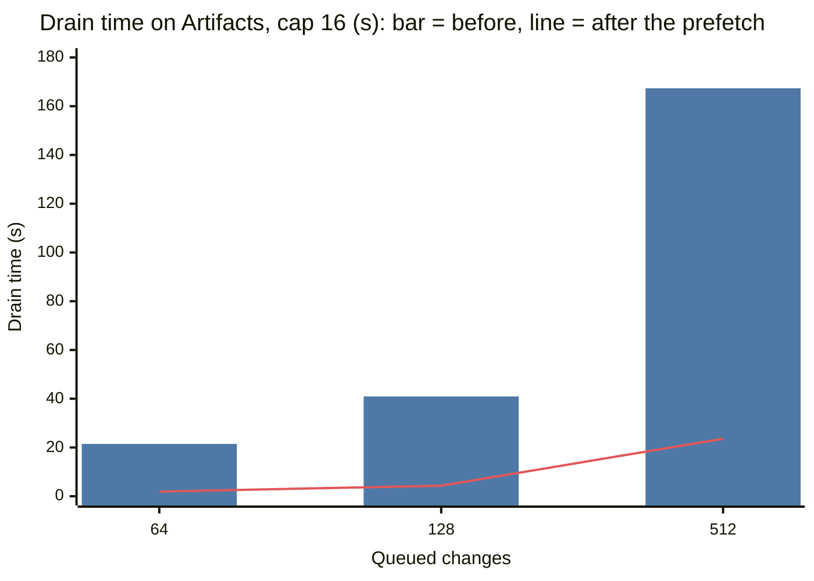

# Stage timings of the landing loop

This document tells where the landing loop of one trunk spends its time. It compares two
hosts: Cloudflare with Artifacts, and this computer with `wrangler dev` and Gitea. It tells
why one trunk landed approximately 3 changes each second on Artifacts and approximately 15
each second on this computer. It tells how reads on the same Durable Object change the
landing rate. It also gives the fix for the largest cause, with the times before and after.

All runs are from 2026-10-12. The data is in
[`../evidence/scale-stages-20261012.json`](../evidence/scale-stages-20261012.json).

## Summary

- Before the fix, the gate used 85% to 95% of the time of each burst on Artifacts. The gate
  fetched the commit of each queued change from its fork with its own request, one request
  after the other. Each request took 270 to 350 ms on Artifacts and 23 to 28 ms on Gitea.
- The other large stage is the push: one push for each batch. A push of 16 changes took 0.4
  to 0.9 s on Artifacts and approximately 0.6 s on Gitea. The time increases with the size of
  the pack.
- The stages that compute (gate, apply, records) were 2% to 10% of the drain time on this
  computer, where the clock of the Worker runs. On Cloudflare, `wrangler tail` also shows
  little CPU. The storage reads and writes of the Durable Object do not show in the stage
  times.
- Thus the difference between the two hosts is the time of one fetch: ×12 on Artifacts. The
  gate did one fetch for each change, so each change cost 0.3 s on Artifacts.
- Reads on the same Durable Object did not slow the landings before the fix. With
  `GET queue` at 20 requests each second and 50 long polls, a burst of 128 changes landed in
  the same time as without readers. After the fix, the same readers added approximately
  0.6 s (16%) to a burst of 128. At 512 changes, the spread between runs (20 to 30 s) was
  larger than any effect of the readers.
- The fix: the gate asks each fork once for all of its queued commits, and it asks up to 6
  forks at the same time. On Artifacts, 512 changes from 4 forks now land in 23.6 s instead
  of 167.4 s. The first change lands after 1.4 s instead of 143.5 s.
- After the fix, the push sets the rate: approximately 0.4 to 0.9 s for each batch of 16
  changes, on both hosts.

## Method

### Measurements in the Worker

Commit `615c376` adds a record for each round of the landing loop (`schedule_with` in
`nerudo-worker/src/trunk.rs`; the type is in `trunk/timings.rs`). One round gates the queue,
chooses a batch, applies it, pushes it and records the landings.

| Field | Contents |
|---|---|
| `queued` | Changes on the queue at the start of the round. The gate examines all of them. |
| `fetched`, `fetch_ms`, `fetch_max_ms` | Fetch requests to forks (or trunk) in the gate, their total time, and the longest request |
| `head_ms` | Fetch of the trunk head and recovery of an interrupted attempt. Only in the first round of an alarm. |
| `load_ms` | Reads of the queue, the change records, the rules and the allowances |
| `gate_ms` | The gate without its fetches: footprint, seals, allowances, writes of records |
| `divert_ms`, `pick_ms` | Competing attempts of a task; the choice of the batch and the writes for the changes that wait |
| `apply_ms` | `apply_change` and `trunk_checks` for each change of the batch |
| `ci_ms` | The type check and the simulated CI time |
| `pack_ms`, `push_ms` | The intent record and the pack; the push to trunk |
| `record_ms`, `events_ms` | The atomic landing record; the events after it |
| `requests`, `rx_bytes`, `pack_bytes` | Git requests, bytes received from git hosts, and the size of the pushed pack |
| `round_ms` | The full round |

`GET /v1/trunks/{trunk}/timings` returns the last 64 rounds. Each round also writes one
console line, `nerudo.round {json}`. The rounds of an alarm go to storage once, at the end
of the alarm, in the same write as the stats.

The clock of a Worker moves only at I/O. On Cloudflare, `Date.now()` does not change while
the isolate computes. Thus a stage that only computes reads approximately 0 ms on Cloudflare,
and its time shows in the next stage that waits on I/O. For example, the time to build the
pack shows in `push_ms`. The storage operations of a Durable Object also read 0 ms. `wrangler
dev` does not stop the clock, so the local runs show the CPU stages.

To measure CPU on Cloudflare, `wrangler tail --format json` gives `cpuTime` and `wallTime`
for each event: each alarm and each request. The tail drops events under load. For a
Durable Object, the CPU of one event can also include work of other events in the same
object at the same time. For example, a `GET stats` showed 239 ms of CPU (p50) after
the fix, but it reads 5 small keys. Thus the CPU numbers of the tail are approximate.

### Bursts

Each burst uses a new trunk with the bench fixture (`fixtures/bench-nerudo.toml`). The
fixture has no `[ci]`, so there is no type check, and `ci_ms` is 0. The procedure is the
same as the `growth` case of the fault harness:

1. Make the trunk and 4 agents. Each agent has its own fork.
2. Pause the trunk.
3. Queue N changes. Each change adds the file `changes/<id>.txt`, so no two changes overlap.
4. Resume the trunk.
5. Measure until the queue is empty. During the burst, the client reads `GET stats` one
   time each second.

The drain time is from the start of the first alarm after the resume to the last landing
record. Both times come from the clock of the Worker. The first landing is the time of the
first landing record.

| Host | Tool | Worker |
|---|---|---|
| This computer | `nix run .#faults -- --cases growth --growth 64,128,512` (`../faults/run.py`) | `wrangler dev`, Gitea through toxiproxy with no faults |
| Cloudflare | `python3 -I cf/scale/stages.py` (`stages.py`) | A Worker deployed only for this test, `nerudo-scale-stages`, with its own Artifacts namespace, `nerudo-scale` |

`stages.py` refuses a Worker whose name does not start with `nerudo-scale-`. It reads the
front page of the live Worker every 2 minutes, and it stops if the reply is not HTTP 200. All
replies were HTTP 200.

Other runs: batch cap 64 instead of 16; 64 agents with one change each; and the reads
experiment (see [Reads on the same Durable Object](#reads-on-the-same-durable-object)).

## Results before the fix

Times are in seconds. "Fetch" and "Push" are the totals of all rounds. "Rest" is the time of
the rounds minus the fetches and the pushes.

| Host | N | Forks | Cap | Drain | First landing | Fetch requests | Fetch | Push | Rest |
|---|---|---|---|---|---|---|---|---|---|
| Local | 64 | 4 | 16 | 4.37 | 2.44 | 64 | 1.79 | 2.45 | 0.10 |
| Local | 128 | 4 | 16 | 7.96 | 3.81 | 128 | 3.14 | 4.51 | 0.29 |
| Local | 512 | 4 | 16 | 34.68 | 12.74 | 512 | 11.90 | 19.45 | 3.31 |
| Artifacts | 64 | 4 | 16 | 21.46 | 19.92 | 64 | 19.25 | 2.21 | 0.00 |
| Artifacts | 128 | 4 | 16 | 40.93 | 37.50 | 128 | 36.97 | 3.96 | 0.00 |
| Artifacts | 512 | 4 | 16 | 167.35 | 143.47 | 512 | 142.84 | 24.44 | 0.00 |
| Artifacts | 128 | 4 | 64 | 37.66 | 36.62 | 128 | 35.72 | 1.95 | 0.00 |
| Artifacts | 512 | 4 | 64 | 163.86 | 152.92 | 512 | 151.78 | 12.01 | 0.00 |
| Artifacts | 64 | 64 | 16 | 24.59 | 23.10 | 64 | 22.47 | 2.12 | 0.00 |

Each burst landed every change once. No change was ejected.

Mean time of one request or one push, in ms:

| Host | Fetch of one change | Push of a batch of 16 | Push of a batch of 64 |
|---|---|---|---|
| Local (Gitea) | 23 to 28 | 560 to 610 | Not measured |
| Artifacts, 4 forks | 279 to 301 | 495 to 764 | 974 to 1,501 |
| Artifacts, 64 forks (one change each) | 351 | 530 | Not measured |

The first fetch from a fork takes more time than the next fetches from the same fork: 351 ms
for each fetch from 64 forks, 300 ms from 4 forks.

The size of the pack increases from batch to batch: from 14 KB to 203 KB at 512 changes. Each
change of the fixture adds a file to one directory, `changes/`. Thus each new commit has a new
tree for that directory, and that tree increases with each landing. The push time increases
with it, from 0.64 s to 0.86 s at 512 changes.

CPU on Cloudflare (`wrangler tail`): the alarm of a burst of 128 changes showed 16 ms of CPU
in 40.9 s. The two alarms of the burst of 512 changes showed 40 ms in 143.4 s and 559 ms in
24.0 s. All events of the Durable Objects that the tail captured before the fix show 17.0 s
of CPU in 1,303 s. The stage times on Cloudflare are thus mostly I/O: the fetches and the
pushes.

## Why one trunk is fast on this computer and slow on Artifacts

Before the fix, the time to drain N queued changes was approximately:

    T(N) = N × f + (N / cap) × p + gate work

- f is the time of one fetch: 25 ms on Gitea, 300 ms on Artifacts.
- p is the time of one push: approximately 0.6 s on both hosts.
- The gate work is CPU. On this computer it is 100 to 120 ms for each round when 500 changes
  wait. On Cloudflare it is less (see the CPU above).

On Artifacts at cap 16, each change cost 0.30 + 0.6 / 16 = 0.34 s: approximately 3 changes
each second. On Gitea, each change cost 0.025 + 0.6 / 16 = 0.06 s: approximately 15 changes
each second. A larger batch cap does not help on Artifacts, because the fetches stay the
same. At cap 64, 512 changes took 163.9 s instead of 167.4 s.

Before the fix, the gate fetched all queued changes before it chose the first batch. Thus the
first landing came after all N fetches. When the first batch was ready, the next batches
needed no fetch. `STRESS_TESTING.md` of the live stress run (not on this
branch) gives this shape for 128 changes at cap 64. The first landing came at 54.5 s, and the
last at 55.5 s.

These runs grow linearly: ×1.9 from 64 to 128, and ×4.1 from 128 to 512 (cap 16). The live
stress run gave ×3.4 from 64 to 128. That run had one fork for each change, and each first
fetch from a fork is slower. It also had a type check for each batch, and clients that read
the queue. These runs do not include the type check, so they do not explain all of the ×3.4.

## Causes

| Hypothesis | Result |
|---|---|
| H2: the gate fetches each change separately | True. This is the largest cause on Artifacts: 85% to 95% of the drain time. Changes from the same fork came in separate requests. |
| H3: round trips to Artifacts set the time of each batch | True for the fetches (×12 slower than Gitea). Not for the push: a push takes approximately the same time on both hosts. |
| H1: the gate examines the full queue before it chooses a batch | True, but it costs little time. It does not add fetches: the gate fetches each commit once. It makes the first landing wait for all fetches. On this computer its CPU is 100 to 120 ms for each round at 500 queued changes (approximately 10% of the drain at 512). On Cloudflare it is less (see the CPU above). |

## Reads on the same Durable Object

Bursts of 128 changes, 4 forks, cap 16. "Readers" means:

- 4 clients that read `GET queue` (each reply has all 128 changes), at a total of
  approximately 20 requests each second.
- 50 long polls `GET changes/{id}?wait=60` on the last 50 changes. Each long poll starts
  again until its change lands.

The readers start 2 s before the resume and stop when the queue is empty.

Before the fix:

| Run | Readers | Drain (s) | First landing (s) | Reader requests | `GET queue` p50 / p95 (ms) |
|---|---|---|---|---|---|
| 1 | No | 38.09 | 34.55 | None | None |
| 2 | Yes | 37.72 | 34.48 | 774 queue, 50 long polls, 0 errors | 141 / 183 |
| 3 | No | 43.48 | 38.65 | None | None |
| 4 | Yes | 41.23 | 37.56 | 845 queue, 50 long polls, 0 errors | 150 / 207 |

One more run with no readers (the first burst of 128 above) took 40.93 s. Without readers,
the mean is 40.8 s. With readers, it is 39.5 s. The difference is in the spread between runs.

After the fix:

| N | Readers | Drain (s) | Median push (ms) | `GET queue` calls | `GET queue` p50 / p95 (ms) |
|---|---|---|---|---|---|
| 128 | No | 4.33 | 488 | None | None |
| 128 | No | 3.70 | 406 | None | None |
| 128 | No | 3.86 | 414 | None | None |
| 128 | Yes | 4.78 | 543 | 136 | 163 / 262 |
| 128 | Yes | 4.44 | 511 | 137 | 148 / 214 |
| 512 | No | 23.56 | 684 | None | None |
| 512 | No | 29.19 | 852 | None | None |
| 512 | No | 20.82 | 613 | None | None |
| 512 | Yes | 20.15 | 608 | 394 | 179 / 358 |
| 512 | Yes | 29.84 | 804 | 395 | 274 / 601 |

At 128 changes, the drain time with readers was 4.44 to 4.78 s, and without readers 3.70 to
4.33 s. The ranges do not overlap: the readers added approximately 0.6 s (16%). At 512
changes, the drain time was 20 to 30 s with and without readers. In the slow runs, some
pushes took 1.2 to 2.1 s. This spread of Artifacts is larger than the effect of the readers.

No reader request failed. Each `GET queue` reply holds all queued changes, so the reply time
increases with the queue. The p95 was 183 to 207 ms at 128 changes before the fix. It was 358
to 601 ms at 512 changes after the fix.

Why the readers have little effect: on Cloudflare the landing loop waits for I/O for most of
its time. The Durable Object serves the reads while the loop waits for a fetch or a push. A reader slows the loop only when the reply of a fetch or a push arrives while the
object computes for a reader. Before the fix, the loop waited approximately 300 ms for each
fetch, and the readers fit in these waits. After the fix, the loop does fewer and longer
round trips, and it waits for the push. In the runs at 128 after the fix, the median push
took 406 to 414 ms without readers and 511 to 543 ms with readers.

## The fix

Commit `daa9af4` changes the gate (`nerudo-worker/src/trunk/prefetch.rs`):

1. Before the gate examines each change, it collects the queued commits that are not in its
   store, by fork.
2. It sends one fetch request to each fork for all the commits of that fork. It sends up to
   6 requests at the same time. A Worker invocation keeps at most 6 connections open.
3. Then the gate examines each change as before.

The fetch errors work as before. If a request for one change fails, its error is the fetch of
that change for this round. The change stays queued to try again, or the gate ejects it. If a
request for more changes fails, the gate fetches those changes again, one at a time. Thus a
commit that a fork cannot give does not stop or eject the other changes of that fork.

`nerudo-git` divides `fetch` into three parts, so that the requests can run at the same
time. The parts are `fetch_body` (the request), `fetch_pack` (the round trip, without the
store) and `ingest` (the pack into the store). `fetch` and `fetch_depth` operate as before.
The test `nerudo-git/tests/fetch_many.rs` uses `git upload-pack`: one request gives 5
commits, and a commit that the repo does not have makes the full request fail.

Checks: `cargo test` for `nerudo-core`, `nerudo-git` and `nerudo-cli`; `cargo check -p
nerudo-worker --target wasm32-unknown-unknown`; the fault cases `parity`, `git_flaky` and
`growth` (23 passes, 0 failures). In `git_flaky`, 12 of 12 changes landed once, the gate tried
12 fetches again, and no change was ejected.

### Before and after

Times are in seconds. The local runs after the fix are from the second run of the harness;
the first run gave 2.29 s, 4.67 s and 21.52 s.

| Host | N | Forks | Cap | Drain before | Drain after | First landing before | First landing after | Fetch requests before | Fetch requests after |
|---|---|---|---|---|---|---|---|---|---|
| Local | 64 | 4 | 16 | 4.37 | 2.61 | 2.44 | 0.76 | 64 | 4 |
| Local | 128 | 4 | 16 | 7.96 | 4.74 | 3.81 | 0.69 | 128 | 4 |
| Local | 512 | 4 | 16 | 34.68 | 23.06 | 12.74 | 0.95 | 512 | 4 |
| Artifacts | 64 | 4 | 16 | 21.46 | 1.91 | 19.92 | 0.79 | 64 | 4 |
| Artifacts | 128 | 4 | 16 | 40.93 | 4.33 | 37.50 | 0.93 | 128 | 4 |
| Artifacts | 512 | 4 | 16 | 167.35 | 23.56 | 143.47 | 1.35 | 512 | 4 |
| Artifacts | 128 | 4 | 64 | 37.66 | 2.08 | 36.62 | 1.11 | 128 | 4 |
| Artifacts | 512 | 4 | 64 | 163.86 | 12.01 | 152.92 | 1.79 | 512 | 4 |
| Artifacts | 64 | 64 | 16 | 24.59 | 7.12 | 23.10 | 5.64 | 64 | 64 |

The chart shows the drain on Artifacts at cap 16 from the table. The bar is the time before
the fix, and the line is the time after it.



On Artifacts at 512 changes, the rate is now 21.7 changes each second at cap 16 (before: 3.1)
and 42.6 at cap 64 (before: 3.1). The git requests of the burst at cap 16 decreased from 576
to 68. Each change landed once, and no change was ejected.

After the fix, the push sets the time on both hosts. At 512 changes and cap 16, the pushes
are 22.95 s of 23.56 s on Artifacts, and 19.92 s of 23.06 s locally. The two hosts now have
almost the same drain time.

With one fork for each change, the fix sends one request for each change, 6 at a time. The
64 requests took 5.12 s instead of 22.47 s (×4.4). One request took up to 1.17 s when 6 ran
at the same time.

## Proposals that this work does not do

1. **Gate a window of the queue.** Gate only the first 2 × `batch_cap` queued changes in each
   round. When each change has its own fork, the fix sends one request for each change, 6 at
   a time. Then the first landing waits for all N requests: 5.6 s at 64 changes from 64 forks.
   A window of 32 changes needs half of the 64 requests before the first batch at cap 16.
   It also removes the CPU of the full queue from each round (100 to 120 ms on this computer
   at 500 queued changes).
2. **Use a larger batch cap.** After the fix, the push sets the rate. A push of 64 changes
   took 1.0 to 1.5 s, and a push of 16 changes took 0.4 to 0.9 s. Thus cap 64 can land
   approximately twice as many changes each second as cap 16. Measure it with the type check,
   because a failed batch costs more checks when the batch is larger.
3. **Make the pushes smaller.** Each commit of a batch has its own trees, so a batch pushes
   N trees for a directory that N changes edit. This is a property of git. A trunk with a hot
   directory pays it.

## Limits

- One fixture: small files, no type check, no conflicts, no seals and no allowances.
- One run for each size and cap. The reads have two or three runs for each condition. The
  times on Artifacts change from run to run. The same burst of 128 changes took 38 to 43 s
  before the fix. A burst of 512 changes took 21 to 29 s after the fix.
- On Cloudflare, the stage times do not show CPU separately: it is in the next I/O stage (see
  the clock above). The CPU numbers come from `wrangler tail`.
- `wrangler tail` can drop events under load, and it can give the CPU of one event to
  another event of the same object. The CPU numbers are thus approximate.
- The readers ran on one computer, with one HTTPS connection for each request.

## Files

| File | Contents |
|---|---|
| `stages.py` | The bursts on a deployed Worker with Artifacts, with the readers |
| `summarize.py` | It makes the evidence file and the tables from the reports |
| `../nerudo-worker/src/trunk/timings.rs` | The record of each round and `GET .../timings` |
| `../nerudo-worker/src/trunk/prefetch.rs` | The fix |
| `../faults/run.py` | The `growth` case keeps the rounds of each size in its report |
| `../evidence/scale-stages-20261012.json` | All rounds of all runs, the CPU of each alarm, and the reader latencies |

To do the live runs again, deploy a Worker only for the test. Do not use the live Worker.
Write its URL and two new tokens in a file, then:

```sh
NERUDO_VARS=<vars file> python3 -I cf/scale/stages.py --sizes 64,128,512 --out live.json
NERUDO_VARS=<vars file> python3 -I cf/scale/stages.py --sizes 128 --readers --out reads.json
```
